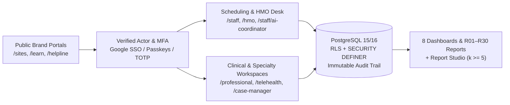

# MH-Clinic Knowledge Base, Training Manuals & Architecture Decks

Welcome to the official public documentation, knowledge base, role-based training manuals, and presentation decks for **MH-Clinic** — an enterprise mental health, integrative medicine, and institutional counseling (`IHC`) scheduling, clinical documentation, billing, and BI platform.

> [!NOTE]
> **Scope & Privacy:** All examples, screenshots, and lab exercises in this repository use **synthetic data only** and contain zero real patient PHI, live credentials, or private infrastructure secrets.

---

## Quick Navigation

**Illustrated walkthroughs:** [Staff sign-in](manuals/01-getting-started-and-mfa.md#staff-sign-in-screen) · [Missing booking hours](manuals/02-scheduling-and-hmo-operations.md#when-the-booking-panel-shows-no-published-hours) · [Internal Report Explorer](manuals/06-reporting-and-analytics-guide.md#4-example-internal-report-explorer). Captures are from synthetic training exercises, not a live installation or release certification.

**More illustrated tasks:** [Missing connected access](manuals/01-getting-started-and-mfa.md#when-no-connected-workspaces-appear) · [Retry HMO availability](manuals/02-scheduling-and-hmo-operations.md#when-an-hmo-availability-lookup-fails) · [Review a note conflict](manuals/03-clinical-workflows-and-prescribing.md#reviewing-a-note-draft-conflict) · [Check a certificate draft](manuals/03-clinical-workflows-and-prescribing.md#checking-a-saved-certificate-draft) · [Track an assessment submission](manuals/04-assessments-and-specialty-tracks.md#following-an-assessment-from-assignment-to-submission).

### 1. Presentation Decks (`decks/`)
| Audience | Document | What It Covers |
| :--- | :--- | :--- |
| **Executives, Sponsors & Clinical Directors** | [Executive Introduction Deck](decks/01-executive-introduction-deck.md) | Platform vision, 3-brand architecture (`MindWell.PH`, `Aventus`, `ADB`), 6-wave capabilities (`WP-01`–`WP-32`), Philippine regulatory compliance, and ROI. |
| **Engineers & Developers** | [Engineering & Developer Deck](decks/02-engineering-and-developer-deck.md) | Next.js + PostgreSQL 15/16 RLS security model, `SECURITY DEFINER` RPCs, `expectedRevision` CAS, `AG-UI 1.0`, migration portability, and CI verification. |
| **Clinicians, Staff & Operations** | [Clinical & Operations User Deck](decks/03-clinical-and-operations-user-deck.md) | Visual end-to-end walkthrough from inquiry $\rightarrow$ booking $\rightarrow$ intake $\rightarrow$ `SOAP`/`5Ps`/`eRx` $\rightarrow$ billing/HMO $\rightarrow$ `R01`–`R30` analytics. |

### 2. Comprehensive System Manuals (`manuals/`)
| # | Manual | Key Topics |
| :---: | :--- | :--- |
| **01** | [Getting Started, Auth & Mandatory MFA](manuals/01-getting-started-and-mfa.md) | Google SSO, staff passwords, TOTP/Passkey MFA, idle timeouts, and RBAC boundaries. |
| **02** | [Scheduling, Waitlist & HMO Operations](manuals/02-scheduling-and-hmo-operations.md) | 8-Gate Booking Simulator, planned hours, waitlist backfill, and 7-step Aventus HMO SOA/SI/BIR 2307 flow. |
| **03** | [Clinical Workflows, MSE, `eRx` & Certificates](manuals/03-clinical-workflows-and-prescribing.md) | `MHCLINIC-SOAP/3`, 14-domain MSE, `ICD-10-CM`/`ICD-11`, `C-SSRS` Safety Plan, RA 6675 `eRx`, and QR `MedCerts`. |
| **04** | [Assessments (`DSM-5-TR`) & Specialty Tracks](manuals/04-assessments-and-specialty-tracks.md) | 68 `DSM-5-TR` Section III measures, dual `RPm`+`RPsy` evals, `Lifestyle Rx`, `Neuro`/`RND`/`CMA` tracks. |
| **05** | [ADB In-House Counseling (`IHC`) & Case Mgmt](manuals/05-adb-ihc-and-case-management.md) | `IHC Today`, client codes, roster/`.ics` import, `SOAP <-> 5Ps`, 27-subtopic taxonomy, and `MDT` hub. |
| **06** | [BI Dashboards, `R01`–`R30` Reports & Studio](manuals/06-reporting-and-analytics-guide.md) | Complete guide to all 30 turnkey reports (`R01`–`R30`), Report Studio, $k$-anonymity ($k \ge 5$), and exports. |
| **07** | [Anonymous Helpline, Learning Hub & AI Coordinator](manuals/07-helpline-learning-hub-and-ai-coordinator.md) | `WP-31` zero-PII helpline (`ANON-xxxx`, `L1`–`L4`), `/learn` hub, `WP-32` `AG-UI` Co-Pilot, and Telehealth Scribe. |

### 3. Role-Based Persona Guides (`personas/`)
- [01 · Company & Branch Administrator](personas/01-company-and-branch-administrator.md)
- [02 · Front-Desk Coordinator](personas/02-front-desk-coordinator.md)
- [03 · Psychiatrist & Prescriber](personas/03-psychiatrist-and-prescriber.md)
- [04 · Psychologist & Psychometrician (`RPsy` / `RPm`)](personas/04-psychologist-and-psychometrician.md)
- [05 · Counselor & Institutional (`IHC`) Specialist](personas/05-counselor-and-ihc-specialist.md)
- [06 · Specialty Clinicians (`MD` Neurologist, `RND` Dietitian, `CMA` Acupuncturist)](personas/06-specialty-clinicians-neuro-rnd-cma.md)
- [07 · Case Manager & Crisis Safety Responder](personas/07-case-manager-and-safety-responder.md)
- [08 · HMO Billing & Finance Officer](personas/08-hmo-billing-and-finance-officer.md)
- [09 · Client, Patient & Guardian](personas/09-client-patient-and-guardian.md)
- [10 · Corporate Sponsor & HR Viewer](personas/10-sponsor-and-hr-viewer.md)

### 4. Training Labs & Onboarding (`training/`)
- [Role Exercises & Hands-On Labs](training/01-role-exercises-and-labs.md)
- [Content & Data Onboarding Checklist](training/02-content-and-data-onboarding-checklist.md)
- [Full Alphabetical & Route Knowledge Base Index](INDEX.md)

---

## Platform Architecture Overview

