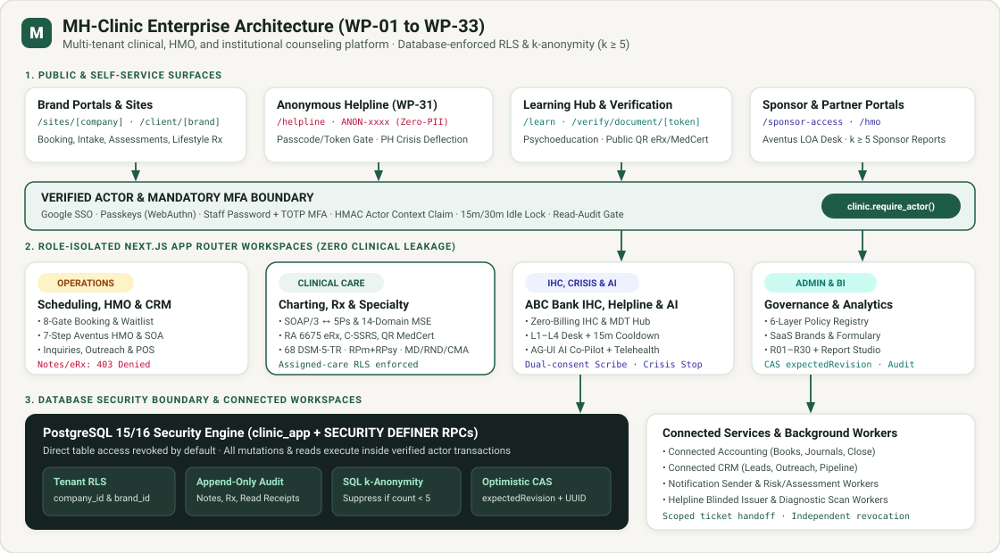

# MH-Clinic Visual Guide

> **Navigation:** [Knowledge Base Home](README.md) · [Master Index](INDEX.md) · [Glossary](GLOSSARY.md)
>
> **Doc ID:** `MHD-HOW-01` · **Type:** How-to guide · **Revised:** 25 November 2026

Use this guide to find a screenshot or architecture diagram at the point where you need to choose an action, explain a workflow, or confirm a result. Each link opens the illustrated step in its manual or persona guide, with a short explanation of what to look for. All screenshots come from synthetic training exercises and contain zero real patient PHI, live credentials, or private infrastructure secrets.

---

## Architecture & Governance Visuals (`assets/visuals/`)

| Visual Diagram | What it illustrates | Where used |
| :--- | :--- | :--- |
| [Platform Architecture Overview](assets/visuals/platform-architecture-overview.svg) | End-to-end multi-brand surfaces, verified actor MFA gate, role-isolated workspaces, PostgreSQL RLS, and connected Accounting/CRM services. | [README](README.md) · [Executive Deck](decks/01-executive-introduction-deck.md) · [Developer Deck](decks/02-engineering-and-developer-deck.md) |
| [Three Operating Modes](assets/visuals/three-operating-modes.svg) | Side-by-side comparison of Direct Self-Pay (`MindWell.PH`), Managed HMO (`Aventus`), and Non-Billable Institutional (`ABC Bank IHC`). | [Manual 10](manuals/10-saas-clients-and-tenant-onboarding.md) · [Executive Deck](decks/01-executive-introduction-deck.md) |
| [RBAC & Clinical Privacy Isolation Matrix](assets/visuals/role-rbac-isolation-matrix.svg) | MFA, idle timeouts, scheduling, clinical note `403` walls, billing, and BI visibility across all 10 personas + AI Coordinator. | [Manual 01](manuals/01-getting-started-and-mfa.md) · [Developer Deck](decks/02-engineering-and-developer-deck.md) · [Training Labs](training/01-role-exercises-and-labs.md) |
| [8-Gate Booking & 7-Step HMO Flow](assets/visuals/eight-gate-booking-flow.svg) | Deterministic 8-gate slot eligibility pipeline paired with the 7-step Aventus referral-to-BIR 2307 lifecycle. | [Manual 02](manuals/02-scheduling-and-hmo-operations.md) · [Front-Desk Guide](personas/02-front-desk-coordinator.md) · [Ops Deck](decks/03-clinical-and-operations-user-deck.md) |
| [Clinical Safety, Coding & Specialty Map](assets/visuals/clinical-safety-and-coding.svg) | `MHCLINIC-SOAP/3`, 14-Domain MSE, `C-SSRS` Safety Plan, `RA 6675` eRx, `DSM-5-TR`, `Lifestyle Rx`, and `MD`/`RND`/`CMA` tracks. | [Manual 03](manuals/03-clinical-workflows-and-prescribing.md) · [Psychiatrist Guide](personas/03-psychiatrist-and-prescriber.md) · [Specialty Guide](personas/06-specialty-clinicians-neuro-rnd-cma.md) |
| [BI `R01`–`R30` Reports & $k$-Anonymity Map](assets/visuals/bi-30-reports-map.svg) | Complete 5-domain map of all 30 turnkey reports, Report Studio exports, and SQL $k \ge 5$ suppression floor. | [Manual 06](manuals/06-reporting-and-analytics-guide.md) · [Sponsor Guide](personas/10-sponsor-and-hr-viewer.md) · [Ops Deck](decks/03-clinical-and-operations-user-deck.md) |
| [Helpline & AI Coordinator Guardrails](assets/visuals/helpline-ai-guardrails.svg) | `WP-31` Zero-PII gatekeeper, PH crisis hotline deflection, 15-minute `L1` cooldown, and `WP-32` deterministic crisis hard-stop + `403` RLS wall. | [Manual 07](manuals/07-helpline-learning-hub-and-ai-coordinator.md) · [Case Manager Guide](personas/07-case-manager-and-safety-responder.md) · [Executive Deck](decks/01-executive-introduction-deck.md) |
| [6-Layer Policy Hierarchy & PH Compliance](assets/visuals/six-layer-policy-hierarchy.svg) | 6-layer inheritance cascade (`Platform` → `Clinician`) and embedded `RA 10173`, `RA 6675`, `RA 10029`, `RA 9994/10754`, and `BIR 2307` controls. | [Manual 11](manuals/11-configurations-and-reference.md) · [Developer Deck](decks/02-engineering-and-developer-deck.md) · [Onboarding Checklist](training/02-content-and-data-onboarding-checklist.md) |

---

## Featured Product Visuals

---

## 1. Sign in, access, enrollment, and scheduling

| Task | What to look for |
| :--- | :--- |
| [Choose a staff sign-in method](manuals/01-getting-started-and-mfa.md#staff-sign-in-screen) | Google SSO, passkey, and email/password choices. |
| [Enroll a minor with a parent or guardian](manuals/01-getting-started-and-mfa.md#guardian-assisted-enrollment-for-minors) | Separate child and guardian detail fields and safe-contact verification reminder. |
| [Review metadata-only read-access audits](manuals/01-getting-started-and-mfa.md#reviewing-metadata-only-staff-read-access-audits) | Timestamp, actor, scope, read type, and record count — zero clinical text. |
| [Troubleshoot missing connected access](manuals/01-getting-started-and-mfa.md#when-no-connected-workspaces-appear) | Empty workspace state; ask an administrator to verify role and destination mapping. |
| [Test a care pathway & booking match](manuals/02-scheduling-and-hmo-operations.md#testing-a-care-pathway-and-booking-match) | Brand, service, channel, and payer selectors for verifying pathway rules. |
| [Review an appointment detail panel](manuals/02-scheduling-and-hmo-operations.md#reviewing-an-appointment-detail-panel) | Brand, booking channel, inherited policy, and Confirm/Reschedule/Cancel actions. |
| [Check why booking shows no published hours](manuals/02-scheduling-and-hmo-operations.md#when-the-booking-panel-shows-no-published-hours) | Both staff and client portal notices when published hours are absent. |
| [Hold an initial HMO consultation time](manuals/02-scheduling-and-hmo-operations.md#holding-an-initial-hmo-consultation-time) | Temporary Manila-time hold, expiry timer, and Release selected time action. |
| [Handle empty or failed HMO availability](manuals/02-scheduling-and-hmo-operations.md#when-an-hmo-availability-lookup-returns-empty-or-fails) | Empty completed lookup vs. lookup error with Refresh available times button. |

## 2. Document a visit, prescribe, assess, and review specialty tracks

| Task | What to look for |
| :--- | :--- |
| [Save a first SOAP draft & attest a visit](manuals/03-clinical-workflows-and-prescribing.md#first-saved-soap-draft--consultation-attestation) | Version 1 supervision reminder and clinician completion attestation queue. |
| [Review a note draft conflict](manuals/03-clinical-workflows-and-prescribing.md#reviewing-a-note-draft-conflict) | Conflict notice and disabled save control; compare against current saved version. |
| [Load the 1-Click PH Psychiatric Starter Formulary](manuals/03-clinical-workflows-and-prescribing.md#preparing-the-1-click-ph-psychiatric-starter-formulary) | Expanded Prepare several products panel with the 17-item starter formulary action. |
| [Configure brand prescription authority](manuals/03-clinical-workflows-and-prescribing.md#governing-brand-prescription-authority) | Paused policy state, approval reference, and explicit `SAVE` confirmation guardrail. |
| [Check a saved certificate draft](manuals/03-clinical-workflows-and-prescribing.md#checking-a-saved-certificate-draft) | Draft status and revision, clearly distinct from a signed or issued certificate. |
| [Browse the 68-measure `DSM-5-TR` catalog](manuals/04-assessments-and-specialty-tracks.md#browsing-the-68-measure-apa-dsm-5-tr-section-iii-catalog) | Category, population/rater, and measure code filters across all 68 measures. |
| [Follow an assessment from assignment to submission](manuals/04-assessments-and-specialty-tracks.md#following-an-assessment-from-assignment-to-submission) | Coordinator assignment, client task form, and Submitted for professional review receipt. |
| [Verify evaluation instrument approval authority](manuals/04-assessments-and-specialty-tracks.md#checking-evaluation-instrument-approval-authority-ra-10029) | Governance gate ensuring approved edition, rights, and norm references before use. |
| [Review specialty clinical protocols (`RND` / `CMA`)](manuals/04-assessments-and-specialty-tracks.md#specialty-clinical-governance--protocol-review) | Source and formulary verification gates for nutrition-medication rules and acupuncture protocols. |

## 3. ABC Bank In-House Counseling (`IHC`), case management, helpline, and AI

| Task | What to look for |
| :--- | :--- |
| [Use `IHC Today` and the IHC walk-in desk](manuals/05-ihc-and-case-management.md#counselor-ihc-today-and-coordinator-walk-in-desk) | Counselor assigned institutional schedule and coordinator `ABC Bank` walk-in lookup. |
| [Review de-identified IHC roster & `.ics` import](manuals/05-ihc-and-case-management.md#reviewing-de-identified-roster-and-ics-calendar-import) | `4000` population target, `sourceId,clientId` format (zero names/DOBs), and PII-stripped `.ics` import. |
| [Inspect ABC Bank annual workplan & `R14`–`R21` links](manuals/05-ihc-and-case-management.md#reviewing-the-abc-bank-annual-workplan-and-r14r21-links) | Turnkey `R14`–`R21` navigation and `Withheld for privacy` small-cohort suppression. |
| [Manage MDT longitudinal case episodes](manuals/05-ihc-and-case-management.md#managing-longitudinal-case-episodes) | Brand-scoped follow-up queue in Philippine time and care-gap summary link. |
| [Verify anonymous helpline crisis deflection](manuals/07-helpline-learning-hub-and-ai-coordinator.md#public-entitlement-gate--philippine-national-crisis-hotline-deflection) | Passcode gate and immediate PH National Crisis Hotlines (`NCMH 1553`, `Hopeline`, `In Touch`, `911`). |
| [Open the `L1–L4` Helpline Responder Desk](manuals/07-helpline-learning-hub-and-ai-coordinator.md#l1l4-crisis-helpline-responder-desk-staffhelpline-desk) | Brand-scoped responder endpoints and 15-minute post-`L1` cooldown reminder. |
| [Browse and publish Learning Hub guides](manuals/07-helpline-learning-hub-and-ai-coordinator.md#public-self-reading-library--administrator-publisher) | Public `/learn` CBT/grounding library and `/admin/learning-hub` brand publisher. |
| [Review the `AG-UI` AI Virtual Care Coordinator](manuals/07-helpline-learning-hub-and-ai-coordinator.md#human-in-the-loop-ag-ui-ai-coordinator-workspace) | HITL draft co-pilot scope and deterministic crisis handoff to `/staff/helpline-desk`. |

## 4. Reporting, accounting, CRM, onboarding, and configuration

| Task | What to look for |
| :--- | :--- |
| [Verify SQL $k$-anonymity on `R16` demographics](manuals/06-reporting-and-analytics-guide.md#database-enforced-k-anonymity-in-institutional-reporting-r16) | PostgreSQL cohort floor disclosure notice for institutional demographic bands. |
| [Build saved recipes in Report Studio](manuals/06-reporting-and-analytics-guide.md#scoped-report-studio-workspace-mindwellph) | Brand-scoped Saved recipes and Appointment report recipe builder. |
| [Check Clinic Operations Hub & Report Explorer](manuals/06-reporting-and-analytics-guide.md#4-example-internal-operations-hub--report-explorer) | Brand, date range, UTC timestamp, chart bars, and matching printable view. |
| [Configure book settings, validate opening rows & reconcile](manuals/08-accounting-invoicing-and-payouts.md#5-connected-accounting-examples) | PHP/Manila book settings, balanced opening import, and zero-difference sign-off. |
| [Approve journals, match bank lines, close periods & cash flow](manuals/08-accounting-invoicing-and-payouts.md#match-bank-statements-check-period-close-readiness-and-review-cash-flow) | Approval dialog, bank movement matching, period-close readiness, and cash-flow dashboard. |
| [Manage CRM lead queue, CSV import & closed outreach](manuals/09-crm-inquiries-and-outreach.md#working-the-connected-crm-lead-pipeline-and-contact-import) | Overdue lead triage, duplicate-skipping CSV preview, and `Client reached` / `Closed` task state. |
| [Use Administrator Home & Brand Launch Wizard](manuals/10-saas-clients-and-tenant-onboarding.md#task-oriented-administrator-home--brand-launch-wizard) | Task-oriented Company setup home and 5-step Brand launch wizard. |
| [Review & preview brand profile + professional schedules](manuals/10-saas-clients-and-tenant-onboarding.md#review-and-preview-a-brand-profile-before-saving) | Public profile editor, admin-only preview, invitation steps, and schedule/payout CAS diff. |
| [Review Configuration Hub & 6-Layer Policy Registry](manuals/11-configurations-and-reference.md#reviewing-effective-scope-inherited-value-and-revision-in-the-policy-registry) | All 6 inheritance layers, Effective value, Inherited value, revision, and audit reason. |
| [Explore the Client Portal experience](personas/09-client-patient-and-guardian.md#3-visual-guide-to-your-client-experience) | Verified client dashboard, care checklist, assessment task, `/learn`, and `/helpline`. |

Practice these workflows in the [role-based labs](training/01-role-exercises-and-labs.md) using synthetic data only.

---

## Specialized Live-Session Captures Still Optional

| Workflow | Optional future capture |
| :--- | :--- |
| [Native Telehealth & Dual-Consent Scribe](manuals/07-helpline-learning-hub-and-ai-coordinator.md#4-native-telehealth-room--ambient-clinical-scribe-telehealthappointmentid) | Live synthetic WebRTC telehealth room showing dual-consent toggle and `unverified_ai_draft` banner. |
| [Dual-Signatory Evaluation Release (`RA 10029`)](manuals/04-assessments-and-specialty-tracks.md#2-measurement-based-care-wp-17--dual-signatory-rpm--rpsy-suite-wp-24) | Synthetic dual-signed (`RPm` + `RPsy`) report unlock state after attesting `Feedback Session Completed`. |

## Screenshot Capture Provenance & Refresh Policy

| Property | Recorded value |
| :--- | :--- |
| **Capture date (PHT)** | 24 November 2026 (all 59 PNG screenshots in `assets/screenshots/`) |
| **Source environment** | Isolated synthetic training tenant (`@example.test` accounts only; zero real PHI or live credentials) |
| **Application baseline** | `mh-clinic` `main` baseline `cf52f970` (routes and features cross-checked against `fd45a889` on 25 November 2026) |
| **Diagram assets** | 8 WCAG 2.2 AA-measured SVG diagrams in `assets/visuals/` (verified 25 November 2026 PHT; see [ACCESSIBILITY.md](ACCESSIBILITY.md)) |
| **Pending re-captures** | Feature-off `/helpline` unavailable notice, interactive `/staff/helpline-desk` responder desk (PR #793), interactive `/staff/ai-coordinator` and `/telehealth/[appointmentId]` preview panels (PR #794), and `/professional/headache-diary-months` (PR #797) — to be re-captured from a synthetic training tenant on the next visual refresh cycle |

When a release changes a documented route or screen layout, re-capture affected screenshots from a synthetic training tenant only and update this provenance table in the same pull request (see [CONTRIBUTING.md](CONTRIBUTING.md#screenshots-and-diagrams)).

---

← Previous: [Master Index](INDEX.md) · [Knowledge Base Home](README.md) · [Getting Started](GETTING_STARTED.md) · [FAQ](FAQ.md) · Next: [Accessibility](ACCESSIBILITY.md) →
