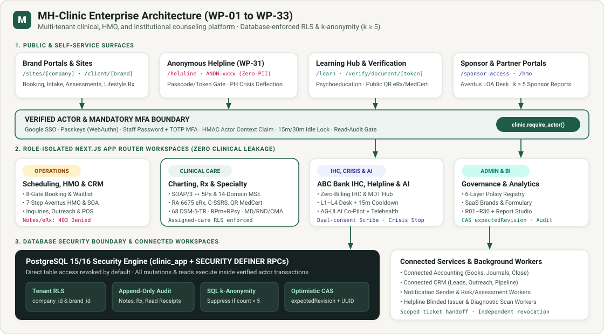
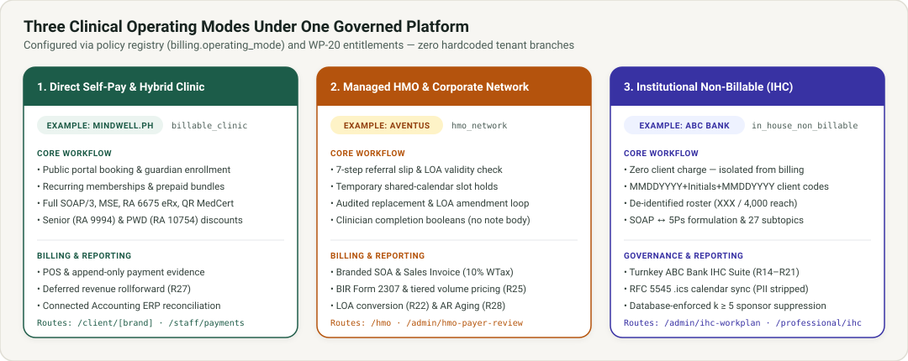
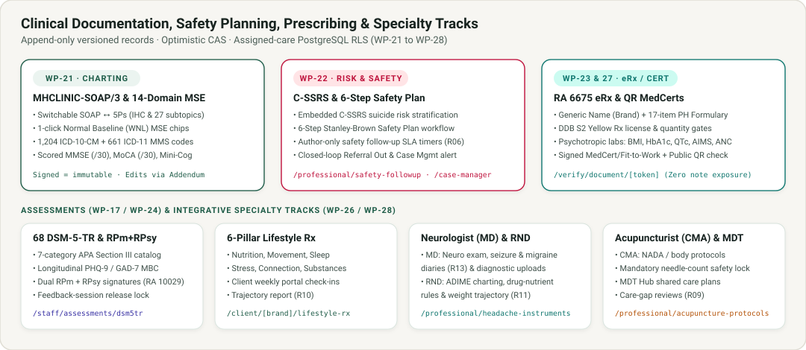
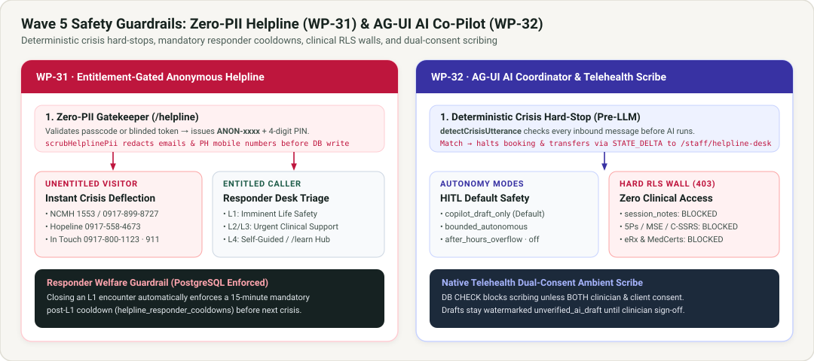
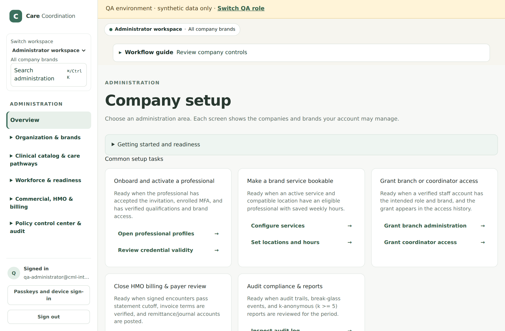

# MH-Clinic: Executive Introduction Deck

> **Audience:** Clinic Owners, Medical Directors, Corporate Sponsors, and Institutional Partners  
> **Scope:** Complete 6-Wave Platform (`WP-01` through `WP-32`)

---

## Slide 1: What Is MH-Clinic?
**MH-Clinic** is a multi-tenant, compliance-first mental health, integrative medicine, and institutional counseling (`IHC`) platform built for Philippine and regional clinical networks.

- **Multi-Brand Architecture:** Operates distinct brands under governed company trees (e.g., **MindWell.PH** self-pay/hybrid, **Aventus** HMO-backed care, and **ABC Bank** zero-billing In-House Counseling).
- **Zero Clinical Leakage:** Administrative, coordinator, HMO, and AI roles are blocked at the PostgreSQL layer (`403`) from reading clinical notes, prescriptions, or diagnoses.
- **Turnkey Intelligence:** 8 role-scoped dashboards, 30 turnkey reports (`R01`–`R30`), and a no-code Report Studio with database-enforced $k$-anonymity ($k \ge 5$).

---

## Slide 2: Three Operating Modes Under One Roof

| Operating Mode | Example Brand | Core Workflow | Billing & Reporting |
| :--- | :--- | :--- | :--- |
| **Direct Self-Pay & Hybrid** | *MindWell.PH* | Portal booking, memberships, prepaid bundles, Senior/PWD statutory discounts | Manual payment receipts, deferred revenue (`R27`), Accounting ERP |
| **Managed HMO / Corporate** | *Aventus* | 7-step referral slip $\rightarrow$ LOA hold $\rightarrow$ encounter $\rightarrow$ `SOA` + `Sales Invoice` (`10% WTax`) + `BIR 2307` | AR Aging (`R28`), Tiered Volume (`R25`), Sponsor Portal ($k \ge 5$) |
| **In-House Non-Billable (`IHC`)** | *ABC Bank* | `IHC Today`, `MMDDYYYY+Initials+MMDDYYYY` codes, `.ics` + roster sync (`XXX / 4,000` reach), `SOAP <-> 5Ps` | Zero-billing; Turnkey ABC Bank Reports (`R14`–`R21`) |

---

## Slide 3: Clinical Depth & Safety Guardrails

- **Structured Charting (`WP-21`):** 14-domain Chip-to-Prose MSE (`< 20s` normal baseline), `1,204` `ICD-10-CM` + `661` `ICD-11` codes with 1-line descriptions, and scored `MMSE`/`MoCA`/`Mini-Cog`.
- **Suicide & Crisis Safety (`WP-22`):** `C-SSRS` screening, 6-step Stanley-Brown Safety Plan, SLA follow-up tracking (`R06`), and closed-loop `"Referral Out"`.
- **Psychiatric Prescribing (`WP-23`):** Philippine **RA 6675** Generic-First `eRx`, **DDB S2** Yellow Rx safeguards, and 1-click 17-item Philippine Psychiatric Starter Formulary.
- **Psychological Testing (`WP-24`):** 68 `DSM-5-TR` Section III standard measures + **RA 10029** dual `RPm` + `RPsy` signatures + post-feedback client release lock.
- **Integrative & Specialty Tracks (`WP-26`, `WP-28`):** 6-Pillar `Lifestyle Rx`, psychotropic metabolic/`QTc`/`AIMS`/`ANC` flowsheets (`R07`), plus **Neurologist (`MD`)**, **Dietitian (`RND` `ADIME`)**, and **Acupuncturist (`CMA` `NADA`)** workspaces.

---

## Slide 4: Wave 5 Commercial Add-Ons (`WP-31` & `WP-32`)

- **Entitlement-Gated Anonymous Helpline (`WP-31`):** Blinded corporate passcode or member token opens an `ANON-xxxx` session with Zero-PII scrubbing, `L1`–`L4` triage, mandatory 15-minute post-`L1` responder cooldown, and instant Philippine National Crisis Hotline deflection (`NCMH 1553`, `Hopeline`, `In Touch`, `911`) for unentitled callers.
- **Psychoeducation & Self-Reading Hub (`WP-31`):** Clinician-curated `/learn` library & between-session homework prescriptions.
- **Omnichannel `AG-UI` AI Coordinator & Telehealth (`WP-32`):** Human-in-the-loop (`HITL`) coordinator co-pilot with deterministic crisis hard-stop, plus native telehealth rooms with **dual-consent-gated** ambient clinical scribing (`unverified_ai_draft` until clinician signature).

---

## Slide 5: Governance & Readiness Summary
1. **Database-Enforced Privacy:** PostgreSQL Row-Level Security + `SECURITY DEFINER` RPCs + mandatory MFA for privileged roles.
2. **Auditability:** Every sensitive read and mutation records immutable provenance (`record_staff_read_access`, `commandId`, `expectedRevision` CAS).
3. **Go-Live Path:** All 6 waves (`WP-01`–`WP-32`) are complete on `main`; brands activate step-by-step via `/admin` wizards and clinical reviewer approvals.

*Synthetic administrator-training capture, November 2026.*
