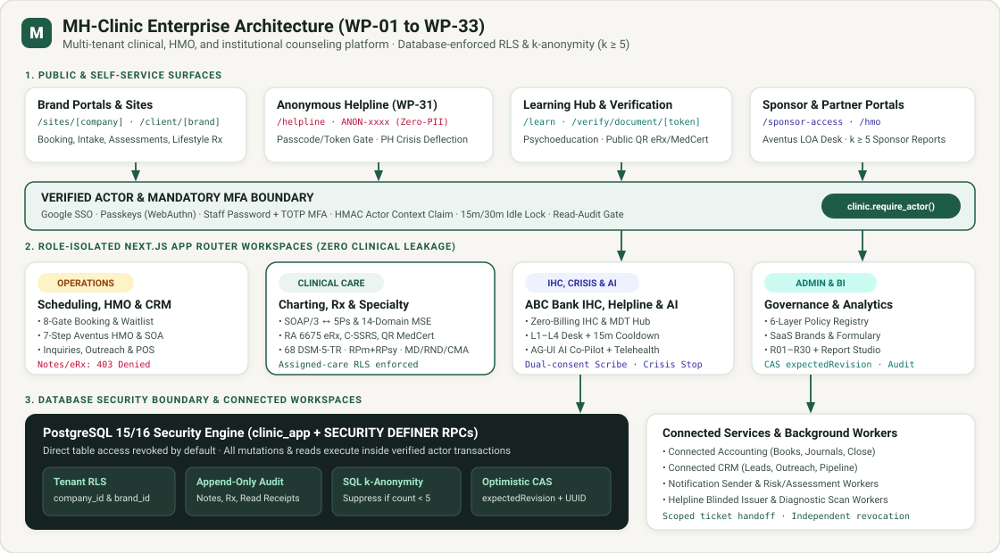
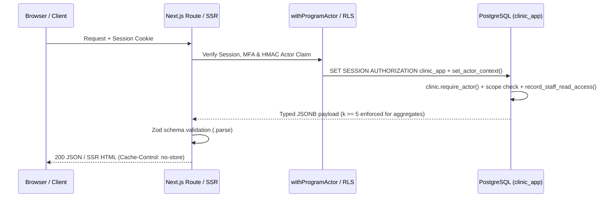
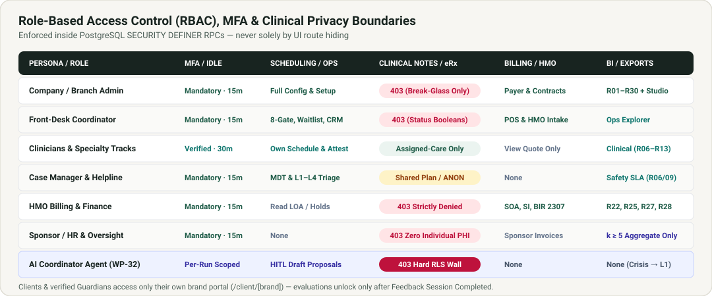
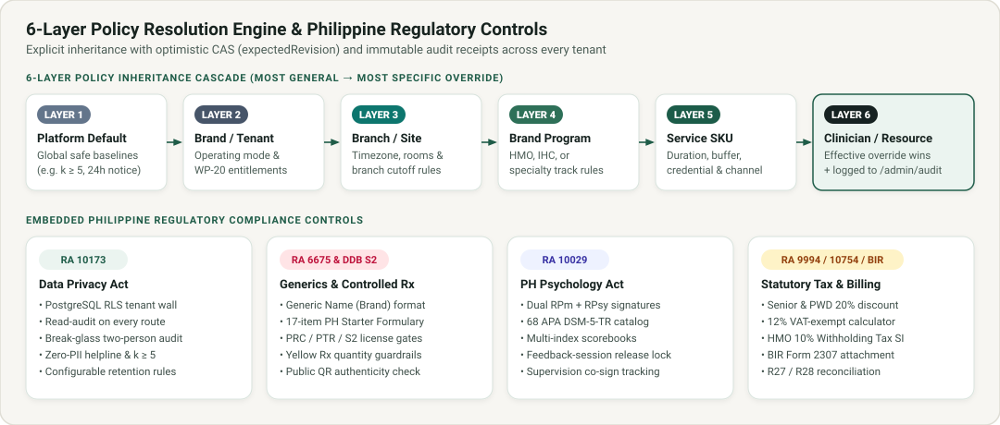
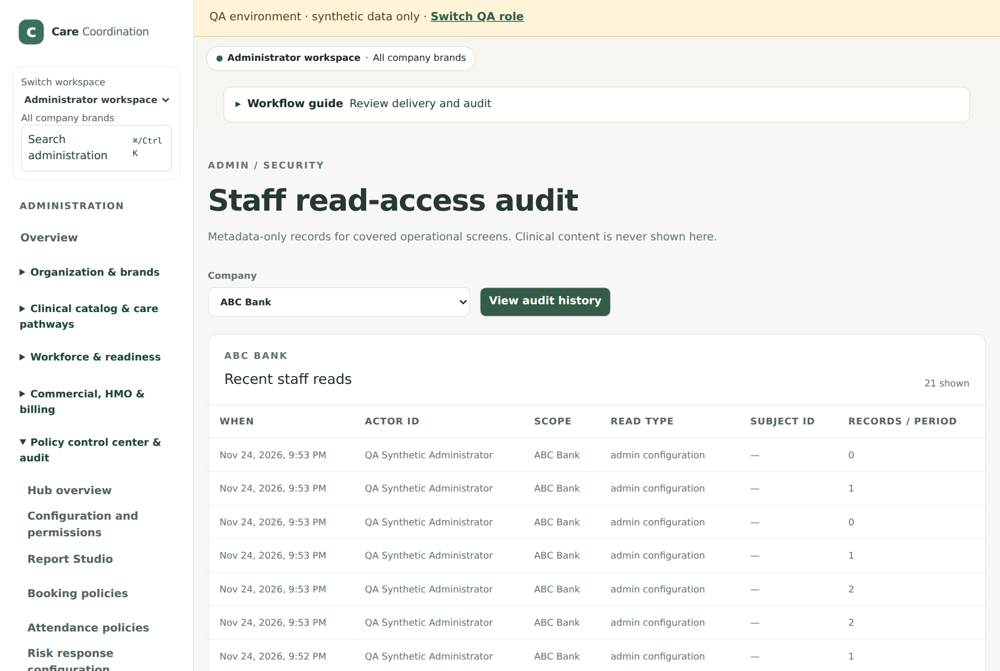

# MH-Clinic: Engineering & Developer Architecture Deck

> **Navigation:** [Knowledge Base Home](../README.md) · [Master Index](../INDEX.md) · [Glossary](../GLOSSARY.md)
>
> **Doc ID:** `MHD-DCK-02` · **Type:** Explanation · **Audience:** Executives, sponsors, engineers or clinical leads (see title) · **Revised:** 25 November 2026 · All examples use synthetic data.

> **Audience:** Software Engineers, Database Architects, Security Auditors, and DevOps/QA Engineers
> **Stack:** Next.js App Router (TypeScript + Zod) · PostgreSQL 15/16 (`SECURITY DEFINER` + RLS) · Node.js Workers · Biome · Playwright

---

## Agenda

1. Core architectural tenets
2. End-to-end request lifecycle
3. Key codebase directories
4. Privacy, k-anonymity and migration portability
5. Verification and CI gates

---

## Slide 1: Core Architectural Tenets

1. **Database as the Security Boundary:**
   - The web tier connects as the unprivileged `clinic_app` role.
   - All table access is denied by default (`REVOKE ALL FROM PUBLIC, clinic_app, clinic_auth`); reads and writes occur exclusively through `SECURITY DEFINER` functions with `SET search_path = pg_catalog, clinic`.
2. **Verified Actor Context:**
   - Every protected API route uses `withProgramActor(request, fn, { pinActor: true })` and every SSR page uses `withVerifiedActorTransaction(getDatabasePool(), claim, fn)`.
   - PostgreSQL verifies an HMAC-signed actor claim (`clinic.set_actor_context`) and checks active session + mandatory MFA (`clinic.require_actor`).
3. **Immutable History & CAS:**
   - Clinical notes, prescriptions, demographics, and financial events are append-only (`BEFORE UPDATE OR DELETE` immutability triggers).
   - Admin and clinical mutations use `expectedRevision` Compare-And-Swap (`409 Conflict` on stale writes) and `commandId` UUID idempotency.

---

## Slide 2: End-to-End Request Lifecycle

---

## Slide 3: Key Codebase Directories (`mh-clinic`)
- `apps/web/src/modules/` — Domain models, Zod contracts, and pure business logic (`reports/`, `assessments/`, `formulary-publication/`, `helpline/`, `coordinator-agent/`, `ihc/`, `session-notes/`).
- `apps/web/src/app/api/` — Next.js Route Handlers (`admin/`, `staff/`, `professional/`, `client/`, `public/`).
- `apps/web/src/app/` — App Router SSR pages & client workspaces.
- `apps/web/scripts/check-read-audit-coverage.cjs` — Static gate ensuring **every** protected GET/POST route and SSR page declares an audited read mechanism.
- `db/migrations/` — Sequential, append-only SQL migrations (`0001` through `0689`).
- `services/` — Standalone Node.js workers (`accounting`, `crm`, `notification-sender`, `helpline-issuer`, `helpline-redemption`, etc.).

---

## Slide 4: Privacy, $k$-Anonymity & Migration Portability Rules

- **No Hardcoded Tenants:** `tools/check_migration_portability.py` rejects literal tenant slugs (e.g., `'abc-bank'`, `'aventus'`) in prospective migrations; behavior is driven by `clinic.policy_values`.
- **Database-Enforced $k$-Anonymity:** Aggregate reports (`R01`–`R30`, Sponsor Portal) compute `floor := greatest(5, clinic.sponsor_minimum_cohort_size(...))` in SQL and return `status: 'suppressed'` with `NULL` counts whenever `distinct_clients < floor`.
- **Read-Audit Bounds:** `clinic.record_staff_read_access` enforces `p_range_start/end IS NULL` for `'admin_configuration'` and `p_range_end - p_range_start <= 89` for `'operational_report'`.

*Synthetic administrator-training capture, November 2026.*

---

## Slide 5: Verification & CI Gates
1. **Static & Lint:** `npm run check --prefix apps/web` (Biome + `check-read-audit-coverage.cjs` + `check-public-edge-upstreams.cjs`) & `npm run typecheck --prefix apps/web`.
2. **Unit & Build:** `npm test` & `npm run build --prefix apps/web`.
3. **Database & Inventory:** `python3 tools/check_migration_portability.py` & `python3 tools/audit_persona_coverage.py --check`.
4. **Full Containerized Wave Gate:** `sh scripts/verify-master-wave.sh` (disposable PostgreSQL 16 + Accounting + CRM + Playwright multi-profile browser suite).

---

## Summary & Next Steps

**Key takeaways**

- Authorization lives in PostgreSQL (RLS + SECURITY DEFINER RPCs), not only in the UI.
- Every sensitive write is revision-checked (CAS) and audited.
- Verification combines static checks, unit tests, migration portability and a containerized wave gate.

**Next steps**

- Read [Manual 11: Configurations & Reference](../manuals/11-configurations-and-reference.md).
- Report vulnerabilities privately per [SECURITY.md](../SECURITY.md).

---

← Previous: [MH-Clinic: Executive Introduction Deck](01-executive-introduction-deck.md) · [Knowledge Base Home](../README.md) · [Getting Started](../GETTING_STARTED.md) · [FAQ](../FAQ.md) · Next: [MH-Clinic: Clinical & Operations User Walkthrough Deck](03-clinical-and-operations-user-deck.md) →
