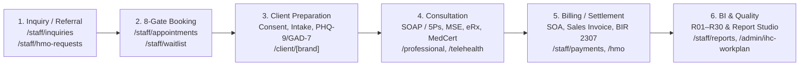

# MH-Clinic: Clinical & Operations User Walkthrough Deck

> **Audience:** Coordinators, Psychiatrists, Psychologists, Psychometricians, Counselors, Specialty Clinicians, and Billing Officers

---

## Slide 1: The Unified Patient & Operational Journey

---

## Slide 2: Front-Desk & HMO Operations
- **Booking with Confidence:** The 8-Gate Booking Simulator explains *why* a slot is open or blocked (location, room, equipment, notice window, hours, or eligibility).
- **Aventus 7-Step HMO Flow:** Paste referral slip $\rightarrow$ reserve LOA slot $\rightarrow$ confirm $\rightarrow$ track in 10-column Inventory Ledger $\rightarrow$ generate branded `SOA` & `Sales Invoice` (`10% WTax`) $\rightarrow$ settle with Deposit Slip + `BIR 2307`.
- **Smart Waitlist & AI Co-Pilot:** Backfill cancelled slots (`/staff/waitlist`) or review `AG-UI` draft actions (`/staff/ai-coordinator`) with 1-click human approval.

---

## Slide 3: Clinician Encounter Workspace
- **Fast, Structured Notes (`MHCLINIC-SOAP/3`):** Apply `"Normal Baseline (WNL)"` in 1 click, toggle abnormal MSE chips, and pick `ICD-10-CM` (`1,204` codes) or `ICD-11` (`661` codes) with 1-line descriptions.
- **Safe Prescribing (`eRx`):** Generic-first format (`Generic Name (Brand Name)` per RA 6675), DDB `S2` controlled drug checks, and metabolic/`QTc`/`AIMS`/`ANC` monitoring flowsheets.
- **Assessments (`WP-17` & `WP-24`):** Browse 68 standardized `DSM-5-TR` Section III measures (`/staff/assessments/dsm5tr`), track longitudinal `PHQ-9`/`GAD-7` progress, and co-sign dual `RPm` + `RPsy` evaluation reports.

---

## Slide 4: ABC Bank In-House Counseling (`IHC`) & Crisis Helpline
- **IHC Workspace (`/admin/ihc-workplan`, `/professional/ihc`):** Switchable `SOAP <-> 5Ps` formulation, `MMDDYYYY+Initials+MMDDYYYY` client codes, `XXX / 4,000` reach counter, and 1-click `R14`–`R21` turnkey reports.
- **Anonymous Helpline (`/helpline`, `/staff/helpline-desk`):** Zero-PII `ANON-xxxx` sessions with `L1`–`L4` triage, automatic 15-minute post-`L1` responder cooldown, and curated self-reading guides (`/learn`).

---

## Slide 5: Reporting & Analytics (`R01`–`R30`)
- **30 Turnkey Reports:** Covering Executive Utilization (`R01`–`R05`), Clinical Governance (`R06`–`R13`), Official ABC Bank IHC Suite (`R14`–`R21`), HMO/Sponsor (`R22`–`R24`), and Commercial Finance/NPS (`R25`–`R30`).
- **Privacy First:** Small cohorts ($< 5$ clients) are automatically suppressed so aggregate reports never expose individuals.
