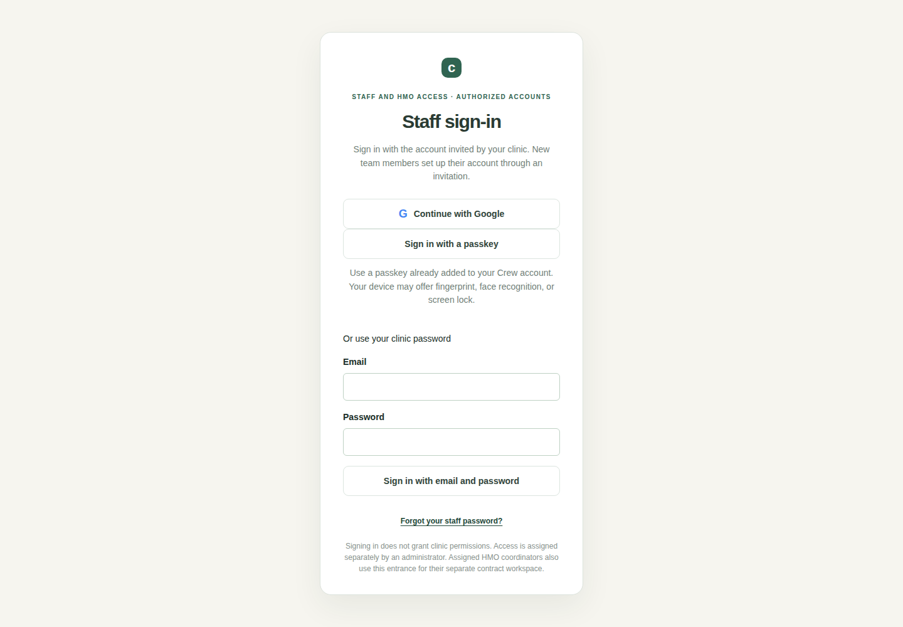
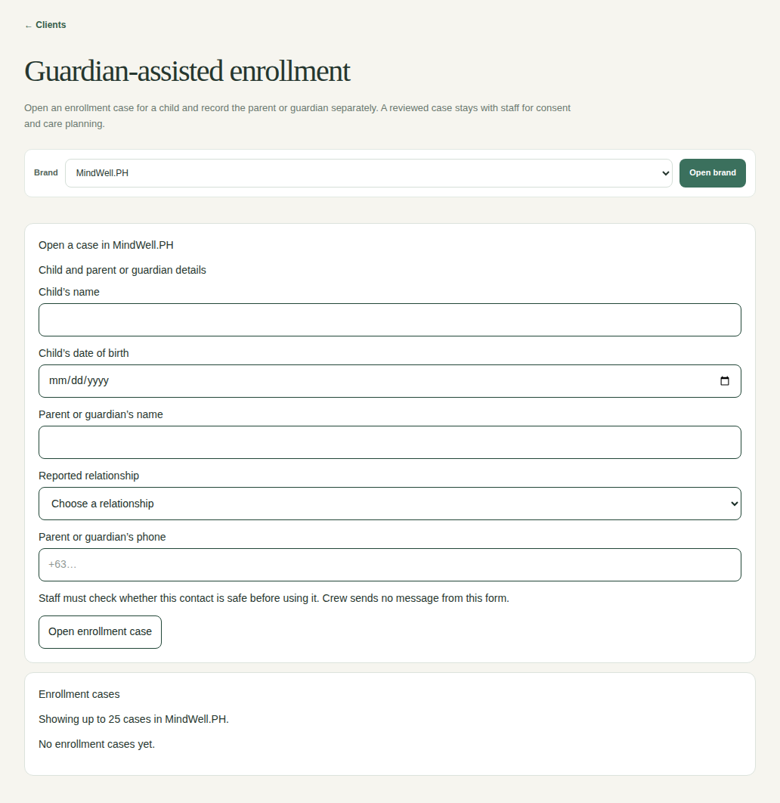
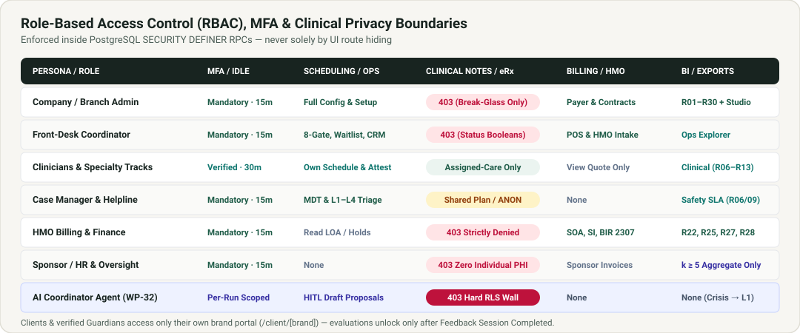
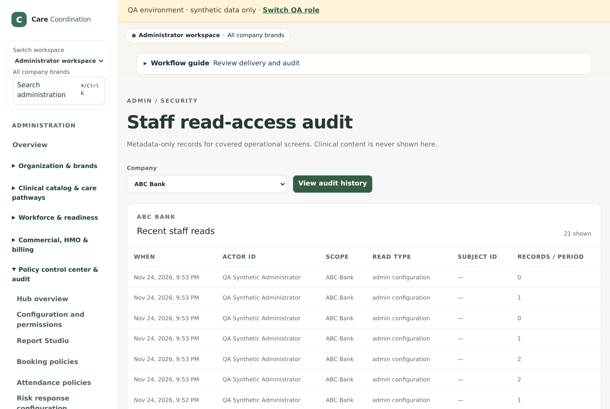

# Manual 01: Getting Started, Authentication & Mandatory MFA

## 1. Sign-In Paths
- **Staff & Clinician Sign-In (`/sign-in` & `/staff-password`):**
  - Supports verified Google Workspace SSO and invitation-based staff email/password login.
  - Account creation is separate from role activation: an administrator must grant active `staff_access` for a specific company/brand, and clinicians must complete 6-gate readiness (`/professional` setup) before becoming bookable.
- **Client & Guardian Sign-In (`/client-access/[brand]`):**
  - Adult clients use Google SSO or clinic-issued one-time claim links.
  - Minors/dependents access care through an enrolled, verified guardian (`/staff/guardian-enrollment`).

### Staff sign-in screen

*Synthetic operator-training capture, November 2026. Use the sign-in method assigned by your clinic. This screen shows sign-in choices, not role activation or MFA enrollment.*

### Guardian-assisted enrollment for minors

*Synthetic operator-training capture, November 2026. Child and parent/guardian details are captured separately so staff can verify safe contact and authority before linking portal access.*

## 2. Mandatory Multi-Factor Authentication (MFA)
Privileged roles (**Company Administrator**, **Branch Administrator**, **Coordinator**, **Parent/Oversight Viewer**, **Platform Master Admin**) require MFA on every active session:
1. **Setup (`/mfa/setup`):** Enroll an authenticator app (TOTP QR code) and store single-use backup recovery codes offline.
2. **Passkeys (`/mfa/passkeys`):** Optional WebAuthn/FIDO2 passkey registration for faster hardware-backed sign-in.
3. **Verification (`/mfa/verify`):** PostgreSQL enforces `clinic.staff_is_mfa_session_verified` inside `clinic.require_actor`; unverified sessions are rejected with `42501`.

## 3. Session Idle Timeouts & Role Isolation

| Role Group | Idle Timeout | Clinical Notes Access |
| :--- | :---: | :--- |
| **Company / Branch Administrator** | 15 min | **Denied (`403`)** unless granted explicit temporary break-the-glass / Two-Person approval |
| **Front-Desk Coordinator / HMO** | 15 min | **Denied (`403`)** — sees appointment status/completion booleans only |
| **Psychiatrist / Psychologist / Counselor / Specialty Clinician** | 30 min | **Assigned-care only** (or approved colleague access grant) |
| **AI Coordinator Agent (`WP-32`)** | Per-run | **Denied (`403`)** on all clinical notes, prescriptions, and certificates |

### Reviewing metadata-only staff read-access audits

*Synthetic administrator-training capture, November 2026. Every protected operational and reporting screen logs a metadata-only read receipt without ever displaying clinical note bodies.*

### When no connected workspaces appear

*Synthetic operator-training capture, November 2026. If you expect a connected workspace, ask your Clinic administrator to verify your role and access to that destination. Signing in alone does not grant access.*
