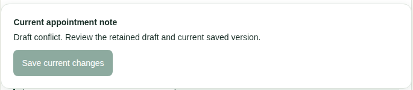
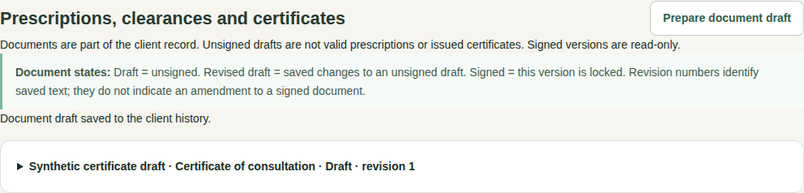

# Manual 03: Clinical Workflows, 14-Domain MSE, `eRx` & Certificates

## 1. Versioned `MHCLINIC-SOAP/3` & `SOAP <-> 5Ps` Notes
- Opened from `/professional/appointments/[appointmentId]/notes`.
- Every save creates an immutable version; finalizing locks the body with a verified clinician signature. Later edits require an explicit **Addendum** with reason.
- **Reason to Seek Consult & Diagnostic Coding (`WP-21`):**
  - Select from 20+ brand-extensible Reasons to Seek Consult.
  - Search & select from **1,204 `ICD-10-CM` codes** (`F00–F99`, `G40–G43`, `Z55–Z73`, CDC FY2027) or **661 `ICD-11 MMS` codes** (`6A00–6E8Z`), each displayed with its **code + 1-line clinical description + category header**.
  - Assign certainty (`Provisional / Rule-Out`, `Working Impression`, `Confirmed`, `Non-Clinical / Z-V Code`).

### Reviewing a note draft conflict

*Synthetic clinician-training capture, November 2026. Compare the retained local draft with the current saved version before discarding or re-entering changes. A disabled save control does not mean the local changes were saved.*

## 2. Rapid 14-Domain Chip-to-Prose MSE & Cognitive Screens (`WP-21`)
- Apply **"Normal Baseline (WNL)"** in 1 click, then toggle domain-specific chips across all 14 MSE domains (`Appearance`, `Behavior`, `Engagement`, `Orientation`, `Speech`, `Reported Mood`, `Observed Affect`, `Thought Process`, `Thought Content`, `Perception`, `Attention & Cognition`, `Insight`, `Judgment`, `Context & Limitations`).
- Scored cognitive screens (`MMSE` `/30`, `MoCA` `/30`, `Mini-Cog` `/5`) auto-calculate totals and plot longitudinal trends.

## 3. Suicide & Safety Risk Protocol (`WP-22`)
- Embedded **`C-SSRS`** screening + **6-step Stanley-Brown Safety Plan** (`Warning Signs`, `Internal Coping`, `Social/Distraction`, `People Who Can Help`, `Professionals/Crisis Lines`, `Making Environment Safe`).
- Author-only safety follow-up episodes (`/professional/safety-followup`) track SLA timers (`R06`) and closed-loop **"Referral Out"** handoffs.

## 4. Philippine Generic-First Psychiatric `eRx` (`WP-23`)
- **RA 6675 Compliance:** Prescriptions render as `Generic Name (Brand Name)` from the brand's clinically approved formulary.
- **1-Click Starter Formulary:** Admins open `/admin/configuration/formulary` $\rightarrow$ **Prepare several products** $\rightarrow$ click **Load Philippine Psychiatric Starter Formulary (17 items)** (`13` `standard_rx` + `4` `ddb_s2_yellow_rx`), then approve in `/admin/configuration/prescription-authority`.
- **DDB `S2` Yellow Rx Safeguard:** Controlled substances require valid S2 license/PTR metadata and strict quantity limits.

## 5. QR-Verifiable Certificates (`MedCert` / `Fit-to-Work`) (`WP-27`)
- Clinicians draft and sign certificates tied to exact `served` encounters; clients download PDFs with a public QR verification token (`/verify/document/[token]`) confirming authenticity without exposing clinical note text.

### Checking a saved certificate draft

*Synthetic clinician-training capture, November 2026. After saving, reopen the record and check the title, status and revision. An unsigned draft is not an issued certificate.*
