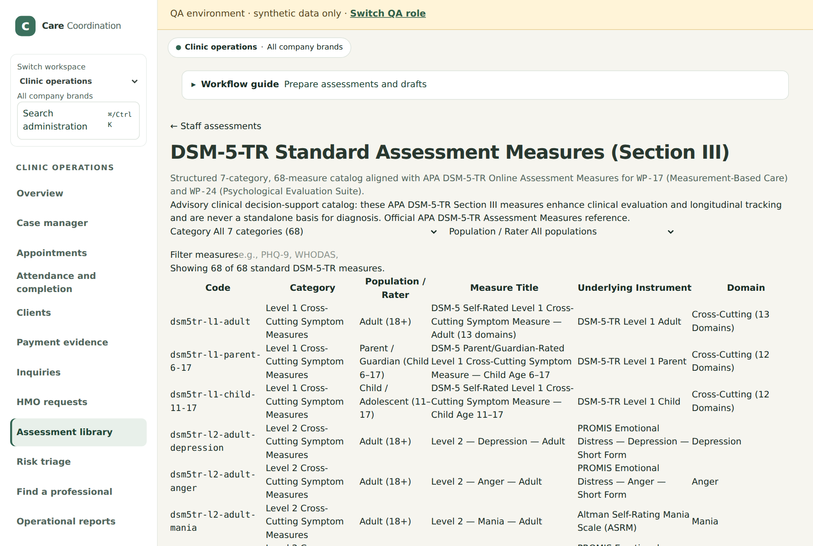
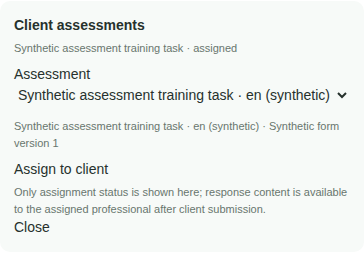
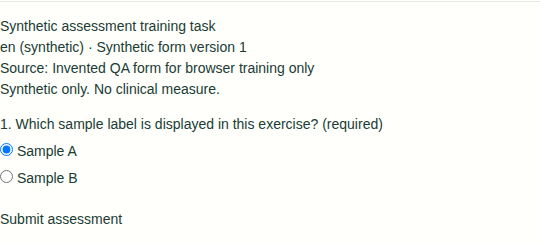
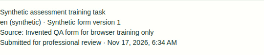
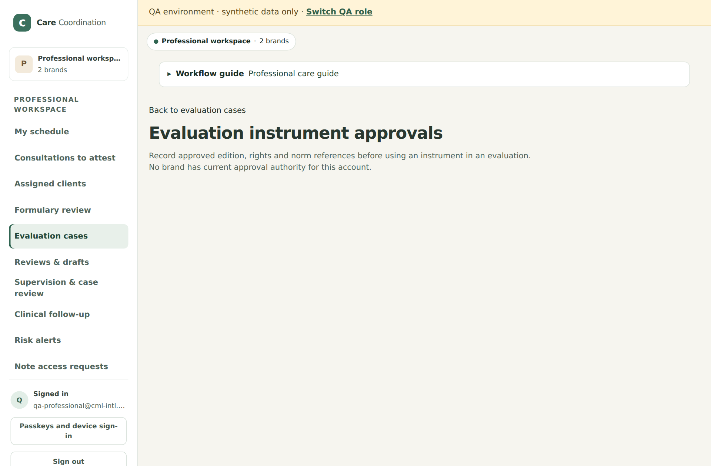
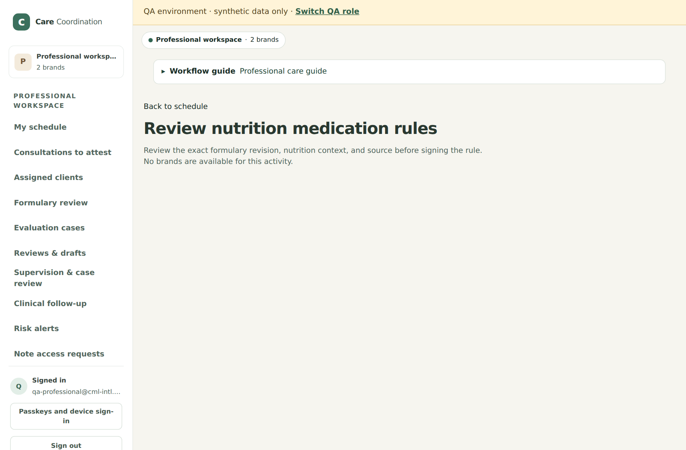
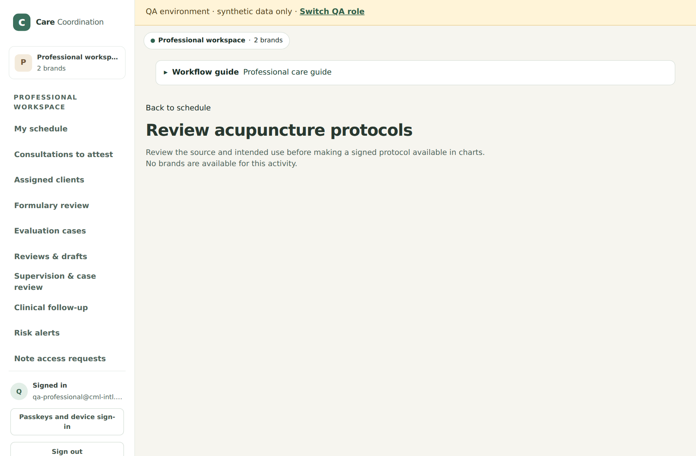

# Manual 04: Psychological Assessments (`DSM-5-TR`), `Lifestyle Rx` & Specialty Tracks

> **Navigation:** [Knowledge Base Home](../README.md) · [Master Index](../INDEX.md) · [Glossary](../GLOSSARY.md) · [Psychologist Guide](../personas/04-psychologist-and-psychometrician.md)

## 1. APA `DSM-5-TR` Section III Standard Assessment Catalog (`/staff/assessments/dsm5tr`)
MH-Clinic includes a structured **7-category, 68-measure catalog** aligned with APA `DSM-5-TR` Online Assessment Measures:

| Category | Count | Key Measures |
| :--- | :---: | :--- |
| **1. Level 1 Cross-Cutting Symptom** | **3** | Adult (13 domains), Parent/Guardian 6–17 (12 domains), Child 11–17 (12 domains) |
| **2. Level 2 Cross-Cutting Symptom** | **26** | `PROMIS` (Depression, Anger, Anxiety, Sleep), `ASRM` Mania, `PHQ-15` Somatic, `FOCI`/`C-FOCI`, `ASSIST` Substance, `SNAP-IV`, `ARI` |
| **3. Disorder-Specific Severity** | **26** | Adult (`10`), Child 11–17 (`10`), Clinician-Rated (`6`) — `PHQ-9`/`PHQ-A`, Anxiety/Phobia/Panic/GAD, `NSESS` PTSD/Acute Stress, `DES-B`, ASD, `CRDPSS`, ODD, Conduct, NSSI |
| **4. Disability Measures** | **2** | `WHODAS 2.0` (36-item Self & Proxy) |
| **5. Personality Inventories** | **5** | `PID-5-BF` (25-item), `PID-5` (220-item), `PID-5-IRF` (Informant) |
| **6. Early Development & Home Background** | **2** | `EDHB` Form — Parent/Guardian & Clinician |
| **7. Cultural Formulation Interviews** | **4** | Core `CFI` (16 questions), Informant, Alternative, Supplementary (12 modules) |

### Browsing the 68-measure APA `DSM-5-TR` Section III catalog

*Synthetic clinician-training capture, November 2026. Filter by category, population/rater, or measure code. The catalog serves as an advisory clinical decision-support index and never acts as a standalone diagnosis.*

## 2. Measurement-Based Care (`WP-17`) & Dual-Signatory `RPm` + `RPsy` Suite (`WP-24`)
- **Client Portal Delivery (`/client/[brand]`):** Coordinators/clinicians assign activated self-report measures to appointments; clients complete them online and results flow into `/professional/assessments/paired-score-change`.
- **RA 10029 Dual-Signatory Evaluations (`/professional/evaluations/`):**
  - Psychometrician (`RPm`) records multi-index scores (`Raw`, `Standard`, `T-Score`, `Percentile`, `95% CI`) and signs testing tables.
  - Psychologist (`RPsy`) authors the 7-section formulation and co-signs.
  - **Feedback Lock:** Client PDF unlocks in `/client/[brand]/evaluation-reports` only after **Feedback Session Completed** is attested.

### Following an assessment from assignment to submission

1. **Coordinator:** At the correct appointment, check the approved assessment version and verify that the task is **assigned**. The coordinator sees task status, not submitted answers.

   

2. **Linked client completing the task:** Open the assigned task in the client portal and submit answers.

   

3. **Linked client submission receipt:** Confirm **Submitted for professional review**. This confirms receipt, not completed clinical review or report release.

   

*These captures are from the same synthetic training exercise, November 2026. They show an invented form, not a clinical instrument, licensed content or a signed evaluation report.*

### Checking evaluation instrument approval authority (`RA 10029`)

*Synthetic clinician-training capture, November 2026. Approved edition, rights, and norm references must be recorded by an authorized reviewer before an instrument is used in a formal evaluation.*

## 3. 6-Pillar `Lifestyle Rx` & Psychotropic Safety Monitoring (`WP-26`)
- **6 Pillars (`Nutrition`, `Movement`, `Sleep`, `Stress`, `Connection`, `Substances`):** Clinicians publish SMART plans; clients log weekly check-ins (`/client/[brand]/lifestyle-rx`); tracked in `R10`.
- **Psychotropic Monitoring (`R07`):** Tracks baseline, week 4/8/12, quarterly, and annual labs (`BMI`, `HbA1c`, `Lipids`, `QTc`, `AIMS`, `Lithium`, `Clozapine ANC`), blocking renewal issuance if mandatory monitoring evidence is missing.

## 4. Multidisciplinary Specialty Tracks (`WP-28`)
- **Neurologist (`MD`):** Focused neuro exam, seizure/headache/migraine diary (`R13`), and governed neuro-diagnostic file uploads.
- **Registered Nutritionist-Dietitian (`RND`):** `ADIME` charting, medication-nutrient rule checks, and weight trajectory (`R11`).
- **Certified Medical Acupuncturist (`CMA`):** `NADA` / body protocol selection with mandatory needle-count insertion/removal safety lock.

### Specialty clinical governance & protocol review

*Synthetic clinician-training captures, November 2026. Specialty protocols and medication-nutrient rules require explicit clinical authority and brand assignment before becoming available inside active charts.*
