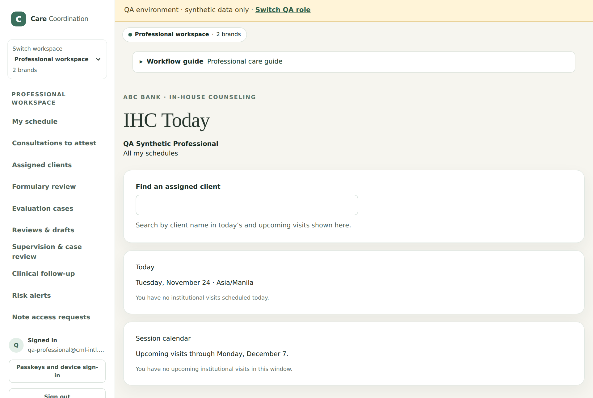
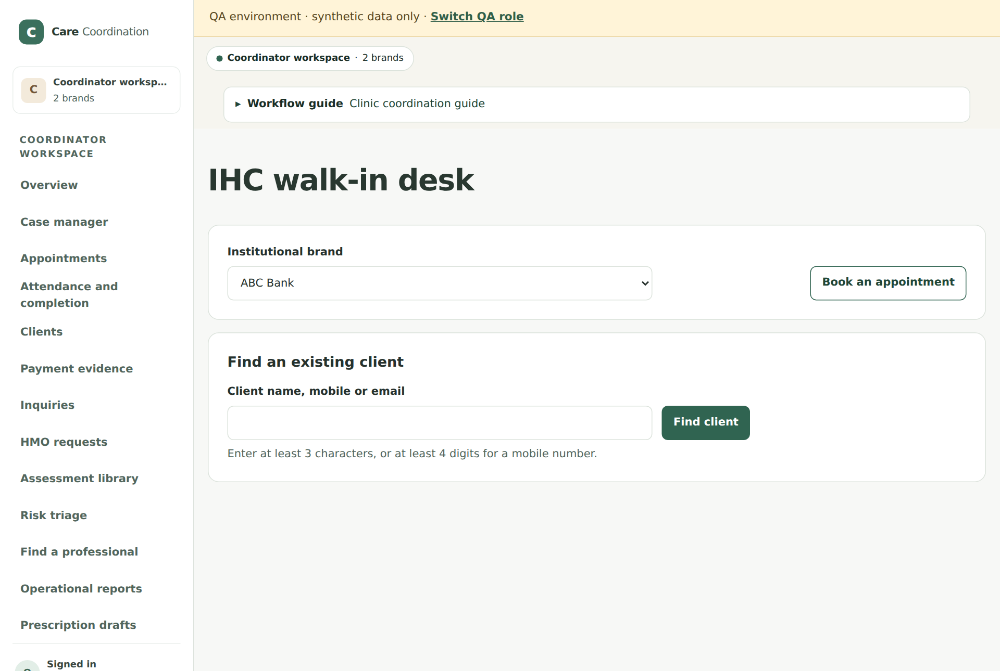
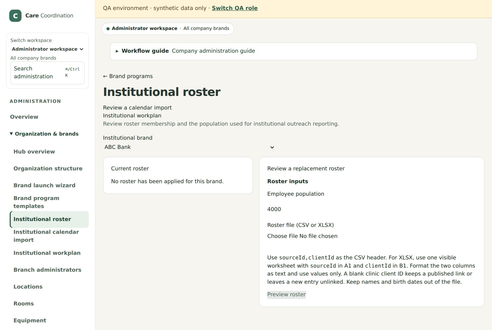
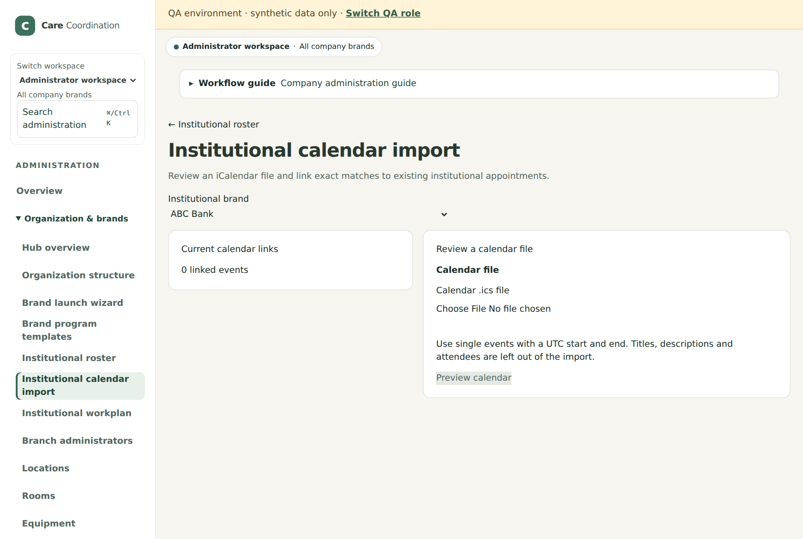
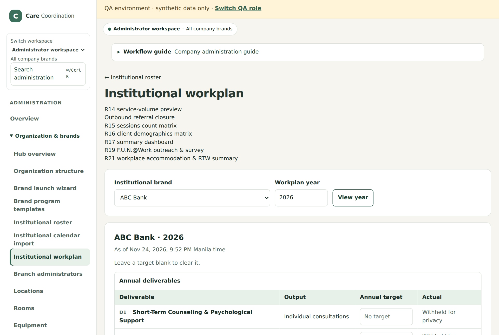
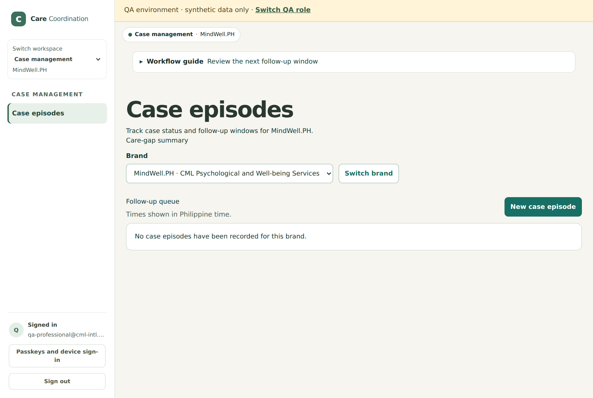

# Manual 05: ABC Bank In-House Counseling (`IHC`) & MDT Case Management (`WP-29`)

> **Navigation:** [Knowledge Base Home](../README.md) · [Master Index](../INDEX.md) · [Glossary](../GLOSSARY.md) · [Counselor Guide](../personas/05-counselor-and-ihc-specialist.md)
>
> **Doc ID:** `MHD-MAN-05` · **Type:** Reference · **Audience:** All roles; see the persona guides for task paths · **Revised:** 25 November 2026 · All examples use synthetic data.

## 1. Zero-Billing Institutional Mode
Brands configured with `billing.operating_mode = 'in_house_non_billable'` (such as ABC Bank IHC) operate completely outside Accounting/SOA billing:
- Appointments show **No client charge**.
- Counselors work from `/professional/ihc` and coordinators from `/staff/ihc`.

### Counselor `IHC Today` and Coordinator walk-in desk

*Synthetic counselor-training capture, November 2026. Counselors manage assigned institutional visits directly inside `IHC Today`, separated from clinic billing.*

*Synthetic coordinator-training capture, November 2026. Coordinators confirm the institutional brand (`ABC Bank`) before searching for an existing client or booking a walk-in visit.*

## 2. Institutional Client Codes & Demographics
- **Client Code Format:** `MMDDYYYY+Initials+MMDDYYYY` (normalized Unicode initials, generated in `/professional/appointments/[appointmentId]/institutional-code`).
- **6-Band Demographics (`/professional/appointments/[appointmentId]/institutional-profile`):** Records `genderIdentity`, `geographicOrigin`, `dutyStation` (`headquarters` vs. `field_office`), `tenure`, `staffCategory`, and `gradeBand` (`levels_1_to_6` vs. `levels_7_plus`), feeding `R16`.

## 3. Roster, Calendar `.ics` Import & Workplan (`/admin/ihc-roster`, `/admin/ihc-calendar-import`, `/admin/ihc-workplan`)
- **De-Identified Roster:** Upload up to `10,000` pseudonymous `sourceId` tokens against total population (default `4,000`) to track `XXX / 4,000` reach without storing raw employee names or emails.
- **RFC 5545 `.ics` Calendar Import:** Imports UTC-normalized counselor calendar blocks while stripping external attendee PII.
- **Annual Workplan:** Tracks annual targets vs. actuals across individual sessions, group sessions, trainings, programs, advisory meetings, field interventions, and outbound referral closures (`R14`–`R21`).

### Reviewing de-identified roster and `.ics` calendar import

*Synthetic administrator-training capture, November 2026. Only pseudonymous `sourceId` and optional `clientId` columns are uploaded; employee names and birth dates are never included.*

*Synthetic administrator-training capture, November 2026. Calendar previews link UTC start/end timestamps while stripping attendee PII, titles, and descriptions.*

### Reviewing the ABC Bank annual workplan and `R14`–`R21` links

*Synthetic administrator-training capture, November 2026. Annual deliverables link directly to turnkey `R14`–`R21` reports, while small-cohort actuals automatically show **Withheld for privacy**.*

## 4. `SOAP <-> 5Ps` Formulation & 27-Subtopic Taxonomy
- Inside `MHCLINIC-SOAP/3`, IHC clinicians can switch between `SOAP` and `5Ps` (`Presenting`, `Predisposing`, `Precipitating`, `Perpetuating`, `Protective`), tag up to **27 presenting-issue subtopics**, set `reintegrationStatus` (`ongoing`, `recovered_and_reintegrated`, `referred`), and log `referralTarget`.

## 5. Longitudinal Case Management (`MDT` Hub — `/case-manager/episodes`)
- Coordinates multidisciplinary care plans, hardship assignment milestones (`pre_assessment`, `pre_travel_briefing`, `assignment_check_in`, `post_assignment_assessment`), and care-gap reviews (`R09`).

### Managing longitudinal case episodes

*Synthetic case-manager training capture, November 2026. Case episodes are explicitly brand-scoped and display follow-up windows in Philippine time.*

---

← Previous: [Manual 04: Psychological Assessments (`DSM-5-TR`), `Lifestyle Rx` & Specialty Tracks](04-assessments-and-specialty-tracks.md) · [Knowledge Base Home](../README.md) · [Getting Started](../GETTING_STARTED.md) · [FAQ](../FAQ.md) · Next: [Manual 06: BI Dashboards, `R01`–`R30` Turnkey Reports & Report Studio (`WP-30`)](06-reporting-and-analytics-guide.md) →
