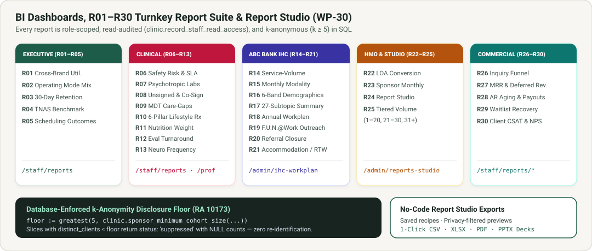
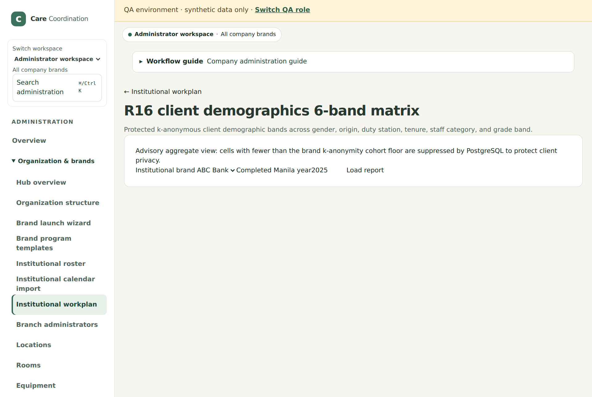
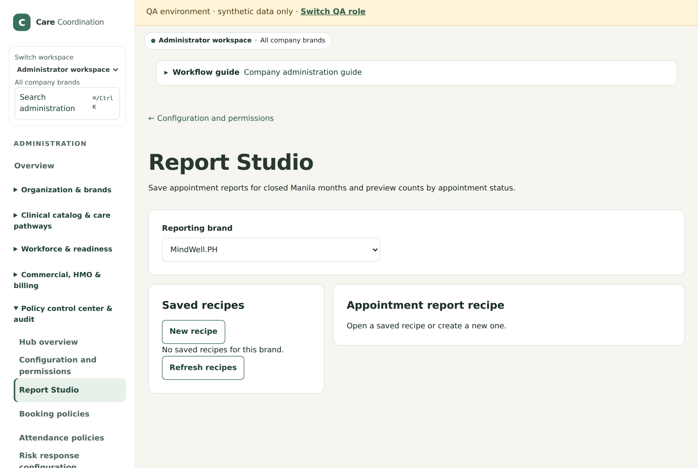
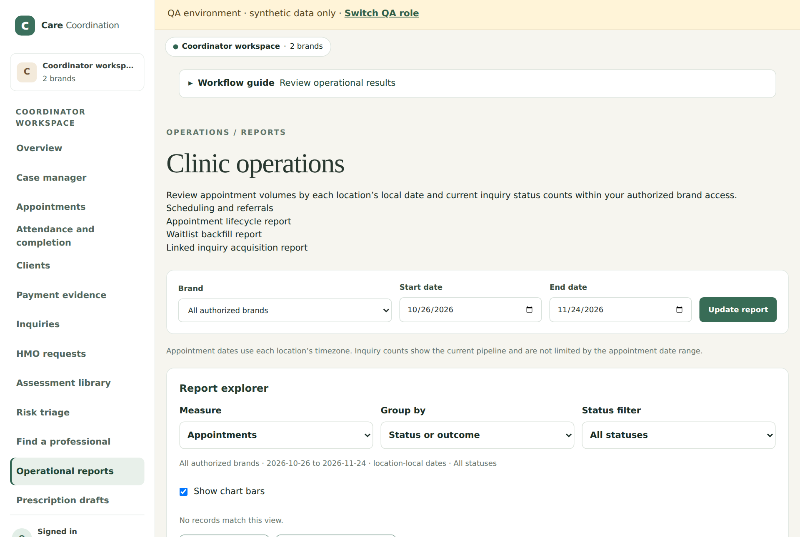
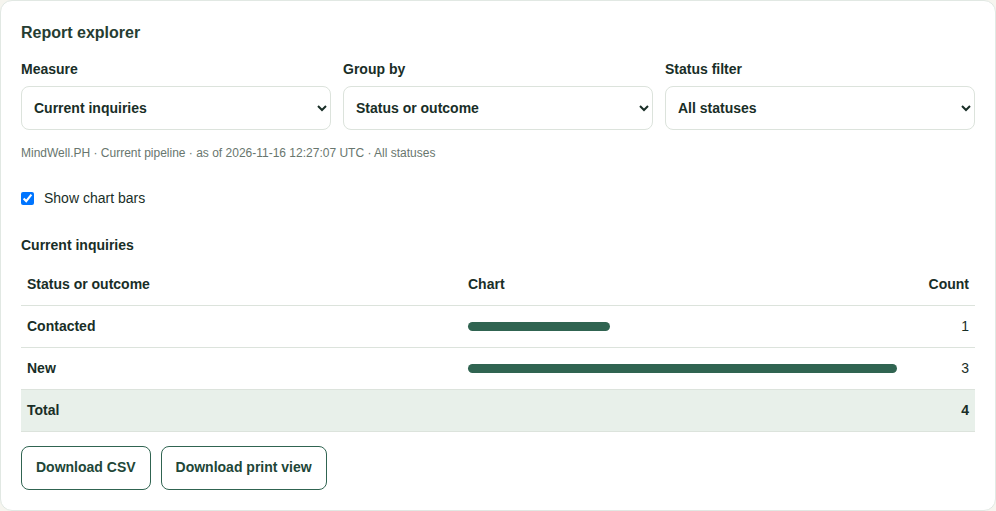
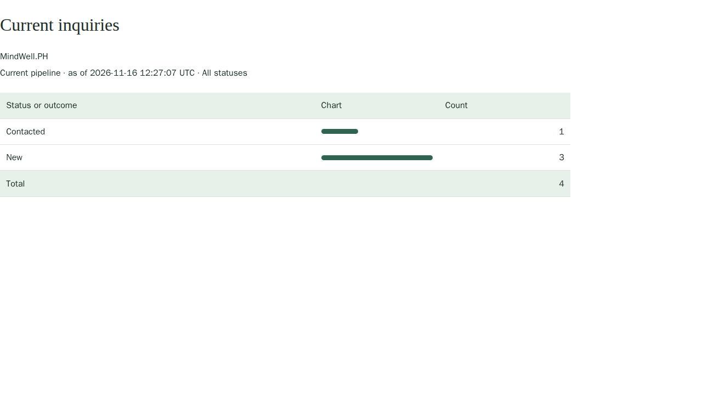

# Manual 06: BI Dashboards, `R01`–`R30` Turnkey Reports & Report Studio (`WP-30`)

## 1. Privacy & Governance Rules
- **Database-Enforced $k$-Anonymity:** Sponsor and institutional reports subject to the disclosure floor enforce `floor := greatest(5, clinic.sponsor_minimum_cohort_size(...))`. Any slice with fewer than `floor` distinct clients returns `status: 'suppressed'` and `NULL` counts.
- **Read Auditing:** Every report call logs an immutable `clinic.record_staff_read_access` receipt with actor, company, brand, and date window.

### Database-enforced $k$-anonymity in institutional reporting (`R16`)

*Synthetic administrator-training capture, November 2026. Cells below the brand's $k$-anonymity cohort floor ($k \ge 5$) are suppressed directly by PostgreSQL before leaving the database.*

## 2. Complete `R01`–`R30` Turnkey Report Directory

### Executive & Operations (`/staff/reports` & `/admin/configuration/consultation-retention`)
| Code | Report | Route |
| :--- | :--- | :--- |
| **R01** | Cross-Brand Utilization & Capacity | `/staff/reports/cross-brand-utilization` |
| **R02** | Revenue & Volume Mix by Operating Mode | `/staff/reports/operating-mode-mix` |
| **R03** | Consultation Follow-Up Retention (30-day window) | `/admin/configuration/consultation-retention` |
| **R04** | Third-Next-Available-Slot (`TNAS`) Access Benchmark | `/staff/reports/access-benchmark` |
| **R05** | Scheduling Lifecycle & Outcomes | `/staff/reports/scheduling` |

### Clinical Governance & Specialty Outcomes (`/staff/reports` & `/professional`)
| Code | Report | Route |
| :--- | :--- | :--- |
| **R06** | Safety & Suicide Risk Registry + Follow-Up SLA | `/staff/reports/safety-risk-registry` |
| **R07** | Psychotropic Metabolic / `QTc` / `AIMS` / `ANC` Compliance | `/staff/reports/psychotropic-monitoring` |
| **R08** | Unsigned Note & Supervision Co-Sign Aging | `/staff/reports/unsigned-notes-supervision` |
| **R09** | Case Management Care-Gap Review | `/professional/case-management` |
| **R10** | 6-Pillar `Lifestyle Rx` Trajectory | `/staff/reports/lifestyle-rx-trajectory` |
| **R11** | Nutrition Weight-Recorded Trajectory | `/professional/nutrition` |
| **R12** | Evaluation Turnaround Time | `/professional/evaluations/turnaround` |
| **R13** | Neurology Seizure & Migraine Frequency | `/staff/reports/neurology-frequency` |

### Official ABC Bank `IHC` Suite (`/admin/ihc-workplan`)
| Code | Report | Route |
| :--- | :--- | :--- |
| **R14** | IHC Service-Volume Preview | `/admin/ihc-workplan/service-volume` |
| **R15** | IHC Sessions Count Monthly Activity & Modality Matrix | `/admin/ihc-workplan/sessions-count` |
| **R16** | IHC Client Demographics 6-Band Matrix | `/admin/ihc-workplan/demographics` |
| **R17** | IHC Summary Dashboard & 27-Subtopic Issues | `/admin/ihc-workplan/summary` |
| **R18** | IHC Workplan Annual Targets & Actuals | `/admin/ihc-workplan` |
| **R19** | IHC `F.U.N.@Work` Outreach & Survey Report | `/admin/ihc-workplan/fun-at-work` |
| **R20** | IHC Outbound Referral Closure | `/admin/ihc-workplan/referral-closure` |
| **R21** | IHC Workplace Accommodation & `RTW` Summary | `/admin/ihc-workplan/rtw` |

### HMO, Sponsor, Commercial Finance & Acquisition
| Code | Report | Route |
| :--- | :--- | :--- |
| **R22** | HMO LOA-to-Encounter Conversion | `/staff/reports/hmo-loa-conversion` |
| **R23** | Sponsor Monthly Reporting & Quota | `/admin/workflows/sponsor-reports` |
| **R24** | Report Studio Definitions & Preview | `/admin/reports-studio` |
| **R25** | Monthly Tiered Volume Contract Utilization (`1–20`, `21–30`, `31+`) | `/staff/reports/tiered-volume-utilization` |
| **R26** | Linked Inquiry Acquisition Funnel | `/staff/reports/acquisition` |
| **R27** | Membership MRR & Prepaid Bundle Deferred Revenue | `/staff/reports/membership-deferred-revenue` |
| **R28** | AR Aging, Clinician Payout & Accounting Reconciliation | `/staff/reports/ar-payout-reconciliation` |
| **R29** | Waitlist Backfill & Recovery | `/staff/reports/waitlist` |
| **R30** | Post-Session Client Satisfaction & NPS Summary | `/staff/reports/client-satisfaction-nps` |

## 3. No-Code Report Studio (`/admin/reports-studio`)
Allows company administrators to build saved appointment recipes, apply privacy-filtered previews, and export 1-click `.xlsx`, `.pdf`, and `.pptx` decks.

### Scoped Report Studio workspace (`MindWell.PH`)

*Synthetic administrator-training capture, November 2026. Select a reporting brand first; saved recipes and closed Manila-month previews remain strictly scoped to the selected brand.*

## 4. Example: Internal Operations Hub & Report Explorer

*Synthetic operations-training capture, November 2026. Use the Clinic operations hub to jump directly to scheduling, waitlist, and acquisition reports or filter the inline Report explorer.*

*Synthetic operations-training capture, November 2026. Check the brand, filters and as-of timestamp before using an export. This example shows the internal inquiry view, not sponsor reporting, cohort suppression or Report Studio.*

*Synthetic operations-training capture, November 2026. Print views mirror the exact brand scope, UTC timestamp, and totals shown in Report Explorer.*
