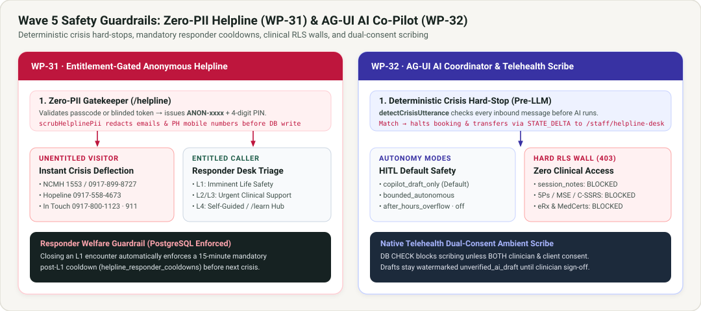
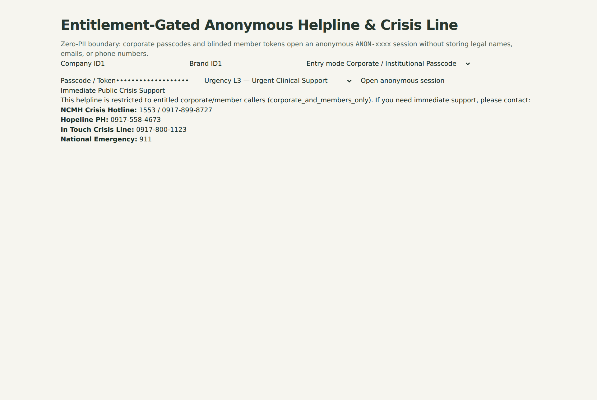
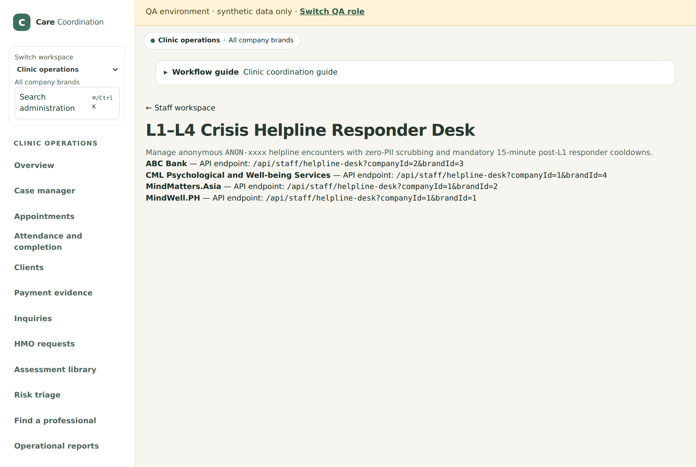
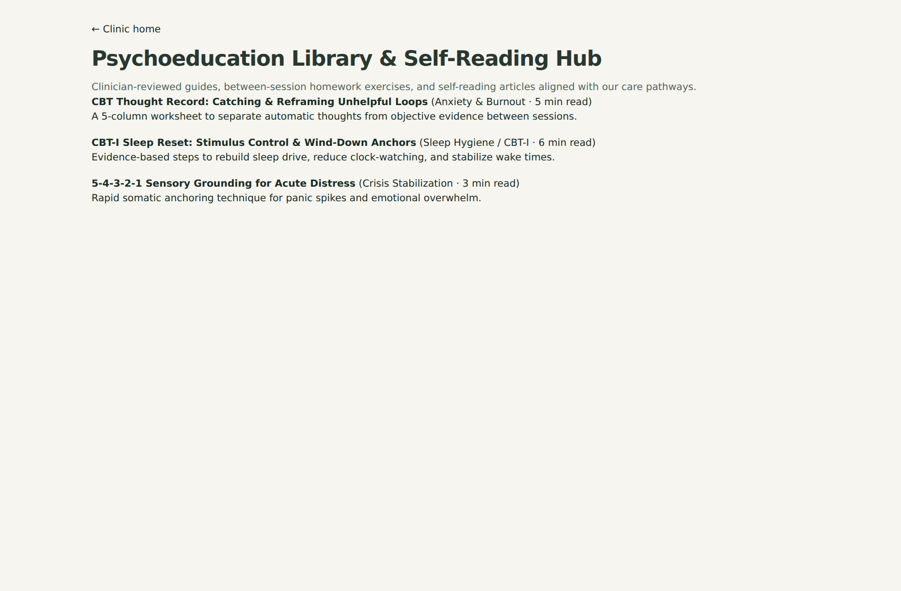
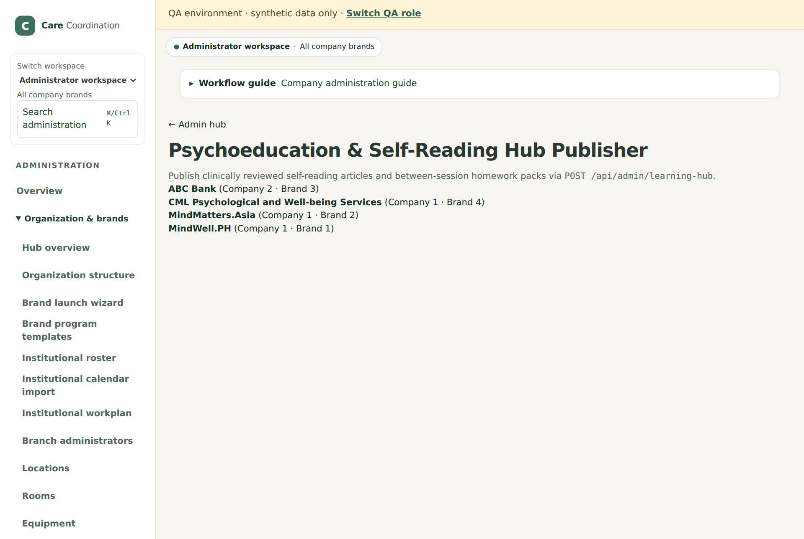
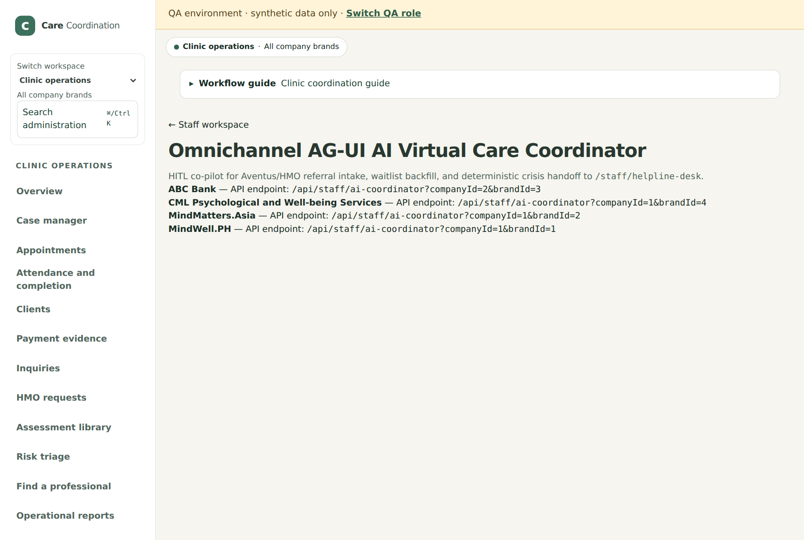

# Manual 07: Anonymous Helpline, Learning Hub & AI Virtual Coordinator (`WP-31` & `WP-32`)

> **Navigation:** [Knowledge Base Home](../README.md) · [Master Index](../INDEX.md) · [Glossary](../GLOSSARY.md) · [Client Guide](../personas/09-client-patient-and-guardian.md)

## 1. Entitlement-Gated Anonymous Helpline (`/helpline` & `/staff/helpline-desk`)
- **Zero-PII Gatekeeper:** Validates corporate passcodes or blinded member tokens against `clinic.helpline_access_policies` without collecting legal names, emails, or phone numbers.
- **Anonymous Alias & PIN:** Issues a deterministic `ANON-xxxx` alias and 4-digit recovery PIN for repeat continuity.
- **Public Deflection Card:** Unentitled visitors are immediately shown Philippine National Crisis Hotlines (**NCMH 1553 / 0917-899-8727**, **Hopeline PH 0917-558-4673**, **In Touch 0917-800-1123**, **911**).
- **Responder Welfare Guardrail:** Closing an `L1` (Imminent Life Safety) encounter automatically places the responder into a **15-minute mandatory post-`L1` cooldown** (`helpline_responder_cooldowns`).
- **Zero-PII Scrubber:** `scrubHelplinePii` redacts accidental emails and PH mobile numbers before storage.

### Public entitlement gate & Philippine National Crisis Hotline deflection

*Synthetic public-access training capture, November 2026. When an unentitled passcode is submitted, visitors receive immediate Philippine National Crisis Hotline numbers without collecting any personal identifiers.*

### `L1–L4` Crisis Helpline Responder Desk (`/staff/helpline-desk`)

*Synthetic responder-training capture, November 2026. Shows brand-scoped responder endpoints and welfare guardrails without exposing caller transcripts or identifying records.*

## 2. Psychoeducation & Self-Reading Blog Hub (`/learn` & `/admin/learning-hub`)
- Clinicians and administrators publish reviewed guides organized by clinical domain in `/admin/learning-hub`.
- Public self-reading guides (CBT Thought Records, CBT-I Sleep Reset, 5-4-3-2-1 Grounding) are accessible at `/learn`.

### Public self-reading library & administrator publisher

*Synthetic public-access training capture, November 2026. Unauthenticated visitors can read clinically reviewed psychoeducation guides immediately at `/learn`.*

*Synthetic administrator-training capture, November 2026. Administrators review authorized brand scopes before publishing new psychoeducation articles.*

## 3. Omnichannel `AG-UI` AI Virtual Care Coordinator (`/staff/ai-coordinator`)
- **Autonomy Modes:** `off`, `copilot_draft_only` (default — human staff click *Approve*), `bounded_autonomous`, and `after_hours_and_short_handed_overflow`.
- **Hard RLS Boundary:** The AI Coordinator is strictly blocked (`403`) from reading `session_notes`, `5Ps`, `eRx`, or `MedCert` bodies.
- **Deterministic Crisis Hard-Stop:** `detectCrisisUtterance` checks every inbound message before LLM/workflow execution; any crisis utterance halts booking and emits an `AG-UI` `STATE_DELTA` transferring the session to `/staff/helpline-desk`.

### Human-in-the-loop `AG-UI` AI Coordinator workspace

*Synthetic operator-training capture, November 2026. The coordinator operates in draft-only HITL mode by default and hands off crisis utterances deterministically to `/staff/helpline-desk`.*

## 4. Native Telehealth Room & Ambient Clinical Scribe (`/telehealth/[appointmentId]`)
- Logs participant join/leave timestamps for HMO/IHC duration audits.
- **Dual-Consent Lock:** Ambient scribing is blocked by PostgreSQL (`CHECK (ambient_draft_status = 'none' OR dual_scribe_consent = true)`) unless both clinician and client explicitly consent, and outputs are watermarked `unverified_ai_draft` until signed by the clinician.
