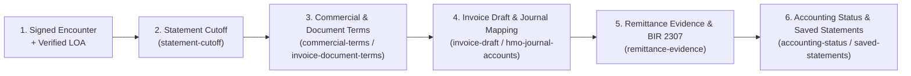
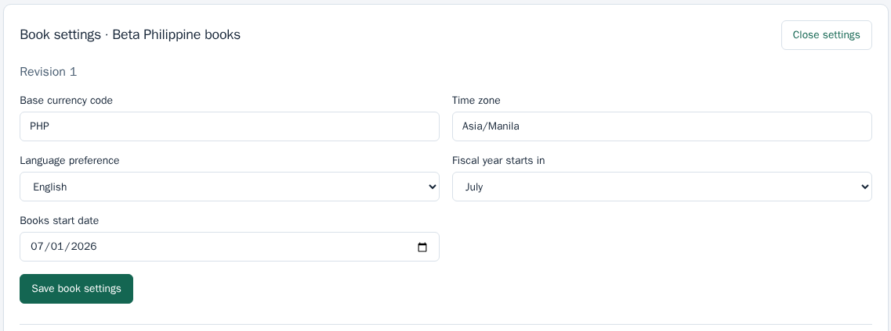
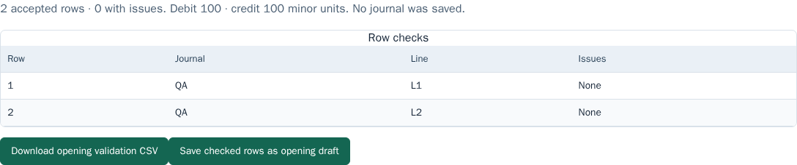
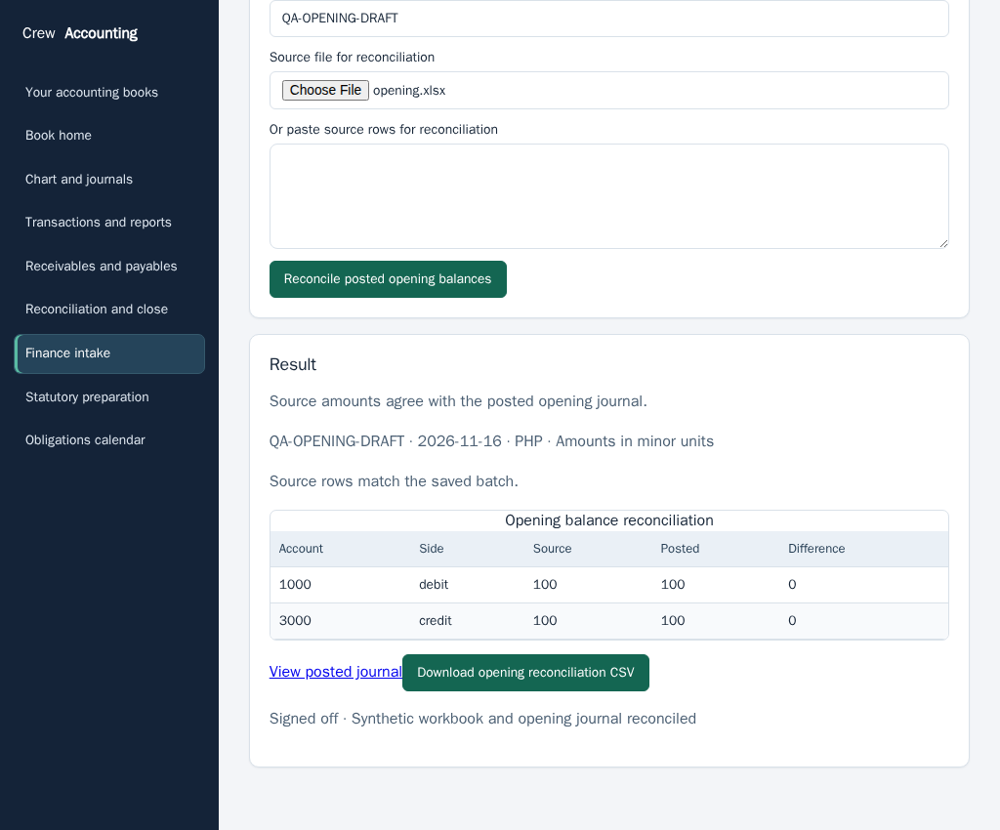
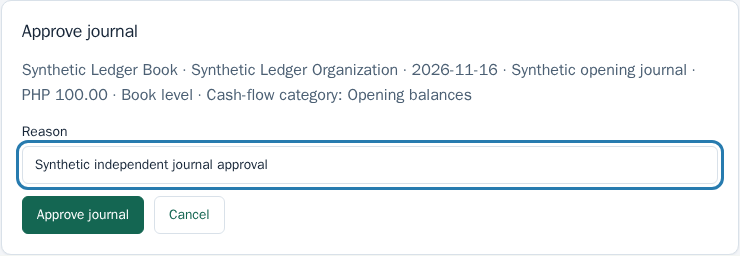
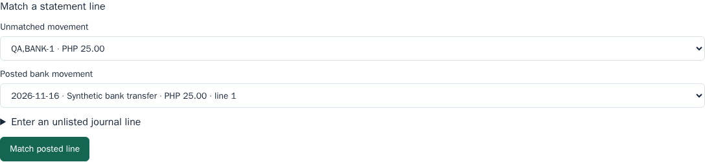
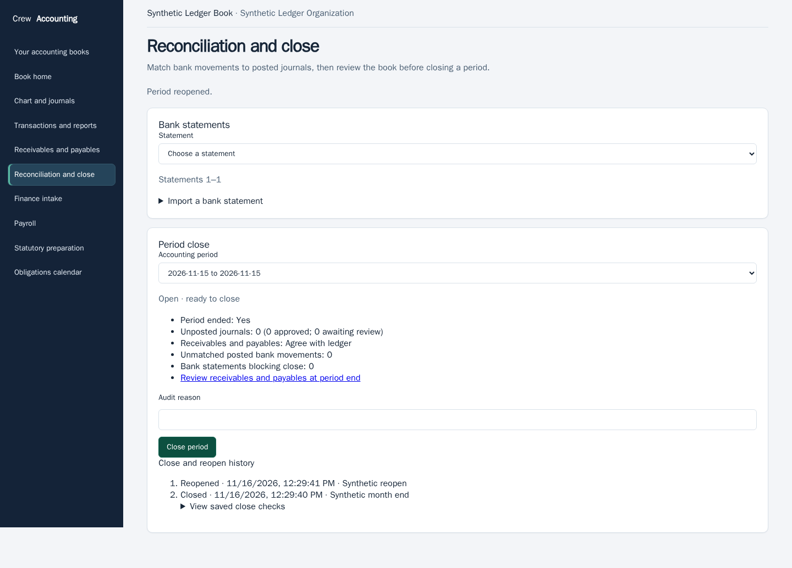
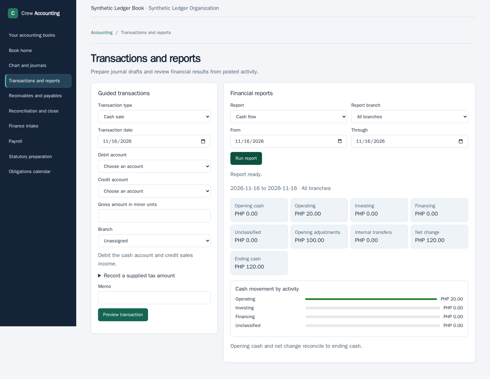

# Manual 08: Accounting, Invoicing & Journal Mapping

> **Navigation:** [Knowledge Base Home](../README.md) · [Master Index](../INDEX.md) · [Scheduling & HMO Operations](02-scheduling-and-hmo-operations.md) · [BI & Reports](06-reporting-and-analytics-guide.md) · [Finance Persona Guide](../personas/08-hmo-billing-and-finance-officer.md)

---

## 1. Scope of MH-Clinic Accounting & Financial Controls

MH-Clinic provides **clinic-grade financial operations, HMO/sponsor invoicing, journal account mapping, cancellation/refund governance, and AR/clinician payout reconciliation** tailored for Philippine multi-brand clinics (`MindWell.PH`, `Aventus`) while keeping non-billable institutional programs (`ABC Bank IHC`, `billing.operating_mode = 'in_house_non_billable'`) strictly isolated.

> [!NOTE]
> **ERP Boundary:** MH-Clinic manages operational billing, Statement of Account (SOA) cutoffs, Sales Invoice (SI) drafts, journal account mapping, and payout reconciliation. General-ledger tax filing and external payroll are exported via accounting reconciliation reports (`R28`) rather than replacing external ERP software.

| Capability | Primary Route / API | Primary Owner |
| :--- | :--- | :--- |
| **HMO Payer Review & Accounting** | `/admin/hmo-payer-review` | `BILLING` / `ADMIN` |
| **HMO Invoices & Journal Accounts** | `/api/admin/hmo-invoices`, `/api/admin/hmo-journal-accounts`, `/api/admin/hmo-invoice-document-terms` | `BILLING` / `ADMIN` |
| **Sponsor Invoicing** | `/admin/workflows` (`sponsor-invoice-editor`) | `BILLING` / `ADMIN` |
| **Staff Payments & POS** | `/staff/payments` | `FRONT_DESK` / `BILLING` |
| **Cancellations & Refunds** | `/admin/cancellation-refunds` | `BILLING` / `BRANCH_ADMIN` |
| **AR & Payout Reconciliation (`R28`)** | `/staff/reports/ar-payout-reconciliation` | `BILLING` / `ADMIN` |

---

## 2. HMO Payer Review, Statement Cutoffs & Invoicing (`/admin/hmo-payer-review`)

The Payer Review workspace (`payer-review-workspace`) coordinates the end-to-end financial lifecycle for institutional and HMO payors:

### 2.1 Key Sub-Modules in `/admin/hmo-payer-review`
1. **Statement Cutoff (`statement-cutoff`):** Groups eligible, clinician-signed encounters by billing period and payor cutoff date.
2. **Commercial Terms (`commercial-terms`) & Document Terms (`invoice-document-terms`):** Applies contracted HMO tariffs, volume pricing (`volume-invoice-preview`), payment terms, and invoice footer/tax disclosures.
3. **Invoice Draft (`invoice-draft`):** Generates structured Statement of Account (`SOA`) / Sales Invoice (`SI`) drafts before final posting.
4. **Journal Account Mapping (`/api/admin/hmo-journal-accounts`):** Maps revenue, HMO receivable, withholding tax (`BIR 2307`), and discount lines to standardized chart-of-accounts codes.
5. **Remittance Evidence (`remittance-evidence`):** Attaches payor remittance advices and `BIR Form 2307` creditable withholding tax certificates to close open receivables.
6. **Accounting Status & Saved Statements (`accounting-status`, `saved-statements`):** Tracks posting state (`DRAFT` → `ISSUED` → `PARTIALLY_PAID` → `RECONCILED`) with immutable audit history.

---

## 3. Self-Pay POS, Senior/PWD Discounts & Refunds

### 3.1 Point-of-Sale Collections (`/staff/payments`)
- Collects self-pay consultation, assessment, and co-pay balances (`CASH`, `CARD`, `GCASH/MAYA`, `BANK_TRANSFER`).
- Enforces **Senior Citizen (`RA 9994`)** and **PWD (`RA 10754`)** statutory calculations: **12% VAT removal + 20% discount** on eligible services.

### 3.2 Cancellation & Refund Governance (`/admin/cancellation-refunds`)
- **Cancellation Financial Manager:** Applies branch policy windows for late cancellations and no-shows.
- **Refund Funding Review:** Requires documented reason codes and supervisor/finance dual-approval before releasing refunds or credit memos.

---

## 4. AR Aging & Clinician Payout Reconciliation (`R28`)

Open **`/staff/reports/ar-payout-reconciliation`** (Turnkey Report **`R28`**) to reconcile:
- **Accounts Receivable Aging:** `0–30`, `31–60`, `61–90`, and `90+` day buckets across Self-Pay, HMO, and Corporate Sponsor accounts.
- **Clinician Payouts:** Matches collected/settled encounters against clinician revenue-share or per-session fee schedules.
- **Accounting Export:** Produces clean, auditable period summaries for external bookkeeping and tax reconciliation.

## 5. Connected Accounting examples

These captures show the separate Accounting workspace, not the Clinic payer desk or a live journal.

### Configure book settings and currency

*Synthetic operator-training capture, November 2026. Confirm base currency (`PHP`), time zone (`Asia/Manila`), and books start date before posting opening balances.*

### Validate opening rows and reconcile posted opening balances

*Synthetic operator-training capture, November 2026. Read the row checks and totals before deciding whether to save as an opening draft. Validation does not save or post a journal.*

*Synthetic operator-training capture, November 2026. Independent sign-off verifies zero differences between the source workbook and posted opening entries.*

### Review a journal before approval

*Synthetic operator-training capture, November 2026. The assigned approver checks the book, date, amount and reason. This dialog shows the review before approval, not a posted entry.*

### Match bank statements, check period close readiness, and review cash flow

*Synthetic operator-training capture, November 2026. Pair each bank statement movement with its exact posted ledger entry before running period-close checks.*

*Synthetic operator-training capture, November 2026. Verify zero unposted journals and zero unmatched bank movements before closing an accounting period.*

*Synthetic operator-training capture, November 2026. Confirm the book, date window, and branch filter when reviewing operating cash movement and ending balances.*
