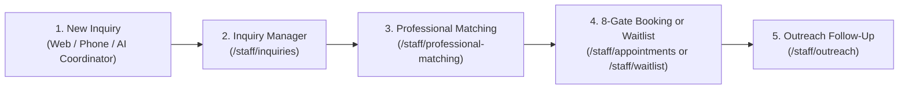
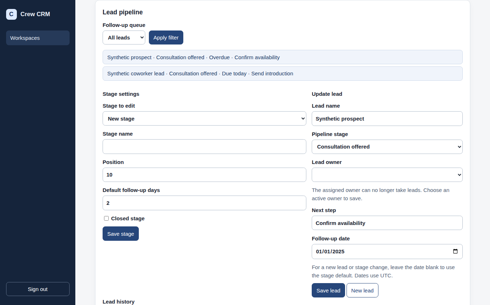
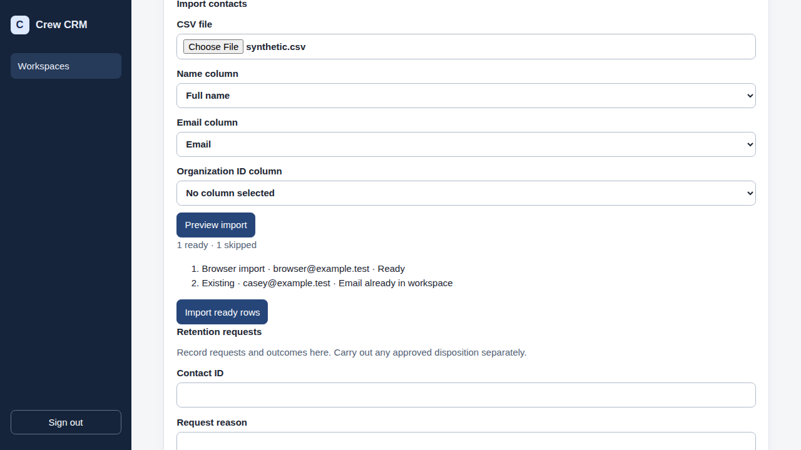

# Manual 09: CRM, Inquiries, Outreach & Corporate Events

> **Navigation:** [Knowledge Base Home](../README.md) · [Master Index](../INDEX.md) · [Scheduling & HMO Operations](02-scheduling-and-hmo-operations.md) · [Front-Desk Guide](../personas/02-front-desk-coordinator.md) · [Case Manager Guide](../personas/07-case-manager-and-safety-responder.md) · [Glossary](../GLOSSARY.md)

---

## 1. Scope of MH-Clinic CRM & Outreach

MH-Clinic includes built-in **front-of-funnel inquiry management, clinician matching, waitlist/outreach queues, and corporate event intake** so prospective clients and institutional partners convert smoothly into booked care without external spreadsheets.

| Module | Primary Route | Primary Owners |
| :--- | :--- | :--- |
| **Inquiry & Lead Queue** | `/staff/inquiries` | `FRONT_DESK` / `COORDINATOR` |
| **Professional Matching** | `/staff/professional-matching` | `FRONT_DESK` / `CASE_MANAGER` |
| **Outreach & Follow-Up Queue** | `/staff/outreach` | `FRONT_DESK` / `CASE_MANAGER` |
| **Waitlist Backfill (`WP-17`)** | `/staff/waitlist` | `FRONT_DESK` |
| **Corporate Events & Group Intake** | `/staff/corporate-events` | `COORDINATOR` / `IHC_SPECIALIST` |
| **AI Virtual Care Coordinator (`WP-32`)** | `/staff/ai-coordinator` | `COORDINATOR` / `STAFF` |

---

## 2. Inquiry-to-Appointment Pipeline (`/staff/inquiries`)

1. **Capture & Triage (`/staff/inquiries`):**
   - Incoming leads from brand landing pages, phone intake, or the `WP-32` AI Coordinator land in the **Inquiry Manager**.
   - Staff record preferred branch, modality (`IN_PERSON` / `TELEHEALTH`), payor type (`SELF_PAY` / `HMO` / `SPONSOR`), and urgency.
2. **Clinician Matching (`/staff/professional-matching`):**
   - Filters available clinicians by **Specialty Track** (`MD`, `RPsy`, `RPm`, `RND`, `CMA`, `IHC`), language, credential gate, and next open slot.
3. **Conversion or Waitlist:**
   - Book directly through the **8-Gate Simulator** or place the prospect onto the ranked **Waitlist (`/staff/waitlist`)** for automated cancellation backfill.

### Working the connected CRM lead pipeline and contact import

*Synthetic operator-training capture, November 2026. Review overdue leads and reassign any inactive lead owner before saving stage or follow-up updates.*

*Synthetic operator-training capture, November 2026. Preview CSV contact imports first so duplicate workspace emails are skipped cleanly before importing ready rows.*

---

## 3. Proactive Outreach Queue (`/staff/outreach`)

The **Outreach** workspace consolidates outbound follow-up tasks across operational and clinical teams:
- **Intake & No-Show Recovery:** Re-engages prospective clients who dropped off before completing consent or missed an initial consultation.
- **High-Risk Safety Outreach (`WP-18`):** Prioritizes outreach requests for clients with `Moderate`/`High` `C-SSRS` flags, logging every attempt (`PHONE`, `SMS`, `PORTAL`) with SLA timestamps.
- **Open Requests (`/staff/outreach`):** Surfaces unassigned or overdue follow-up items for shift handover.

---

### Confirm a connected CRM follow-up is closed

*Synthetic operator-training capture, November 2026. In the connected CRM workspace, check both **Client reached** and **Closed** after recording the outcome. Closing the follow-up is not the same as confirming the appointment in Clinic.*

## 4. Corporate Events & Institutional Campaigns (`/staff/corporate-events`)

Used for wellness talks, screening drives, and sponsored organizational events:
1. **Event Configuration (`corporate-event-editor`):** Define event title, sponsor/brand, date, branch or virtual format, and capacity.
2. **Check-In Links (`check-in-link-editor`):** Generate dedicated event check-in links for fast attendee registration without manual front-desk data entry.
3. **Sponsor Charge Mapping (`corporate-event-charge-editor`):** Attach commercial event fees for sponsor invoicing when running billable corporate programs (while keeping non-billable `ABC Bank IHC` events at zero charge).

---

## 5. Privacy & Compliance Guardrails (`RA 10173`)
- **Minimal Intake Data:** Inquiry records store contact and scheduling preferences only — **never** full clinical histories before informed consent is signed.
- **Zero-PII Helpline Separation:** Anonymous `/helpline` callers (`ANON-xxxx`) are **never** pushed into `/staff/inquiries` unless the caller explicitly opts in to a warm clinic referral.
