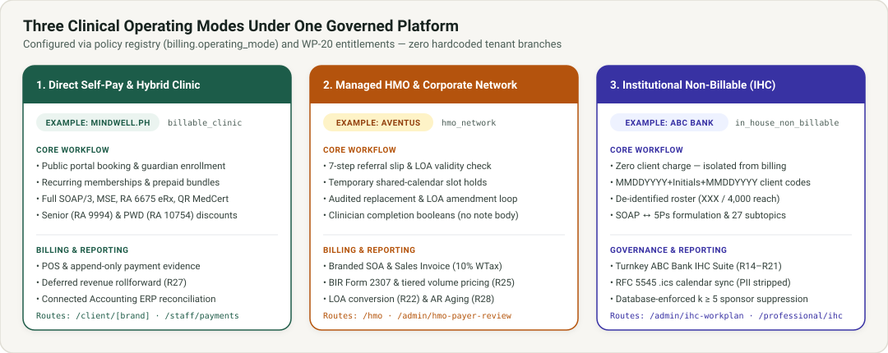
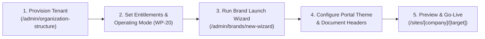
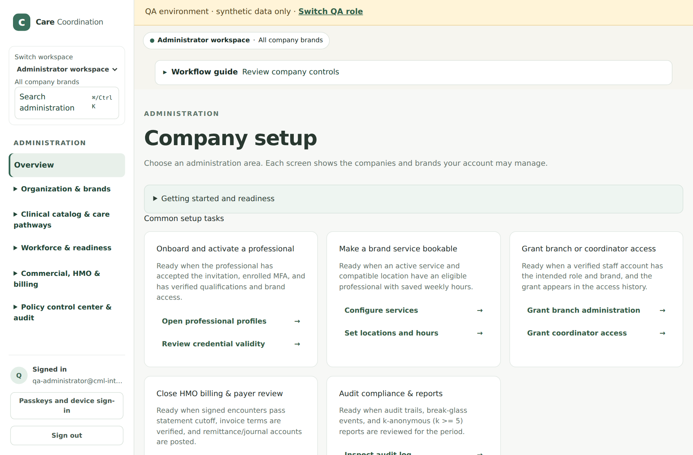
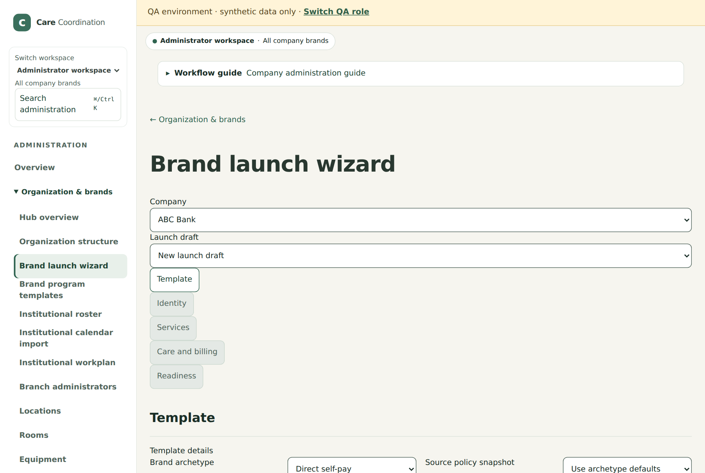
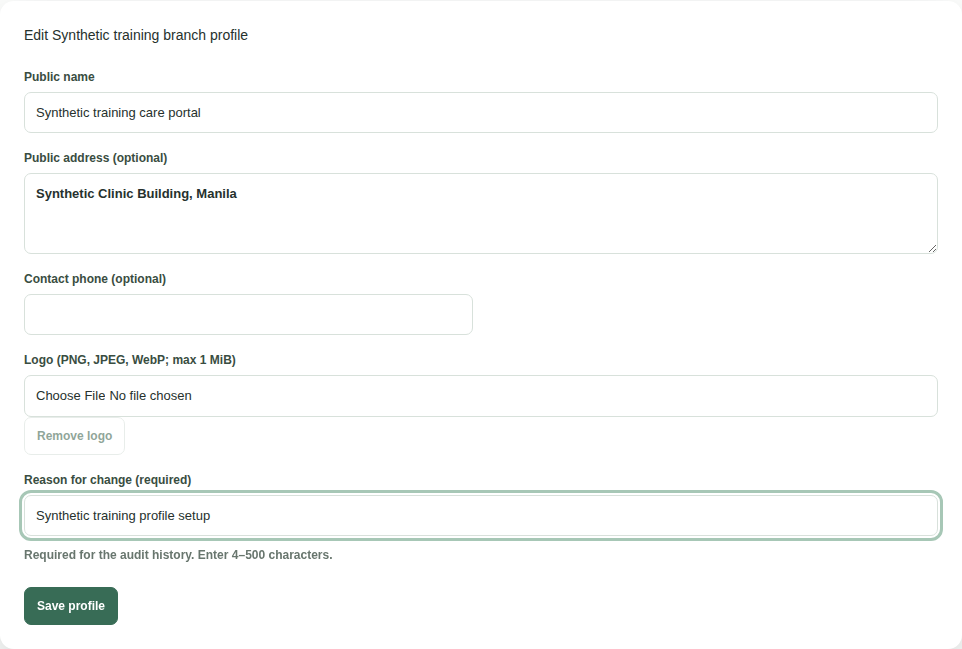
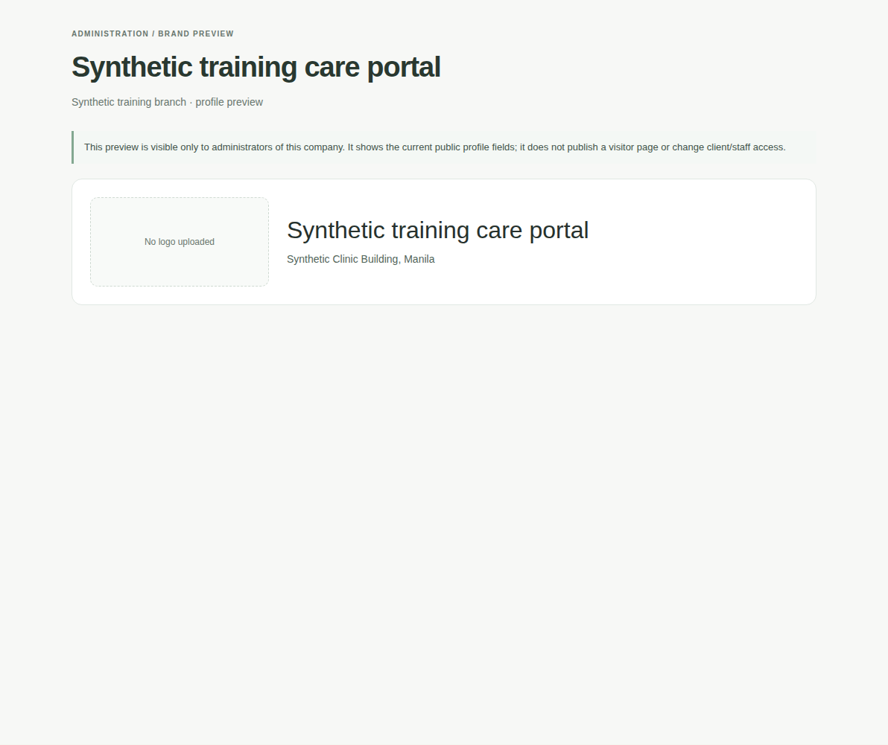
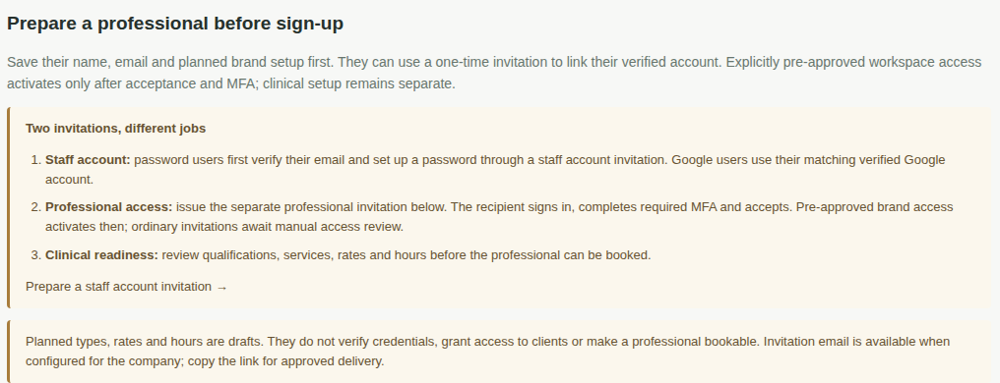
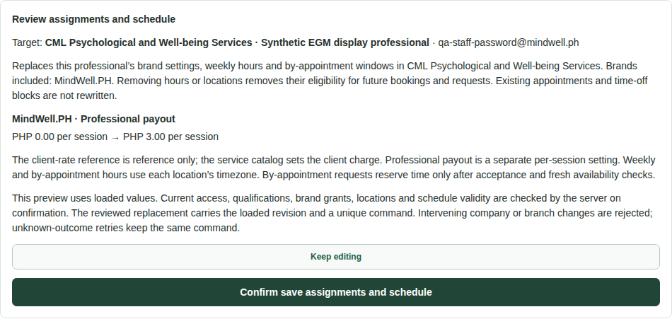

# Manual 10: SaaS Clients, Multi-Tenancy & Brand Onboarding

> **Navigation:** [Knowledge Base Home](../README.md) · [Master Index](../INDEX.md) · [Developer Deck](../decks/02-engineering-and-developer-deck.md) · [Executive Deck](../decks/01-executive-introduction-deck.md) · [Admin Guide](../personas/01-company-and-branch-administrator.md) · [Glossary](../GLOSSARY.md)
>
> **Doc ID:** `MHD-MAN-10` · **Type:** Reference · **Audience:** All roles; see the persona guides for task paths · **Revised:** 25 November 2026 · All examples use synthetic data.

---

## 1. Multi-Tenant SaaS Architecture (`WP-18`, `WP-20`)

MH-Clinic operates as a **multi-tenant, white-label SaaS platform** where independent clinics, HMO-affiliated networks, and institutional EAP programs run on shared infrastructure with strict **PostgreSQL Row-Level Security (`RLS`)** tenant isolation (`company_id`).

| Layer | Purpose | Key Routes / APIs |
| :--- | :--- | :--- |
| **Platform Tenant Console** | Provision and manage SaaS client organizations & entitlements | `/admin/organization-structure`, `/admin/configuration/subscription`, `/admin/company-admins`, `/api/platform/company-admins` |
| **Brand Launch Wizard** | Guided setup for a new clinic brand, branches, and defaults | `/admin/brands/new-wizard`, `/api/admin/brand-launch` |
| **Brand Portals & Themes** | White-label portal theming, logos, and PDF document headers | `/admin/brand-portals`, `/admin/brand-portals/preview/[companyId]/[brandId]`, `/api/public/brand-logo/[brand]` |
| **Brand Programs** | Configure clinical programs & operating modes per tenant | `/admin/brand-programs`, `/api/admin/brand-programs` |
| **Public Tenant Sites** | Branded public landing pages & self-service entrypoints | `/sites/[company]/[target]`, `/client/[brand]` |

---

## 2. SaaS Client Operating Modes & Entitlements (`WP-20`)

Each SaaS client tenant is provisioned with explicit **feature entitlements** and an **operating mode**:

| Operating Mode | Typical Tenant | Billing & Invoicing | Key Entitlements |
| :--- | :--- | :--- | :--- |
| **`billable_clinic`** | Private psychiatric/psychology clinic (e.g., `MindWell.PH`) | Full Self-Pay POS, Senior/PWD (`RA 9994`/`RA 10754`), HMO & SOA/SI invoicing | `eRx`, `MedCerts`, `DSM-5-TR`, `Telehealth`, `R01`–`R30` |
| **`hmo_network`** | HMO-integrated clinic partner (e.g., `Aventus`) | 7-Step HMO LOA intake, `BIR 2307` remittance, journal mapping | HMO Payer Review, Volume Invoicing, `R22`, `R28` |
| **`in_house_non_billable`** | Institutional / EAP program (e.g., `ABC Bank IHC`) | **Zero clinic billing**; isolated from Accounting/SOA | `IHC Today`, `SOAP <-> 5Ps`, 27 Subtopics, $k \ge 5$ Sponsor Portal |

### Entitlement-Gated Add-Ons
- **`helpline` (`WP-31`):** Enables the entitlement-gated `/helpline` zero-PII crisis desk (corporate passcode or blinded member token) and the `/staff/helpline-desk` responder console.
- **`learning_hub` (`WP-31`):** Enables `/learn` public psychoeducation hub & `/admin/learning-hub` CMS.
- **`ai_coordinator` (`WP-32`):** Enables `AG-UI 1.0` Virtual Care Coordinator & dual-consent Telehealth Ambient Scribe.
- **`semantic_discovery` (`WP-21`):** **OFF by default**; optional non-PHI discovery toggle per tenant.

---

## 3. Onboarding a New SaaS Client (`/admin/organization-structure` → `/admin/brands/new-wizard`)

1. **Tenant Provisioning (`/admin/organization-structure`):**
   - Create the SaaS client record, assign `company_id`, set operating mode (`billable_clinic`, `hmo_network`, or `in_house_non_billable`), and toggle entitled modules.
2. **Brand Launch Wizard (`/admin/brands/new-wizard`):**
   - Guided setup for initial branches, operating hours, service catalog templates, and initial `COMPANY_ADMIN` / `BRANCH_ADMIN` invitation.
3. **White-Label Portal & Document Headers (`/admin/brand-portals`):**
   - Upload tenant logo (`/api/public/brand-logo/[brand]`), configure colors/typography (`theme-editor`), and customize official PDF headers (`document-header-editor`) for `RA 6675` `eRx`, QR `MedCerts`, and Invoices.
   - Verify rendering in **`/admin/brand-portals/preview/[companyId]/[brandId]`** before publishing to `/sites/[company]/[target]`.
4. **Program & Policy Activation (`/admin/brand-programs`):**
   - Enable specialty tracks (`MD`, `RPsy`, `RPm`, `RND`, `CMA`, `IHC`), 6-layer booking policies, and $k$-anonymity ($k \ge 5$) sponsor reporting rules.

---

### Task-oriented Administrator Home & Brand Launch Wizard

*Synthetic administrator-training capture, November 2026. The task-oriented Administrator Home surfaces readiness checklists and quick links across all managed company brands.*

*Synthetic administrator-training capture, November 2026. Launch drafts move sequentially through Template, Identity, Services, Care and billing, and Readiness before going live.*

### Review and preview a brand profile before saving

*Synthetic administrator-training capture, November 2026. Verify the target branch, the intended public fields and the reason before saving. Saving this profile does not verify production routing or publish a site.*

*Synthetic administrator-training capture, November 2026. Use the administrator-only preview to confirm public profile fields before publishing.*

### Prepare professional access and review schedule assignments

*Synthetic administrator-training capture, November 2026. Account setup, access to a brand and readiness for bookings are separate checks. The screenshot shows guidance, not an invitation link or an active grant.*

*Synthetic administrator-training capture, November 2026. Schedule and payout updates show an explicit diff and enforce optimistic concurrency (`expectedRevision`) on confirmation.*

## 4. Tenant Isolation & Data Governance Guarantees
- **Database Isolation:** Every tenant-scoped table enforces PostgreSQL `RLS` keyed to `company_id`; cross-tenant queries are blocked at the database layer.
- **Separate Audit & Export Scopes:** `/admin/audit` and `/admin/compliance-exports` are strictly scoped to the active tenant (`RA 10173`).
- **Pre-Launch Verification:** Complete the [Content & Data Onboarding Checklist](../training/02-content-and-data-onboarding-checklist.md) and [Admin Training Curriculum](../training/03-admin-training-curriculum.md) before enabling live patient traffic for any new SaaS client.

---

← Previous: [Manual 09: CRM, Inquiries, Outreach & Corporate Events](09-crm-inquiries-and-outreach.md) · [Knowledge Base Home](../README.md) · [Getting Started](../GETTING_STARTED.md) · [FAQ](../FAQ.md) · Next: [Manual 11: System Configurations & Technical Reference](11-configurations-and-reference.md) →
