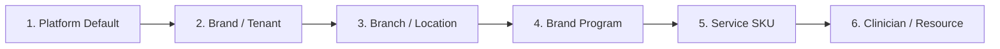

# Manual 11: System Configurations & Technical Reference

> **Navigation:** [Knowledge Base Home](../README.md) · [Master Index](../INDEX.md) · [Developer Deck](../decks/02-engineering-and-developer-deck.md) · [Admin Training](../training/03-admin-training-curriculum.md) · [Go-Live Checklist](../training/02-content-and-data-onboarding-checklist.md)

---

## 1. Configuration Hub (`/admin/configuration`)

The **Configuration Hub** (`/admin/configuration`) centralizes tenant-level policy registries, clinical catalogs, specialty protocols, and commercial/statutory rules without requiring code deployments.

### 1.1 Policy & Governance Configurations
| Sub-Module | Route | Purpose |
| :--- | :--- | :--- |
| **Policy Registry Editor** | `/admin/configuration` (`policy-registry-editor`) | Manages the 6-layer policy engine (booking windows, idle locks, `k`-anonymity thresholds, feature flags) |
| **Case Management** | `/admin/configuration/case-management` | Configures `MDT` escalation SLAs, `C-SSRS` follow-up intervals, and outreach rules |
| **Consultation Retention** | `/admin/configuration/consultation-retention` | Sets record retention schedules and archival windows under `RA 10173` |

### 1.2 Clinical, Formulary & Specialty Track Configurations
| Sub-Module | Route | Purpose |
| :--- | :--- | :--- |
| **Clinical Catalog** | `/admin/configuration/clinical-catalog` | Maps clinical service SKUs, durations, and credential gates |
| **Formulary** | `/admin/configuration/formulary` | Configures the 1-click PH Psychiatric Starter Formulary (`RA 6675` generic-first) |
| **Prescription Authority** | `/admin/configuration/prescription-authority` | Governs `PRC` / `PTR` / `S2` prescribing gates and clinical approval |
| **Neuro Diagnostics** | `/admin/configuration/neuro-diagnostics` | Neurology workup templates and diagnostic order sets (`MD`) |
| **Headache Instruments** | `/admin/configuration/headache-instruments` | Standardized headache/neurology screening instruments |
| **Nutrition-Medication Rules** | `/admin/configuration/nutrition-medication-rules` | Metabolic & drug-nutrient interaction alerts (`RND` + `MD`) |
| **Acupuncture Protocols** | `/admin/configuration/acupuncture-protocols` | Integrative `CMA` acupuncture protocol templates and safety checks |

### 1.3 Commercial, Statutory & Subscription Configurations
| Sub-Module | Route | Purpose |
| :--- | :--- | :--- |
| **Self-Pay Plans** | `/admin/configuration/self-pay-plans` | Cash/card installment and package pricing rules |
| **Prepaid Delivery** | `/admin/configuration/prepaid-delivery` | Session bundle tracking and redemption rules |
| **Statutory Sales** | `/admin/configuration/statutory-sales` | `RA 9994` (Senior Citizen) & `RA 10754` (PWD) 20% discount + 12% VAT-exempt rules |
| **Subscription** | `/admin/configuration/subscription` | Tenant SaaS subscription tier & `WP-20` entitlement bindings |

---

## 2. 6-Layer Policy Resolution Hierarchy

When evaluating any operational or clinical rule (such as booking lead time, telehealth eligibility, or cancellation fee), MH-Clinic resolves settings from most general to most specific:

- **Override Rule:** Lower-numbered layers provide safe defaults; higher-numbered layers override only explicitly declared keys, preserving auditability in `/admin/audit`.

---

## 3. Identifiers, Standards & Compliance Reference

### 3.1 Standardized Identifiers
| Identifier | Format / Mechanism | Where Used |
| :--- | :--- | :--- |
| **Anonymous Helpline ID** | `ANON-xxxx` (ephemeral, zero-PII) | `/helpline`, `/staff/helpline-desk` (`WP-31`) |
| **ADB IHC Case Key** | `MMDDYYYY+Initials+MMDDYYYY` | `/ihc/today`, `/admin/ihc-roster` (`WP-26`) |
| **Concurrency Token** | `expectedRevision` (Optimistic CAS) | Appointment, encounter, and policy mutations |
| **Verification Token** | Cryptographic QR URL (`/verify/document/[token]`) | `RA 6675` `eRx` and `MedCert` / `Fit-to-Work` |

### 3.2 Clinical & Technical Standards
| Standard | Scope | Reference Manual |
| :--- | :--- | :--- |
| **`MHCLINIC-SOAP/3`** | Structured clinical note with `SOAP <-> 5Ps` mapping | [Manual 03](03-clinical-workflows-and-prescribing.md) · [Manual 05](05-adb-ihc-and-case-management.md) |
| **14-Domain MSE** | Standardized Mental Status Examination | [Manual 03](03-clinical-workflows-and-prescribing.md) |
| **68 `DSM-5-TR` Measures** | APA Section III Cross-Cutting, Severity, WHODAS, PID-5, Pediatric | [Manual 04](04-assessments-and-specialty-tracks.md) |
| **`ICD-10-CM` & `ICD-11`** | Dual diagnostic coding | [Manual 03](03-clinical-workflows-and-prescribing.md) |
| **`C-SSRS` + 6-Step Safety Plan** | Suicide risk stratification & Stanley-Brown safety planning | [Manual 03](03-clinical-workflows-and-prescribing.md) |
| **`ADIME` + 6-Pillar Lifestyle Rx** | Nutrition Care Process & whole-person lifestyle medicine | [Manual 04](04-assessments-and-specialty-tracks.md) |
| **`AG-UI 1.0`** | Streaming protocol for AI Virtual Care Coordinator (`WP-32`) | [Manual 07](07-helpline-learning-hub-and-ai-coordinator.md) |

### 3.3 Philippine Regulatory Reference
| Law / Regulation | Core Mandate in MH-Clinic |
| :--- | :--- |
| **`RA 10173` (Data Privacy Act of 2012)** | DPIA alignment, PostgreSQL `RLS`, masked psychotherapy notes, `break_glass` audit, zero-PII helpline, $k \ge 5$ anonymity |
| **`RA 6675` (Generics Act of 1988) & DDB `S2`** | Mandatory generic-first `eRx` display + `PRC` / `PTR` / `S2` license gating |
| **`RA 10029` (Philippine Psychology Act of 2009)** | Dual `RPm` administration/scoring + `RPsy` interpretation/co-signature enforcement |
| **`RA 9994` & `RA 10754` (Senior Citizen & PWD)** | Automated 12% VAT exemption + 20% statutory discount on eligible services |
| **`BIR Form 2307`** | Creditable withholding tax evidence tracking on HMO/corporate remittances |

---

## 4. Glossary of Key Terms
- **8-Gate Simulator:** Pre-booking validator checking hours, shift, room, credential match, buffer, double-booking, HMO eligibility, and age/consent.
- **Break-Glass Access:** Audited emergency override for viewing restricted clinical records with mandatory reason code and DPO alert.
- **$k$-Anonymity ($k \ge 5$):** Automated suppression of any aggregate report cell representing fewer than 5 individuals.
- **`MDT` Hub:** Multidisciplinary Team coordination workspace connecting `MD`, `RPsy`, `RPm`, `IHC`, `RND`, and `CMA`.
- **`SOA` / `SI`:** Statement of Account and Sales Invoice generated during HMO/sponsor billing cutoffs.
