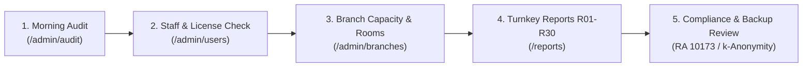
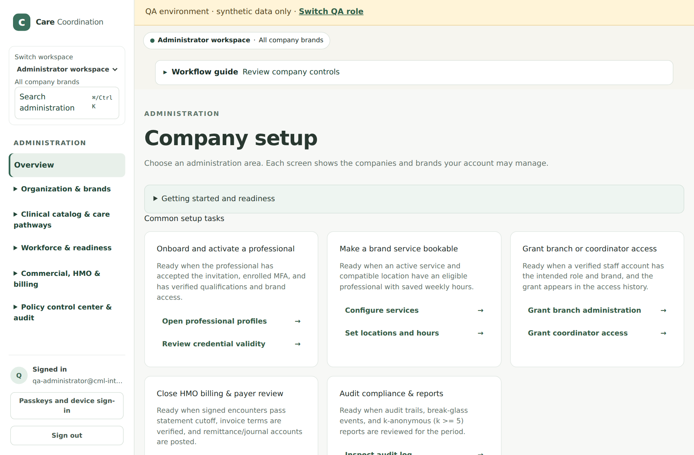
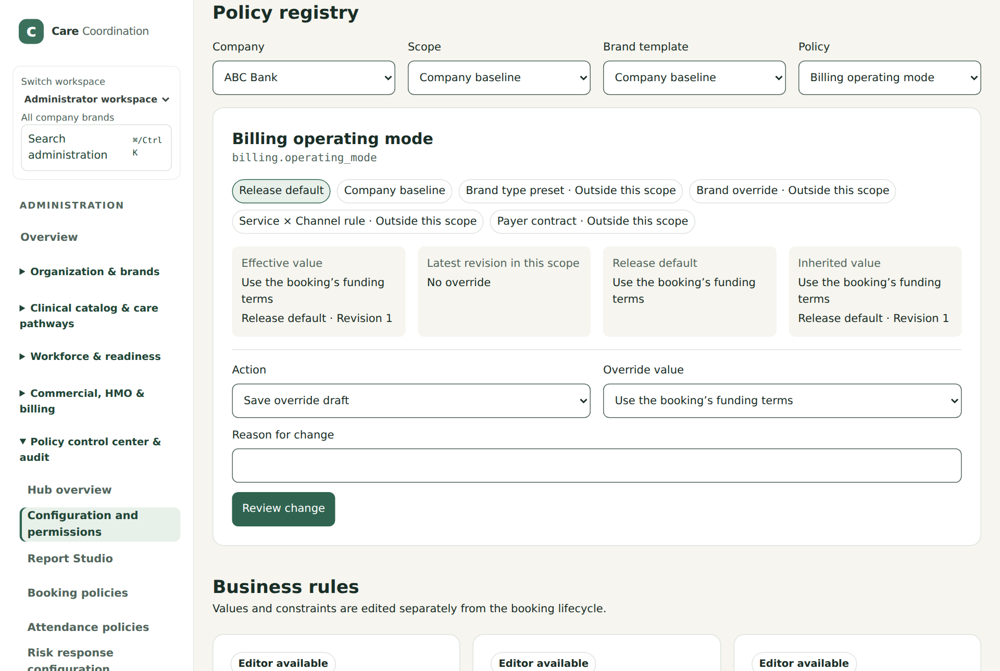
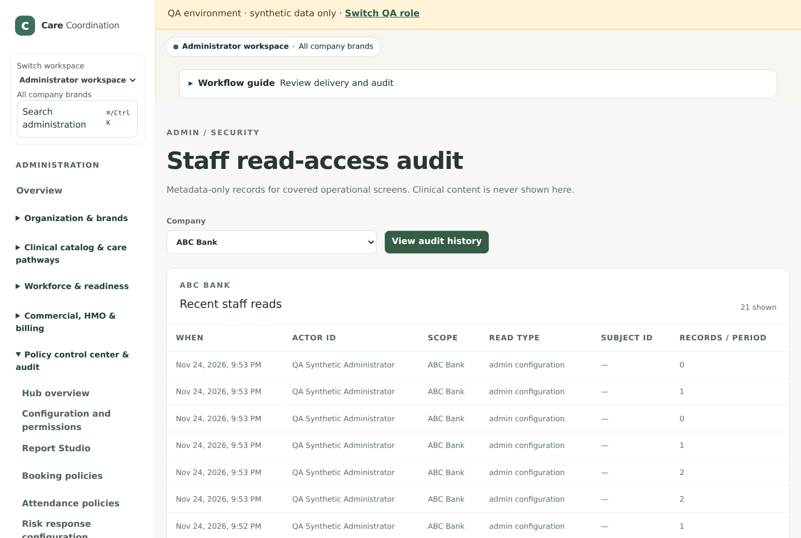

# Persona Guide 01: Company & Branch Administrator

> **Navigation:** [Knowledge Base Home](../README.md) · [Master Index](../INDEX.md) · [Getting Started & MFA](../manuals/01-getting-started-and-mfa.md) · [Reporting & Analytics](../manuals/06-reporting-and-analytics-guide.md) · [Onboarding Checklist](../training/02-content-and-data-onboarding-checklist.md)

---

## 1. Role Summary & Scope

The **Company & Branch Administrator** (`ADMIN` / `BRANCH_ADMIN`) governs tenant-wide configuration, multi-branch operations, role-based access control (`RBAC`), compliance auditing, and operational analytics across MH-Clinic.

| Dimension | Details |
| :--- | :--- |
| **Primary Workspaces** | `/admin`, `/admin/users`, `/admin/branches`, `/admin/catalog`, `/admin/audit`, `/reports`, `/reports/studio` |
| **Core Work Packages** | `WP-01` Auth & RBAC, `WP-02` Multi-Branch Org, `WP-04` Catalog & Pricing, `WP-22` Audit & RA 10173, `WP-23` Report Studio |
| **MFA & Session Policy** | Mandatory TOTP or Passkey MFA (`WP-01`); 15-minute idle lock; 12-hour absolute session |
| **Data Visibility** | Full tenant or branch-scoped administrative configuration; masked clinical notes unless explicitly granted `break_glass` with audit justification |

---

## 2. Daily & Weekly Operational Cadence

### Daily Checks
1. **Security & Audit Log Triage (`/admin/audit`)**
   - Review failed MFA attempts, role escalations, and any `break_glass` chart access events.
   - Confirm zero unauthorized cross-branch queries.
2. **Staff Provisioning & PRC License Validity (`/admin/users`)**
   - Approve pending clinician onboarding requests.
   - Verify active `PRC` / `PTR` / `S2` numbers for prescribing MDs (`WP-10`) and `RPsy` / `RPm` registrations (`WP-07`).

### Weekly Governance
1. **Service Catalog & Tariff Updates (`/admin/catalog`)**
   - Maintain consultation SKU pricing, HMO package mappings (`WP-05`), and Senior Citizen / PWD (`RA 9994` / `RA 10754`) 20% discount + VAT-exempt rules.
2. **Executive KPI Review (`/reports`)**
   - Run `R01`–`R05` (Utilization, No-Show Rate, Clinician Load) and `R11`–`R15` (Revenue, HMO Aging, Discount Mix).
   - Verify `WP-23` $k$-anonymity thresholds ($k \ge 5$) remain enforced on all sponsor-facing and HR exports.

---

## 3. Core Workflows

### 3.1 Provisioning a New User & Assigning Least-Privilege Roles
1. Navigate to **`/admin/users`** and click **Invite Staff Member**.
2. Enter synthetic/work email (`clinician@example.test`), full name, and assigned **Branch(es)**.
3. Select the exact functional role (`FRONT_DESK`, `PSYCHIATRIST`, `PSYCHOLOGIST`, `PSYCHOMETRICIAN`, `COUNSELOR`, `CASE_MANAGER`, `BILLING`, `BRANCH_ADMIN`).
4. For clinicians, attach **PRC License Number**, **Expiration Date**, and **Specialty Track** (`MD`, `RPsy`, `RPm`, `RND`, `CMA`).
5. Save; the user receives an onboarding link requiring **mandatory MFA enrollment** on first sign-in.

### 3.2 Configuring a New Clinic Branch & Telehealth Rooms
1. Open **`/admin/branches`** → **Add Branch**.
2. Configure timezone (`Asia/Manila`), operating hours, physical consultation rooms, and virtual telehealth room pools.
3. Map which service SKUs and HMO payors are active at the branch.
4. Run the **8-Gate Scheduling Simulator** ([Manual 02](../manuals/02-scheduling-and-hmo-operations.md)) to verify slot availability before opening booking.

### 3.3 Managing Break-Glass Access & RA 10173 Compliance
- Clinical records are protected by **RA 10173 (Data Privacy Act of 2012)**.
- Administrators **cannot** silently read psychotherapy or psychiatric notes; any emergency override requires a documented reason code (`EMERGENCY_SAFETY`, `LEGAL_SUBPOENA`, `QUALITY_AUDIT`) and triggers an immutable audit entry plus DPO notification.

### 3.4 Publishing Turnkey & Custom Reports
1. Open **`/reports`** to run any of the **30 Turnkey Reports (`R01`–`R30`)** ([Manual 06](../manuals/06-reporting-and-analytics-guide.md)).
2. Open **`/reports/studio`** to build custom cohort or operational queries using the **No-Code Report Studio** (`WP-23`).
3. When sharing aggregate outcomes with corporate sponsors or HR (`WP-20`), enforce **minimum cell size $k \ge 5$** so no individual client can be re-identified.

---

## 4. Visual Workspace Reference

*Synthetic administrator-training capture, November 2026. The task-oriented Administrator Home links directly to professional onboarding, service configuration, access grants, HMO review, and compliance audits.*

*Synthetic administrator-training capture, November 2026. Policy overrides track effective scope, revision, and required reason before review.*

*Synthetic administrator-training capture, November 2026. Read-access audits log actor, scope, and read type without exposing clinical note content.*

---

## 5. Guardrails & Escalation Matrix

| Scenario | Required Action | Reference |
| :--- | :--- | :--- |
| Clinician PRC license expired | System blocks eRx/signing; suspend prescribing privileges until renewed | [Manual 03](../manuals/03-clinical-workflows-and-prescribing.md) |
| Suspected unauthorized export | Revoke session tokens in `/admin/users`, export `/admin/audit` trail, notify DPO | [Manual 01](../manuals/01-getting-started-and-mfa.md) |
| Report cell count $< 5$ for sponsor | Suppress small cells automatically via $k$-anonymity policy | [Manual 06](../manuals/06-reporting-and-analytics-guide.md) |
| Helpline L1 crisis escalation | Coordinate with Case Manager & Safety Responder; do not alter raw helpline logs | [Manual 07](../manuals/07-helpline-learning-hub-and-ai-coordinator.md) |

---

## 6. Practice & Verification
- Complete the full [Company & Branch Administrator Training Curriculum](../training/03-admin-training-curriculum.md).
- Complete **Lab 01** in [Role Exercises & Labs](../training/01-role-exercises-and-labs.md).
- Verify go-live readiness using the [Content & Data Onboarding Checklist](../training/02-content-and-data-onboarding-checklist.md).
