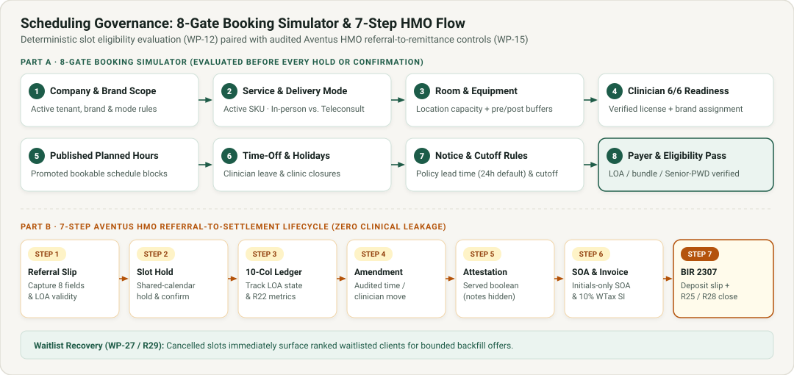
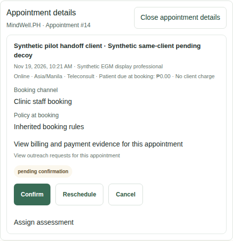
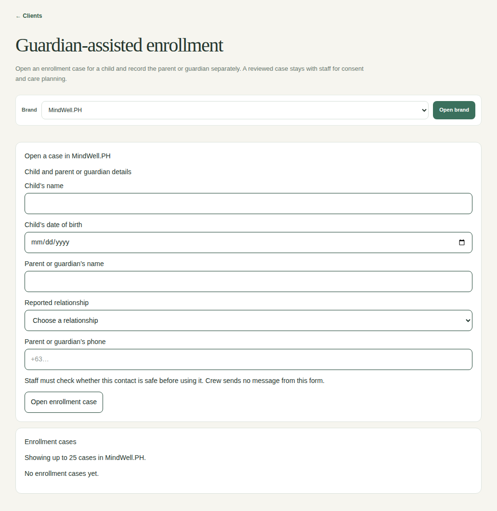
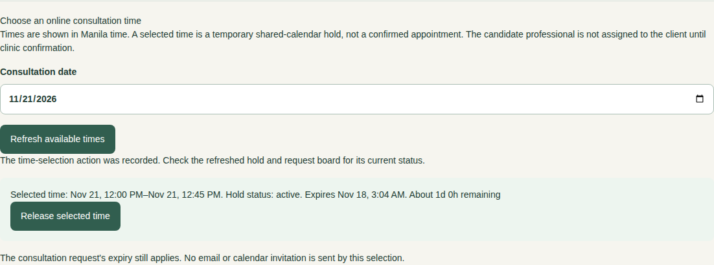

# Persona Guide 02: Front Desk Coordinator

> **Navigation:** [Knowledge Base Home](../README.md) · [Master Index](../INDEX.md) · [Scheduling & HMO Operations](../manuals/02-scheduling-and-hmo-operations.md) · [Role Exercises & Labs](../training/01-role-exercises-and-labs.md) · [Glossary](../GLOSSARY.md)

---

## 1. Role Summary & Scope

The **Front Desk Coordinator** (`FRONT_DESK`) is the operational hub for patient intake, appointment scheduling, waitlist backfill, arrival check-in, HMO eligibility verification, and checkout coordination.

| Dimension | Details |
| :--- | :--- |
| **Primary Workspaces** | `/staff/appointments`, `/staff/waitlist`, `/staff/clients`, `/staff/clients`, `/staff/appointments`, `/staff/payments` |
| **Core Work Packages** | `WP-03` Scheduling & 8-Gate Engine, `WP-05` Aventus HMO Workflow, `WP-06` Self-Pay & Senior/PWD, `WP-17` Waitlist Backfill |
| **MFA & Session Policy** | Mandatory MFA; 15-minute idle timeout at shared reception workstations |
| **Data Visibility** | Demographics, appointments, billing/HMO status, consent status; **no access** to clinical SOAP notes or sensitive psychotherapy details |

---

## 2. Core Workflows

### 2.1 Booking an Appointment Through the 8-Gate Engine
1. Open **`/staff/appointments`** and click **New Appointment**.
2. Select **Patient** (or create a synthetic/new intake record at `/staff/clients` with Consent to Care + RA 10173 Privacy Notice).
3. Choose **Branch**, **Service SKU**, **Clinician**, and **Modality** (`IN_PERSON` or `TELEHEALTH`).
4. The **8-Gate Simulator** validates:
   1. Branch operating hours
   2. Clinician shift & leave calendar
   3. Room / telehealth license capacity
   4. Service-to-clinician credential match
   5. Buffer & turnover time
   6. Existing patient double-booking guard
   7. Payor / HMO branch eligibility
   8. Age / guardian consent requirement
5. Confirm booking; the system dispatches appointment confirmation and telehealth link (if virtual).

### 2.2 Managing Waitlist & Same-Day Backfill (`WP-17`)
1. When a patient cancels, open **`/staff/waitlist`**.
2. Filter ranked waitlist candidates matching **Service SKU**, **Clinician/Specialty**, and **Modality**.
3. Click **Offer Slot** to send an automated time-bounded backfill offer.
4. Once accepted, the slot converts to `CONFIRMED` without manual double-entry.

### 2.3 Executing the 7-Step Aventus HMO Intake (`WP-05`)
1. Verify **Member ID** and **Active Coverage** against Aventus eligibility rules.
2. Check **Consultation Cap / Benefit Limit** for Mental Health or Specialty visits.
3. Capture **LOA (Letter of Authorization)** reference number and expiration date.
4. Attach LOA scan/reference to the appointment record.
5. Collect any **co-pay / excess** if applicable.
6. Mark appointment **HMO Verified** before check-in.
7. Trigger claim-ready handoff to Billing upon clinician encounter sign-off.

### 2.4 Check-In, Senior/PWD Verification & Checkout
1. At arrival, verify identity (2 identifiers: Full Name + Date of Birth).
2. Confirm **Informed Consent** and **RA 10173 Privacy Consent** are signed.
3. If applying **Senior Citizen (`RA 9994`)** or **PWD (`RA 10754`)** benefits, record the ID number and expiration so Billing applies the **20% discount + VAT exemption**.
4. Transition status to `CHECKED_IN` to notify the clinician's queue.

---

## 3. Visual Workspace Reference

*Synthetic operator-training capture, November 2026. Check the brand, booking channel, and payment status before confirming or rescheduling.*

*Synthetic operator-training capture, November 2026. Record child and guardian details separately and confirm safe contact before messaging.*

*Synthetic payer-training capture, November 2026. A held time remains provisional until confirmed by clinic staff.*

---

## 4. Do's and Don'ts at Reception

| Do | Don't |
| :--- | :--- |
| Use two patient identifiers before confirming details | Discuss diagnosis or clinical notes aloud at the counter |
| Verify LOA before transitioning HMO visits to `CHECKED_IN` | Override 8-Gate credential blocks without Supervisor approval |
| Lock workstation (`Ctrl+L` / app lock) when stepping away | Share MFA tokens or stay logged in across shift handovers |

---

## 5. Practice & Verification
- Complete **Lab 02** in [Role Exercises & Labs](../training/01-role-exercises-and-labs.md).
- Review full scheduling rules in [Manual 02: Scheduling & HMO Operations](../manuals/02-scheduling-and-hmo-operations.md).
