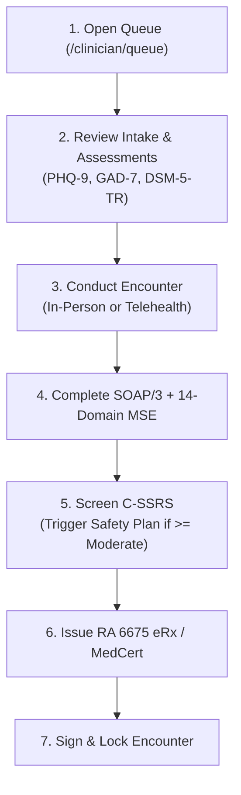

# Persona Guide 03: Psychiatrist & Prescriber

> **Navigation:** [Knowledge Base Home](../README.md) · [Master Index](../INDEX.md) · [Clinical Workflows & Prescribing](../manuals/03-clinical-workflows-and-prescribing.md) · [Role Exercises & Labs](../training/01-role-exercises-and-labs.md)

---

## 1. Role Summary & Scope

The **Psychiatrist & Prescriber** (`PSYCHIATRIST` / `MD`) conducts psychiatric evaluations, formulates diagnoses (`ICD-10-CM` / `ICD-11`), authors `MHCLINIC-SOAP/3` clinical notes, manages `C-SSRS` suicide risk & safety plans, issues **RA 6675-compliant electronic prescriptions (`eRx`)**, and signs QR-verifiable Medical Certificates.

| Dimension | Details |
| :--- | :--- |
| **Primary Workspaces** | `/clinician/queue`, `/encounters/[id]`, `/erx`, `/medcerts`, `/telehealth/[id]` |
| **Core Work Packages** | `WP-08` SOAP/3 & 14-Domain MSE, `WP-09` C-SSRS & Safety Plans, `WP-10` RA 6675 eRx & Formulary, `WP-11` QR MedCerts, `WP-32` Ambient Scribe |
| **Credential Gate** | Active **PRC License** + **PTR** (and **S2** when prescribing regulated psychotropics) |
| **Data Visibility** | Full clinical chart for assigned patients; cross-disciplinary MDT notes (`RPsy`, `RPm`, `RND`, `CMA`) |

---

## 2. Encounter Workflow (`MHCLINIC-SOAP/3`)

### 2.1 Clinical Documentation (`WP-08`)
1. Open the encounter from **`/clinician/queue`**.
2. Review pre-visit **DSM-5-TR** / **PHQ-9** / **GAD-7** scores and prior medication history.
3. Document **Subjective**, **Objective** (including the structured **14-Domain Mental Status Exam**), **Assessment** (`ICD-10-CM` / `ICD-11` primary + secondary codes), and **Plan**.
4. For telehealth visits, optionally enable **`WP-32` Ambient Scribe** with explicit patient consent; always review and edit the generated draft before signing.

### 2.2 Suicide Risk Screening & Safety Planning (`WP-09`)
- Complete **`C-SSRS`** screening on every initial psychiatric intake and whenever clinical risk indicators change.
- If risk is **Moderate** or **High**:
  1. Complete the structured **6-Step Stanley-Brown Safety Plan** inside the encounter.
  2. Flag the chart for **Case Manager / Safety Responder** follow-up (`WP-18`).
  3. Document crisis contacts and next-check-in interval before closing the encounter.

### 2.3 RA 6675 Electronic Prescribing (`WP-10`)
MH-Clinic enforces the **Generics Act of 1988 (`RA 6675`)** on every prescription:
1. Open the **eRx Drawer** inside `/encounters/[id]`.
2. Select from the **1-Click Starter Formulary** (pre-configured common psychiatric regimens with standard titrations) or search the generic drug catalog.
3. Verify **Generic Name** (mandatory and prominent), optional brand name, dosage, frequency, duration, and quantity.
4. Check automated **Drug-Allergy** and **Duplicate Therapy** alerts.
5. Sign with your verified **PRC / PTR / S2** credential block to generate a tamper-evident PDF/QR prescription.

### 2.4 QR-Verifiable Medical Certificates (`WP-11`)
1. From `/encounters/[id]`, click **Issue MedCert**.
2. Choose template (`FIT_TO_WORK`, `FIT_TO_STUDY`, `MEDICAL_LEAVE`, `CLINICAL_SUMMARY`).
3. Confirm diagnosis disclosure preference (masked vs. explicit per patient RA 10173 consent).
4. Sign to embed a cryptographic **QR Verification Code** allowing employers or schools to verify authenticity without exposing private chart notes.

---

## 3. Guardrails & Compliance
- **Unsigned Encounters:** Encounters remain in `DRAFT` until signed; unattested notes block final HMO claim submission.
- **Controlled Substances:** S2 license number and validity date are checked at signing time for regulated medications.
- **Addenda:** Once signed, notes are immutable; post-sign corrections must be entered as timestamped **Addenda**.

---

## 4. Practice & Verification
- Complete **Lab 03** in [Role Exercises & Labs](../training/01-role-exercises-and-labs.md).
- Review full details in [Manual 03: Clinical Workflows & Prescribing](../manuals/03-clinical-workflows-and-prescribing.md).
