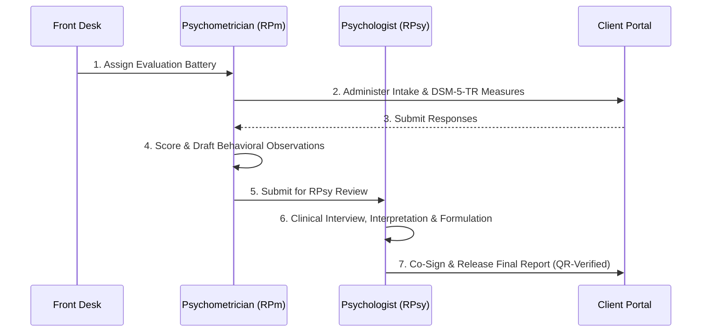
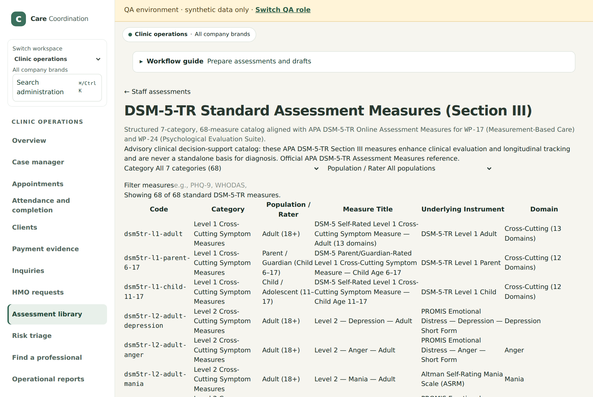
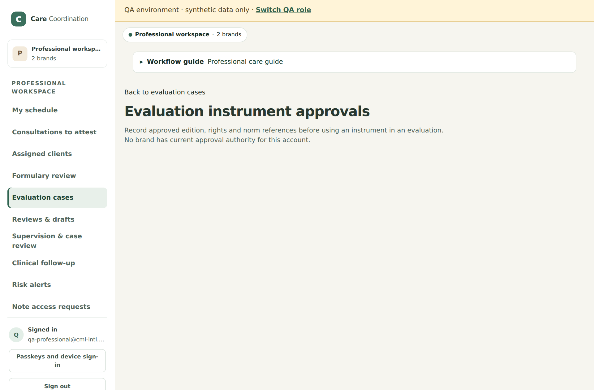
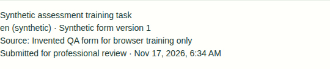

# Persona Guide 04: Psychologist & Psychometrician

> **Navigation:** [Knowledge Base Home](../README.md) · [Master Index](../INDEX.md) · [Assessments & Specialty Tracks](../manuals/04-assessments-and-specialty-tracks.md) · [Role Exercises & Labs](../training/01-role-exercises-and-labs.md)

---

## 1. Role Summary & Scope

This guide covers the **Registered Psychologist (`RPsy`)** and **Registered Psychometrician (`RPm`)** under **RA 10029 (Philippine Psychology Act of 2009)**. MH-Clinic enforces dual-role boundaries: `RPm` clinicians administer and score standardized instruments, while `RPsy` clinicians conduct psychotherapy, interpret psychological batteries, and co-sign final psychological evaluation reports.

| Dimension | `RPm` (Psychometrician) | `RPsy` (Psychologist) |
| :--- | :--- | :--- |
| **Primary Workspaces** | `/assessments`, `/assessments/catalog`, `/evaluations` | `/encounters/[id]`, `/assessments`, `/evaluations`, `/therapy` |
| **Core Work Packages** | `WP-07` Dual RPm+RPsy Evals, `WP-12` 68 DSM-5-TR Measures | `WP-07` Dual RPm+RPsy Evals, `WP-08` SOAP/3, `WP-12` 68 DSM-5-TR Measures |
| **Signing Authority** | Administer & score measures; submit **Provisional Scoring Packet** | Psychotherapy notes, diagnostic interpretation, **Co-Sign & Release Final Evaluation** |

---

## 2. Core Workflows

### 2.1 Administering & Scoring the 68 DSM-5-TR Section III Measures (`WP-12`)
1. Open **`/assessments/catalog`** to browse all **68 standardized DSM-5-TR Section III measures** organized by domain (Cross-Cutting Level 1 & 2, Severity Measures, Disability/WHODAS, Personality PID-5, Pediatric/Guardian).
2. Assign an assessment **Self-Administered** (via Client Portal `/portal/assessments`) or **Clinician-Administered** during the session.
3. Upon completion, MH-Clinic auto-computes raw scores, severity bands, and longitudinal trend deltas.

### 2.2 Dual `RPm` + `RPsy` Psychological Evaluation Workflow (`WP-07`)

1. **Intake & Battery Assignment (`RPm`):** Verify referral question and select appropriate cognitive, personality, and symptom batteries.
2. **Administration & Scoring (`RPm`):** Record behavioral observations, raw scores, and validity indicators; click **Submit for RPsy Co-Signature**.
3. **Clinical Integration & Co-Signature (`RPsy`):** Review `RPm` scoring packet, integrate clinical interview findings, finalize recommendations, and **Co-Sign**.
4. **Release:** Only co-signed reports become eligible for client/guardian release or external referral sharing.

### 2.3 Psychotherapy Documentation (`RPsy`)
- Use `MHCLINIC-SOAP/3` therapy templates with modality tags (`CBT`, `DBT`, `ACT`, `EMDR`, `Supportive`).
- Mark sensitive process notes as **Psychotherapy-Protected** under RA 10173 so non-treating staff cannot view raw session reflections.

---

## 3. Visual Workspace Reference

*Synthetic clinician-training capture, November 2026. Browse all 68 standardized Section III measures across 7 categories before assigning self-report or clinician-rated batteries.*

*Synthetic clinician-training capture, November 2026. Instruments must have recorded approval authority before use in formal `RPm` + `RPsy` evaluations.*

*Synthetic training capture, November 2026. Submission confirms client receipt, not completed clinical review or evaluation release.*

---

## 4. Compliance Guardrails (`RA 10029`)
- An `RPm` account **cannot** unilaterally sign and release a final psychological diagnosis or evaluation report; the system enforces `RPsy` co-signature.
- Test stimuli and raw item-level proprietary protocols are never exported in plain client summaries unless explicitly authorized.

---

## 5. Practice & Verification
- Complete **Lab 04** in [Role Exercises & Labs](../training/01-role-exercises-and-labs.md).
- Review full assessment catalog details in [Manual 04: Assessments & Specialty Tracks](../manuals/04-assessments-and-specialty-tracks.md).
