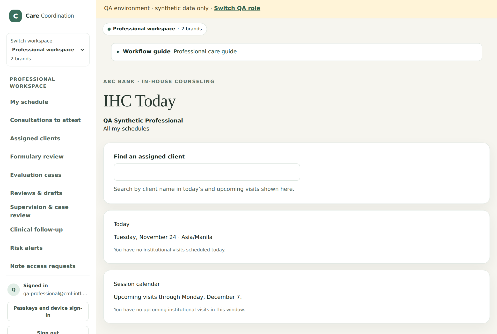
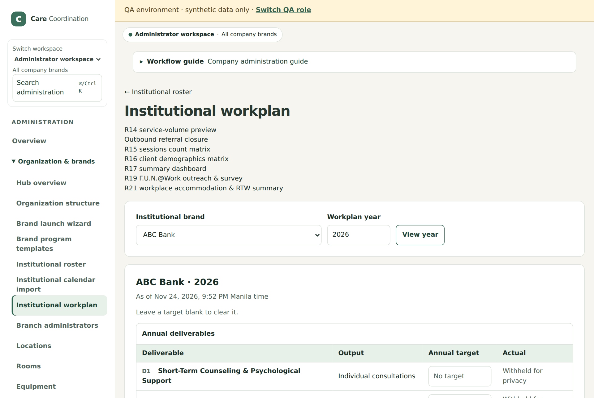
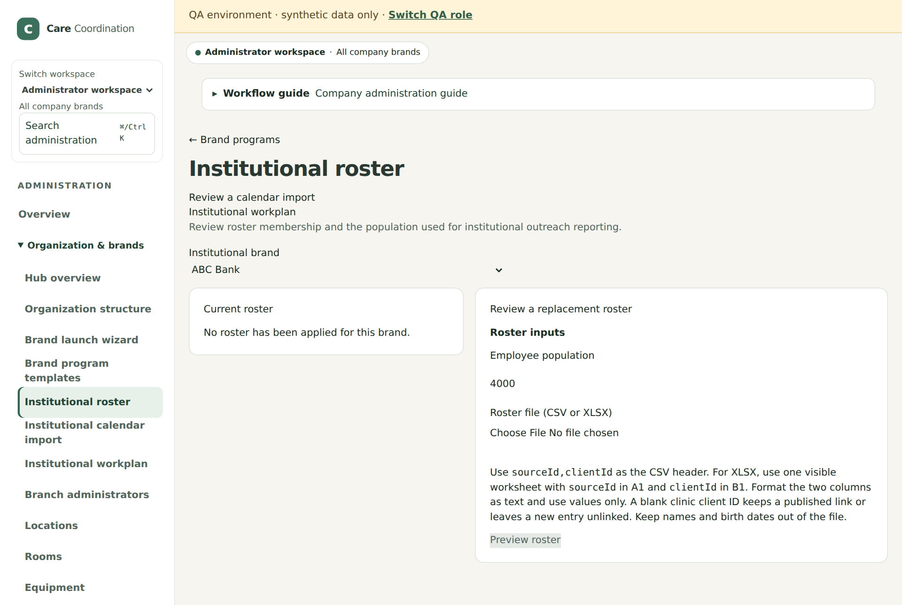

# Persona Guide 05: Counselor & IHC Specialist

> **Navigation:** [Knowledge Base Home](../README.md) · [Master Index](../INDEX.md) · [ABC Bank IHC & Case Management](../manuals/05-ihc-and-case-management.md) · [Role Exercises & Labs](../training/01-role-exercises-and-labs.md) · [Glossary](../GLOSSARY.md)
>
> **Doc ID:** `MHD-PER-05` · **Type:** How-to guide · **Audience:** The named role · **Revised:** 25 November 2026 · All examples use synthetic data.

---

## 1. Role Summary & Scope

The **Counselor & In-House Counselor (`IHC`) Specialist** (`COUNSELOR` / `IHC_SPECIALIST`) delivers employee/organizational counseling, crisis triage, psychoeducation, and structured **ABC Bank In-House Counseling (`IHC`) OS** case workflows (`WP-29`), bridging clinical `SOAP` documentation with the **5Ps Biopsychosocial Formulation**.

| Dimension | Details |
| :--- | :--- |
| **Primary Workspaces** | `/professional/ihc`, `/professional/appointments/[appointmentId]/notes`, `/case-manager/episodes` |
| **Core Work Packages** | `WP-29` ABC Bank IHC OS, `WP-22` C-SSRS & Safety Plans, `WP-16` Sponsor Aggregate Reporting |
| **Case Identifier Standard** | `MMDDYYYY+Initials+MMDDYYYY` (session date + client initials + DOB) |
| **Data Visibility** | Full IHC caseload; **zero individual PHI** is ever exposed to HR or corporate sponsors (`k >= 5` aggregate only) |

---

## 2. Daily Workflow in `IHC Today` (`/professional/ihc`)

1. **Morning Queue & Calendar Sync:**
   - Review today's sessions in **`/professional/ihc`**.
   - Import or reconcile organizational schedules via **`.ics` Calendar Import** or **Roster CSV Import** without exposing external HR systems to clinical notes.
2. **Generate Deterministic Case Key:**
   - Verify the session's `MMDDYYYY+Initials+MMDDYYYY` key for standardized IHC tracking.
3. **Document `SOAP <-> 5Ps` Formulation:**
   - Capture `SOAP` narrative alongside the **5Ps** (*Presenting, Predisposing, Precipitating, Perpetuating, Protective* factors).
   - Tag relevant themes from the **27 Standardized IHC Subtopics** (e.g., *Workplace Burnout*, *Caregiver Fatigue*, *Adjustment/Relocation*, *Grief*, *Interpersonal Conflict*) for anonymized aggregate analytics (`R21`–`R25`).
4. **C-SSRS Check & MDT Escalation (`/case-manager/episodes`):**
   - Run `C-SSRS` when distress indicators appear.
   - Escalate complex cases to the **Multidisciplinary Team (`MDT`) Hub** for `MD` (psychiatry) or `RPsy` (psychotherapy) co-management.

---

## 3. Visual Workspace Reference

*Synthetic counselor-training capture, November 2026. Counselors manage assigned non-billable institutional visits from `IHC Today`.*

*Synthetic administrator-training capture, November 2026. Annual deliverables feed `R14`–`R21` automatically while suppressing cells below the $k \ge 5$ privacy floor.*

*Synthetic administrator-training capture, November 2026. Employee names and birth dates stay out of institutional roster files.*

---

## 4. Confidentiality & Sponsor Reporting Boundary
- Corporate sponsors and HR receive **only** de-identified aggregate trend reports (`R14`–`R21`, `R23`) with **$k$-anonymity ($k \ge 5$)** enforced.
- Counselors must **never** email raw session notes or individual attendance logs to HR unless a documented, client-signed `RA 10173` release or imminent life-safety duty-to-warn protocol applies.

---

## 5. Practice & Verification
- Complete **Lab 05** in [Role Exercises & Labs](../training/01-role-exercises-and-labs.md).
- Review full IHC specifications in [Manual 05: ABC Bank IHC & Case Management](../manuals/05-ihc-and-case-management.md).

---

← Previous: [Persona Guide 04: Psychologist & Psychometrician](04-psychologist-and-psychometrician.md) · [Knowledge Base Home](../README.md) · [Getting Started](../GETTING_STARTED.md) · [FAQ](../FAQ.md) · Next: [Persona Guide 06: Specialty Clinicians (Neurologist, RND & CMA)](06-specialty-clinicians-neuro-rnd-cma.md) →
