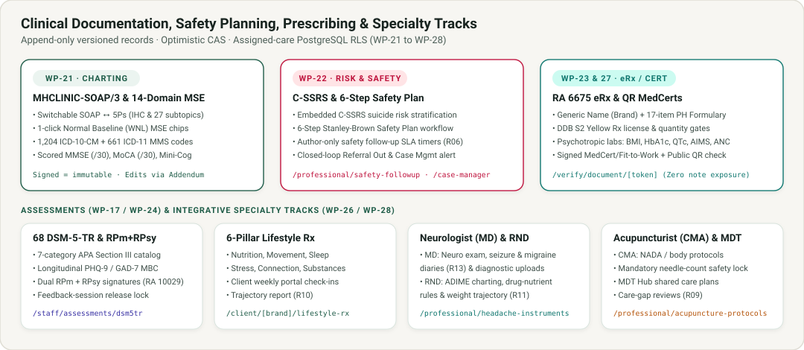
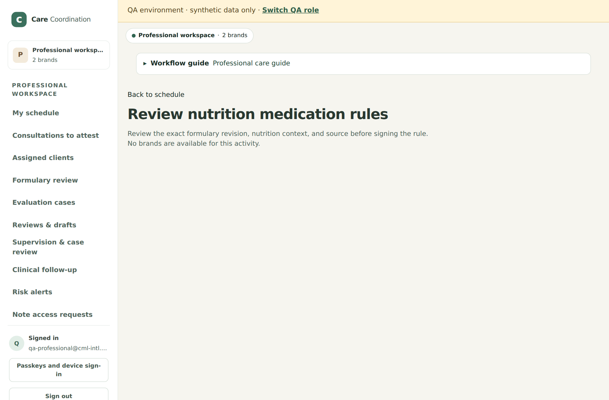
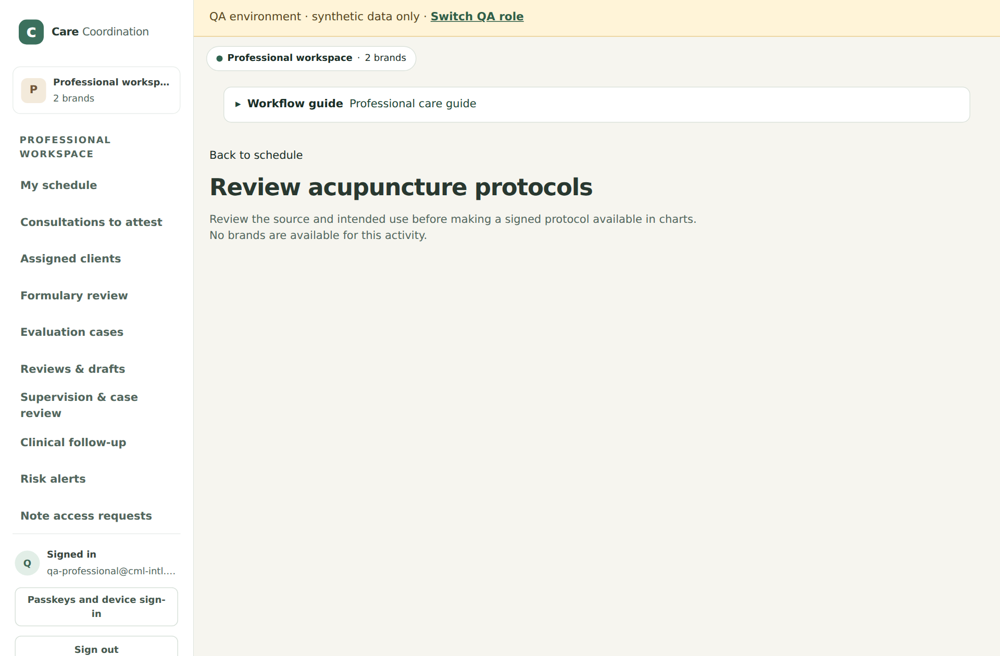

# Persona Guide 06: Specialty Clinicians (Neurologist, RND & CMA)

> **Navigation:** [Knowledge Base Home](../README.md) · [Master Index](../INDEX.md) · [Assessments & Specialty Tracks](../manuals/04-assessments-and-specialty-tracks.md) · [Role Exercises & Labs](../training/01-role-exercises-and-labs.md) · [Glossary](../GLOSSARY.md)
>
> **Doc ID:** `MHD-PER-06` · **Type:** How-to guide · **Audience:** The named role · **Revised:** 25 November 2026 · All examples use synthetic data.

---

## 1. Role Summary & Scope

MH-Clinic supports integrated **whole-person behavioral health** through three specialized clinical tracks (`WP-27`, `WP-28`):
- **Neurologist / Specialty MD (`MD` / `NEUROLOGY`):** Neurological & medical comorbidity evaluations, EEG/imaging correlation, and `RA 6675` specialty prescribing.
- **Registered Nutritionist-Dietitian (`RND`):** Metabolic psychiatry, eating-disorder nutrition care, psychotropic weight/metabolic monitoring, and **6-Pillar Lifestyle Rx** nutrition plans.
- **Certified Medical Assistant / Care Coordinator (`CMA`):** Vitals, anthropometric/metabolic baseline capture, pre-visit screening, and adherence monitoring.

| Track | Primary Workspaces | Core Work Packages | Signing & Ordering Scope |
| :--- | :--- | :--- | :--- |
| **Neurology (`MD`)** | `/professional/appointments/[appointmentId]/notes`, `/professional/appointments/[appointmentId]/neurology-chart` | `WP-08`, `WP-10`, `WP-27` | Neuro exam, `ICD-10-CM` diagnoses, `RA 6675` eRx, diagnostic orders |
| **Nutrition (`RND`)** | `/professional/appointments/[appointmentId]/notes`, `/professional/appointments/[appointmentId]/nutrition-chart`, `/client/[brand]/lifestyle-rx` | `WP-27`, `WP-28` | Nutrition Care Process (`ADIME`), Lifestyle Rx nutrition pillar |
| **Medical Assistant (`CMA`)** | `/staff/appointments`, `/staff/appointments`, `/professional/nutrition-weight-changes` | `WP-27`, `WP-28` | Vitals, BMI/waist circumference, lab-due reminders, lifestyle check-ins |

---

## 2. Core Workflows by Track

### 2.1 Medical Assistant (`CMA`) Pre-Visit & Metabolic Monitoring
1. Capture **Vitals & Anthropometrics** (BP, HR, Weight, Height, BMI, Waist Circumference) before `MD` or `RND` sees the patient.
2. Flag abnormal metabolic baselines (e.g., weight gain $> 5\%$ on atypical antipsychotics) for the prescribing `MD` and `RND`.
3. Log **Lifestyle Monitoring** adherence streaks (sleep, movement, nutrition, hydration) in `/professional/nutrition-weight-changes`.

### 2.2 Registered Nutritionist-Dietitian (`RND`) & 6-Pillar Lifestyle Rx (`WP-28`)
1. Document structured **ADIME** (*Assessment, Diagnosis, Intervention, Monitoring/Evaluation*) notes.
2. Co-author the **6-Pillar Lifestyle Rx** with the treating psychiatrist/psychologist:
   - **Pillar 1:** Whole-Food / Anti-Inflammatory Nutrition
   - **Pillar 2:** Physical Activity & Movement
   - **Pillar 3:** Restorative Sleep Hygiene
   - **Pillar 4:** Stress Regulation & Mindfulness
   - **Pillar 5:** Substance & Stimulant Moderation
   - **Pillar 6:** Social Connection & Purpose
3. Publish patient-friendly action cards to the Client Portal (`/client/[brand]/lifestyle-rx`).

### 2.3 Neurologist (`MD`) Specialty Consultation (`WP-27`)
1. Review psychiatric referral question (e.g., ruling out organic etiology, seizure comorbidity, cognitive decline).
2. Complete the structured **Neurological Exam** module alongside `MHCLINIC-SOAP/3`.
3. Issue `RA 6675` electronic prescriptions (`WP-10`) with automated interaction checks against existing psychotropics.
4. Route findings back to the **Multidisciplinary Team (`MDT`) Hub** for unified care planning.

---

## 3. Visual Workspace Reference

*Synthetic clinician-training captures, November 2026. Specialty protocols and nutrition-medication rules require explicit clinical sign-off before activation in charts.*

---

## 4. Practice & Verification
- Complete **Lab 06** in [Role Exercises & Labs](../training/01-role-exercises-and-labs.md).
- Review full specialty track workflows in [Manual 04: Assessments & Specialty Tracks](../manuals/04-assessments-and-specialty-tracks.md).

---

← Previous: [Persona Guide 05: Counselor & IHC Specialist](05-counselor-and-ihc-specialist.md) · [Knowledge Base Home](../README.md) · [Getting Started](../GETTING_STARTED.md) · [FAQ](../FAQ.md) · Next: [Persona Guide 07: Case Manager & Safety Responder](07-case-manager-and-safety-responder.md) →
