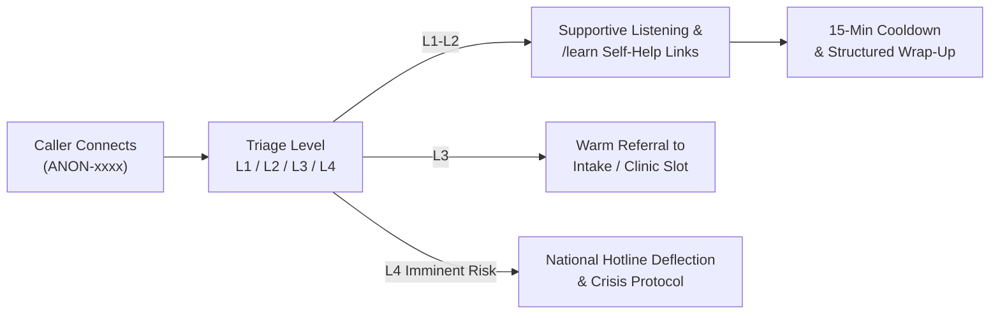
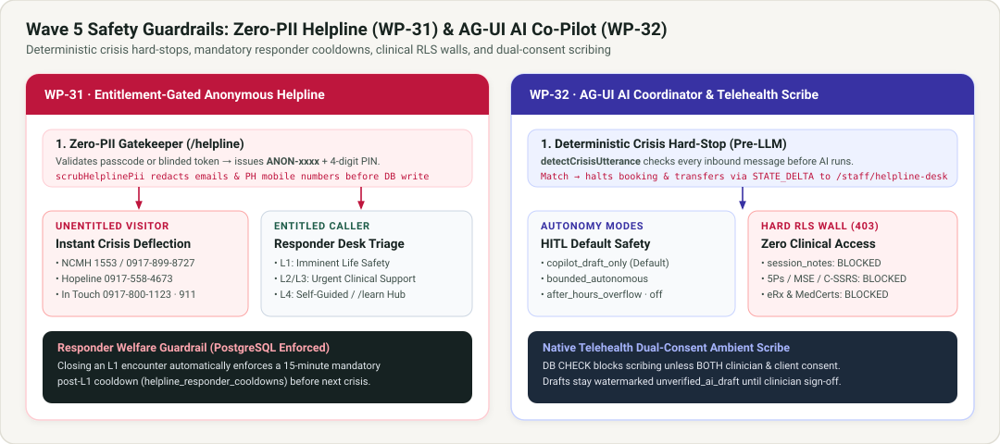
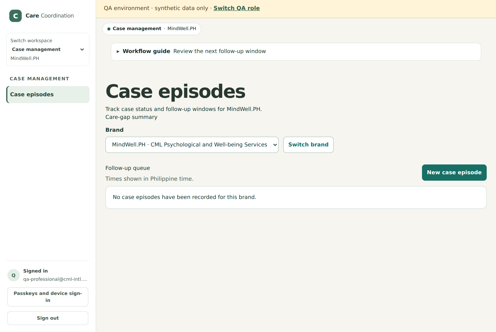
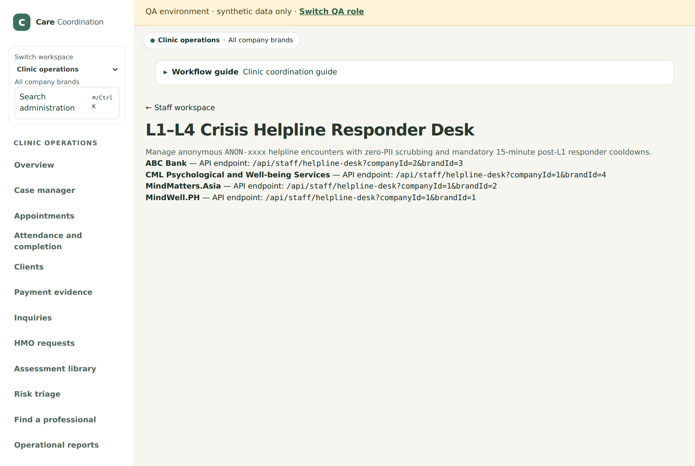
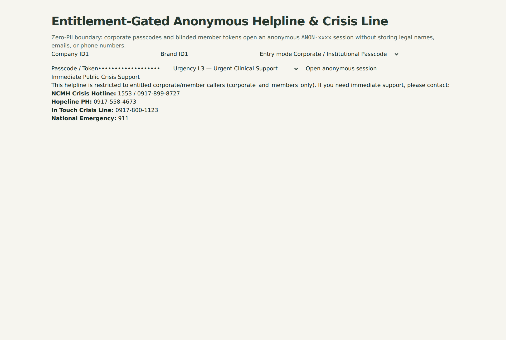

# Persona Guide 07: Case Manager & Safety Responder

> **Navigation:** [Knowledge Base Home](../README.md) · [Master Index](../INDEX.md) · [ABC Bank IHC & Case Management](../manuals/05-abc-bank-ihc-and-case-management.md) · [Helpline & AI Coordinator](../manuals/07-helpline-learning-hub-and-ai-coordinator.md) · [Role Exercises & Labs](../training/01-role-exercises-and-labs.md)

---

## 1. Role Summary & Scope

The **Case Manager & Safety Responder** (`CASE_MANAGER` / `SAFETY_RESPONDER`) oversees high-acuity care coordination, post-discharge/no-show outreach, `C-SSRS` safety plan follow-ups, `MDT` referrals, and **Anonymous Helpline (`WP-31`) crisis escalation (`L3`–`L4`)**.

| Dimension | Details |
| :--- | :--- |
| **Primary Workspaces** | `/cases`, `/cases/safety`, `/helpline/console`, `/ihc/mdt`, `/schedule/waitlist` |
| **Core Work Packages** | `WP-09` C-SSRS & Safety Plans, `WP-18` Case Management & Outreach, `WP-26` MDT Hub, `WP-31` Anonymous Helpline |
| **SLA Targets** | `L4` Crisis Escalation: immediate acknowledgment; `High` C-SSRS No-Show: outreach within 2 hours |
| **Data Visibility** | Safety flags, care plans, outreach logs, and `ANON-xxxx` helpline sessions (pseudonymous until explicit consent-to-identify) |

---

## 2. Core Workflows

### 2.1 High-Risk Safety Queue (`/cases/safety`)
1. Monitor active alerts triggered by:
   - **`C-SSRS` Moderate/High** scores (`WP-09`)
   - **Missed appointments** for flagged high-risk clients
   - **Helpline `L3` / `L4` escalations** (`WP-31`)
2. Open the client's **6-Step Safety Plan** and confirm emergency contact / guardian notification rules.
3. Log every outreach attempt (`PHONE`, `SMS`, `PORTAL`, `EMERGENCY_DISPATCH`) with timestamp and outcome.

### 2.2 Anonymous Helpline Responder Console (`WP-31`)

1. Accept incoming anonymous sessions tagged with ephemeral `ANON-xxxx` IDs (zero PII stored by default).
2. Classify acuity **`L1` (Low)** through **`L4` (Imminent Crisis)**.
3. For **`L4`**, follow the **National Hotline Deflection** and emergency response protocol immediately.
4. Only convert `ANON-xxxx` to a clinic intake record if the caller **explicitly opts in** to warm referral.
5. Respect the mandatory **15-minute post-crisis cooldown** between high-acuity responder sessions to prevent responder burnout.

### 2.3 Multidisciplinary Team (`MDT`) Coordination (`/ihc/mdt`)
- Coordinate warm handoffs across `MD` (Psychiatry/Neurology), `RPsy` (Psychotherapy), `IHC` (Counseling), and `RND` (Nutrition).
- Track referral acceptance, shared goals, and barrier resolution (transport, HMO LOA delays, medication adherence).

---

## 3. Visual Workspace Reference

*Synthetic case-manager training capture, November 2026. Case episodes track longitudinal follow-up windows strictly within the authorized brand.*

*Synthetic responder-training capture, November 2026. Responder consoles keep caller aliases pseudonymous (`ANON-xxxx`) and enforce post-`L1` welfare cooldowns.*

*Synthetic public-access training capture, November 2026. Unentitled visitors immediately receive Philippine National Crisis Hotline deflection numbers.*

---

## 4. Practice & Verification
- Complete **Lab 07** in [Role Exercises & Labs](../training/01-role-exercises-and-labs.md).
- Review full helpline & safety details in [Manual 07: Helpline, Learning Hub & AI Coordinator](../manuals/07-helpline-learning-hub-and-ai-coordinator.md).
