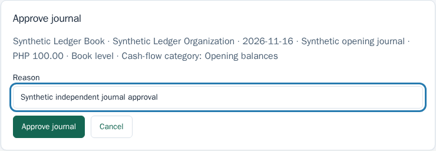
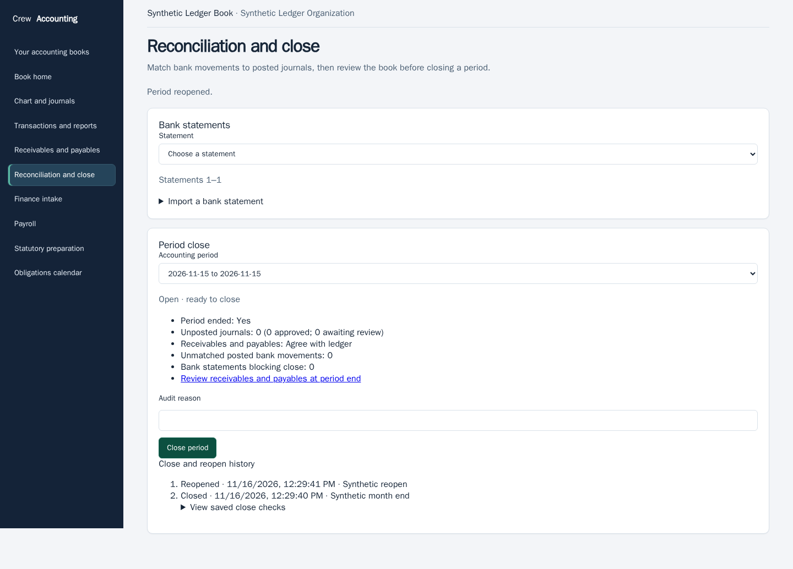
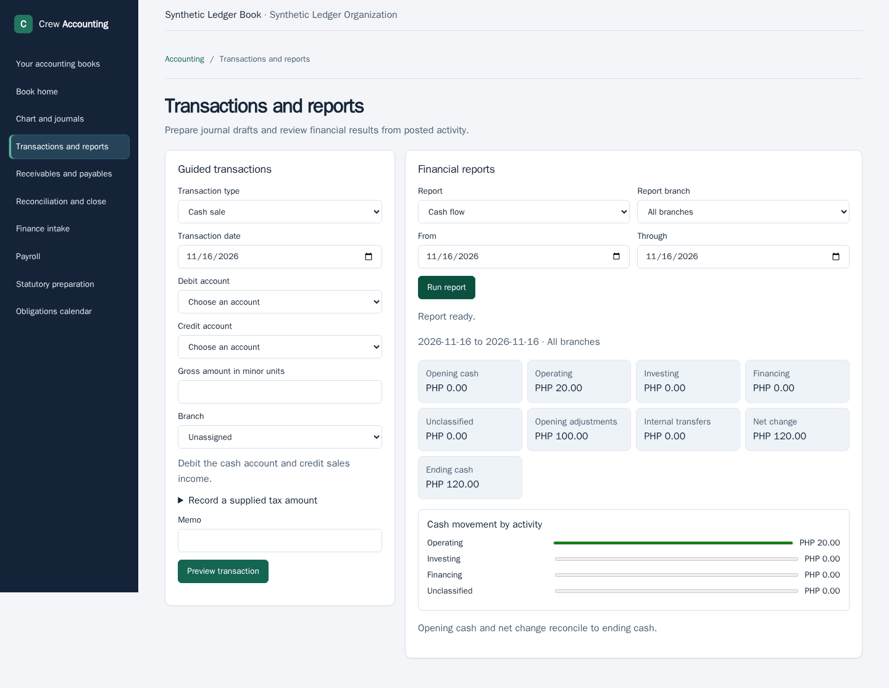

# Persona Guide 08: HMO Billing & Finance Officer

> **Navigation:** [Knowledge Base Home](../README.md) · [Master Index](../INDEX.md) · [Scheduling & HMO Operations](../manuals/02-scheduling-and-hmo-operations.md) · [Reporting & Analytics](../manuals/06-reporting-and-analytics-guide.md) · [Role Exercises & Labs](../training/01-role-exercises-and-labs.md)

---

## 1. Role Summary & Scope

The **HMO Billing & Finance Officer** (`BILLING` / `FINANCE`) manages point-of-sale self-pay collections, **Senior Citizen (`RA 9994`) / PWD (`RA 10754`)** statutory discounts, **7-Step Aventus HMO** claim packets, reconciliation, and revenue/aging analytics (`R11`–`R15`).

| Dimension | Details |
| :--- | :--- |
| **Primary Workspaces** | `/billing`, `/billing/pos`, `/billing/hmo`, `/billing/reconciliation`, `/reports` |
| **Core Work Packages** | `WP-05` Aventus HMO Workflow, `WP-06` Self-Pay & Senior/PWD, `WP-19` Revenue & AR Reconciliation, `WP-23` Financial Reports |
| **Data Visibility** | Invoices, LOAs, `ICD-10` billing codes (when consented for HMO), payments, refunds; **no access** to psychotherapy narrative notes |

---

## 2. Core Workflows

### 2.1 Self-Pay Checkout & Statutory Discounts (`WP-06`)
1. Open **`/billing/pos`** for completed encounters.
2. Verify line items against the Branch Service Catalog (`WP-04`).
3. When a valid **Senior Citizen (`RA 9994`)** or **PWD (`RA 10754`)** ID is verified:
   - System automatically strips **12% VAT** (VAT-exempt) and applies the **20% statutory discount** on eligible services/medications.
   - Audit log records the ID reference and cashier approval.
4. Accept payment (`CASH`, `CARD`, `GCASH/MAYA`, `BANK_TRANSFER`) and issue official receipt.

### 2.2 Aventus HMO Claim Assembly & Submission (`WP-05`)
1. Filter **`/billing/hmo`** for encounters marked `SIGNED` by the clinician.
2. Confirm all **7 Aventus HMO steps** are complete:
   - Valid Member ID & active policy
   - Benefit cap check
   - Valid LOA number & date range
   - Attached LOA document
   - Co-pay collected (if any)
   - Clinician attestation (`SIGNED` encounter)
   - Billing `ICD-10` code (with RA 10173 HMO disclosure consent)
3. Export or submit the claim batch and track status (`SUBMITTED` → `IN_REVIEW` → `PAID` / `DENIED`).

### 2.3 Aging, Denials & Reconciliation (`/billing/reconciliation`)
- Run **`R11`–`R15`** weekly in `/reports` to monitor:
  - Daily collections & payment method mix
  - HMO AR aging (`0-30`, `31-60`, `61-90`, `90+` days)
  - Denial reason codes (missing LOA, expired LOA, unsigned encounter)
- Process void/refund requests with **Supervisor Dual-Approval** for amounts exceeding branch thresholds.

---

## 3. Visual Workspace Reference

*Synthetic operator-training capture, November 2026. Approvers verify book, date, amount, and audit reason before approving a journal draft.*

*Synthetic operator-training capture, November 2026. Confirm zero unposted journals and zero unmatched bank lines before closing the period.*

*Synthetic operator-training capture, November 2026. Verify book, date range, and branch scope before exporting financial summaries.*

---

## 4. Practice & Verification
- Complete **Lab 08** in [Role Exercises & Labs](../training/01-role-exercises-and-labs.md).
- Review full billing rules in [Manual 02: Scheduling & HMO Operations](../manuals/02-scheduling-and-hmo-operations.md) and [Manual 08: Accounting, Invoicing & Journal Mapping](../manuals/08-accounting-invoicing-and-payouts.md).
