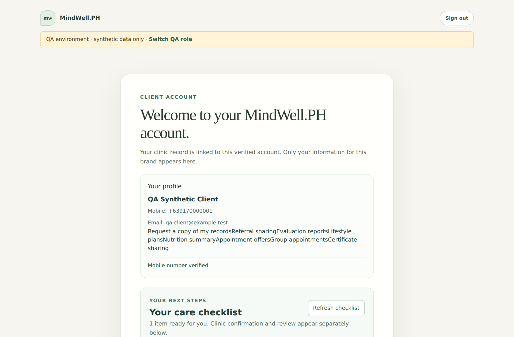
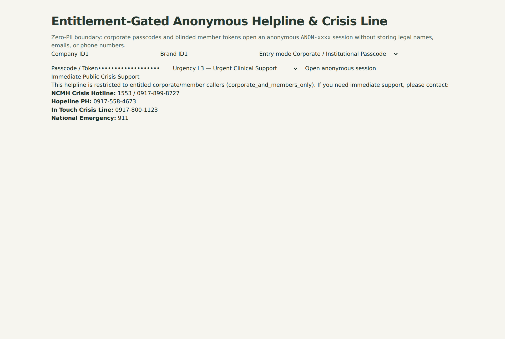

# Persona Guide 09 (Taglish Draft): Client, Patient & Guardian

> **Navigation:** [Knowledge Base Home](../README.md) · [English Version](09-client-patient-and-guardian.md) · [Getting Started (Taglish)](../GETTING_STARTED_TL.md) · [Helpline & Learning Hub](../manuals/07-helpline-learning-hub-and-ai-coordinator.md) · [Glossary](../GLOSSARY.md)
>
> **Doc ID:** `MHD-PER-11` · **Type:** How-to guide · **Audience:** Client, Patient & Guardian · **Revised:** 25 November 2026 · **Status:** Draft — needs native-speaker review · All examples use synthetic data.

> [!NOTE]
> **Needs native-speaker review:** Ang gabay na ito ay Taglish draft ng [Persona Guide 09: Client, Patient & Guardian](09-client-patient-and-guardian.md) at nangangailangan pa ng review mula sa native Filipino/Taglish speaker.

---

## 1. Buod ng Role at Saklaw

Ang **Client, Patient & Authorized Guardian** (`PATIENT` / `GUARDIAN`) ay gumagamit ng MH-Clinic sa pamamagitan ng **Client Sign-In** (`/client-access/[brand]`), **Client Portal** (`/client/[brand]`), **Telehealth room** (`/telehealth/[appointmentId]`), **Learning Hub** (`/learn`), at ng entitlement-gated **Anonymous Helpline** (`/helpline`) — idinisenyo para sa privacy, madaling paggamit, at malinaw na daloy.

| Aspeto | Detalye |
| :--- | :--- |
| **Mga Pangunahing Workspace** | `/client-access/[brand]`, `/client/[brand]`, `/client/[brand]/appointments/[appointmentId]/prepare`, `/client/[brand]/certificate-verifications`, `/client/[brand]/evaluation-reports`, `/client/[brand]/lifestyle-rx`, `/telehealth/[appointmentId]`, `/learn`, `/helpline` |
| **Core Work Packages** | `WP-18` Client Portal, `WP-32` Telehealth, `WP-24` Pre-Visit Assessments, `WP-26` Lifestyle Rx, `WP-31` Helpline & `/learn` |
| **Mga Karapatan sa Privacy** | Buong `RA 10173` consent controls (kumpirmahin sa DPO o abogado para sa legal compliance), proxy/guardian linkage para sa mga menor de edad, at walang paglabas ng clinician-only notes |

---

## 2. Ano ang Pwedeng Gawin ng Clients & Guardians

### 2.1 Pamahalaan ang Appointments & Sumali sa Telehealth (`/client/[brand]`, `/client/[brand]/appointments/[appointmentId]/prepare`)
1. Tingnan ang mga paparating na in-person at telehealth visits.
2. Kumpletuhin ang digital **Consent to Care** at **RA 10173 Privacy Notice** bago ang unang session.
3. I-click ang **Join Telehealth** 10 minuto bago ang nakatakdang oras; gawin ang pre-call camera/mic check.

### 2.2 Sagutan ang Pre-Visit Assessments (`/client/[brand]`)
1. Buksan ang naka-assign na **DSM-5-TR** / **PHQ-9** / **GAD-7** / **Pediatric** questionnaires bago ang konsultasyon.
2. I-save ang progress o i-submit agad para makita ng clinician ang iyong longitudinal trends bago pa magsimula ang session.

### 2.3 I-access ang Prescriptions, MedCerts & Lifestyle Plans (`/client/[brand]/certificate-verifications`, `/client/[brand]/lifestyle-rx`)
- I-download ang mga pirmadong **RA 6675 Electronic Prescriptions** at **QR-Verified Medical Certificates**.
- Sundan ang pang-araw-araw na **6-Pillar Lifestyle Rx** habits (tulog, nutrisyon, paggalaw, mindfulness) at mag-log ng check-ins.

### 2.4 Mga Patakaran sa Guardian / Proxy Access
- Ang mga magulang o legal guardian na naka-link sa verified **Guardian Relationship** ay maaaring mamahala ng scheduling, consents, at pediatric/guardian assessments para sa mga menor de edad.
- May adolescent confidentiality rules na nagbibigay ng naaangkop na privacy boundaries kapag kinakailangan ng klinika at batas.

### 2.5 Anonymous Helpline & Learning Hub (`/helpline`, `/learn`)
- **I-check ang availability ng helpline sa `/helpline`** (`WP-31`). Kung nakalagay na unavailable ang helpline, makikita rito ang public crisis-support information at walang passcode form. Kung naka-enable ang anonymous sessions, maaaring gamitin ang corporate passcode o blinded member token para makapagsimula.
- **Gusto ng self-guided psychoeducation?** Mag-browse sa **`/learn`** para sa mga artikulo, breathing/grounding exercises, at Filipino/English mental health resources. Hindi kailangan ng clinic login para rito.

---

## 3. Mga Larawan ng Client Experience (Synthetic Captures)

*Synthetic client-training capture, November 2026. Ipinapakita sa brand portal mo ang iyong mga appointment, care checklist, evaluation reports, at lifestyle plans.*

*Synthetic training capture, November 2026. Feature-enabled view na may passcode field at public crisis-support information. Kung unavailable notice ang nakikita sa `/helpline`, walang session na pwedeng simulan at tanging public crisis-support information lamang ang ipapakita.*

---

## 4. Pagsasanay at Pagpapatunay
- Kumpletuhin ang **Lab 09** sa [Role Exercises & Labs](../training/01-role-exercises-and-labs.md).
- Basahin ang buong detalye ng portal at helpline sa [Manual 07: Helpline, Learning Hub & AI Coordinator](../manuals/07-helpline-learning-hub-and-ai-coordinator.md).

---

← Previous: [Getting Started (Taglish)](../GETTING_STARTED_TL.md) · [Knowledge Base Home](../README.md) · [Getting Started](../GETTING_STARTED.md) · [FAQ](../FAQ.md) · Next: [Persona Guide 09 (English)](09-client-patient-and-guardian.md) →
