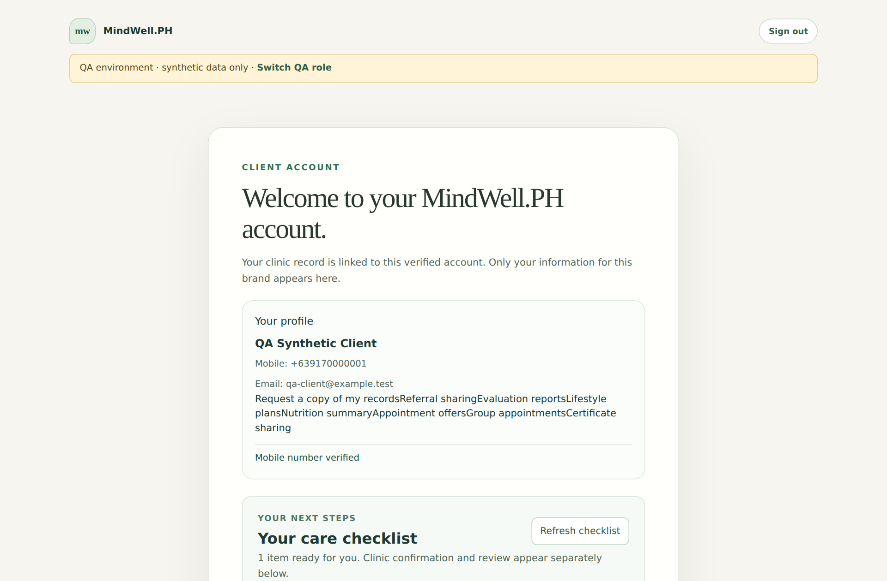
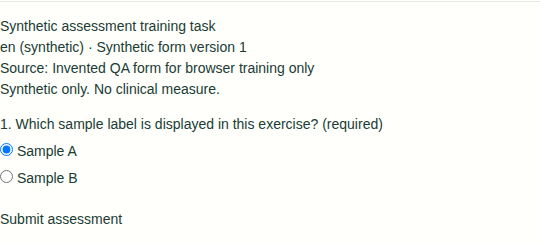
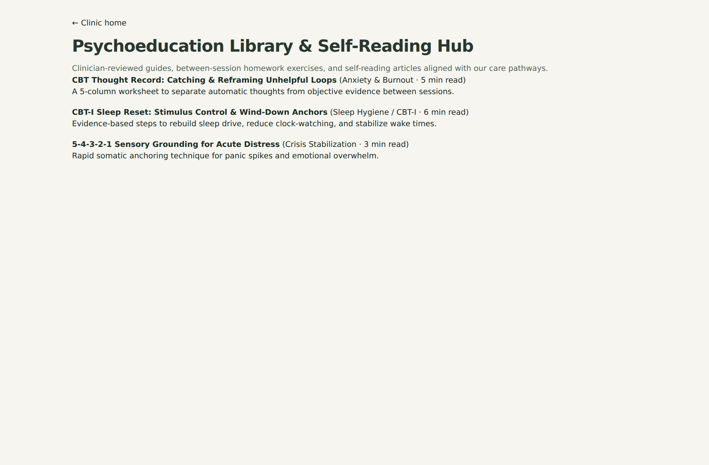
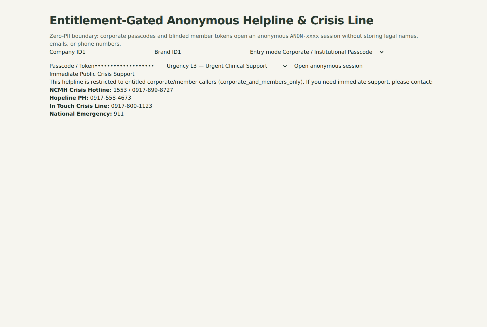

# Persona Guide 09: Client, Patient & Guardian

> **Navigation:** [Knowledge Base Home](../README.md) · [Master Index](../INDEX.md) · [Getting Started & MFA](../manuals/01-getting-started-and-mfa.md) · [Helpline & Learning Hub](../manuals/07-helpline-learning-hub-and-ai-coordinator.md) · [Role Exercises & Labs](../training/01-role-exercises-and-labs.md) · [Glossary](../GLOSSARY.md)
>
> **Doc ID:** `MHD-PER-09` · **Type:** How-to guide · **Audience:** The named role · **Revised:** 25 November 2026 · All examples use synthetic data.

---

## 1. Role Summary & Scope

The **Client, Patient & Authorized Guardian** (`PATIENT` / `GUARDIAN`) accesses MH-Clinic through **Client Sign-In** (`/client-access/[brand]`), the **Client Portal** (`/client/[brand]`), the **Telehealth room** (`/telehealth/[appointmentId]`), the **Learning Hub** (`/learn`), and the entitlement-gated **Anonymous Helpline** (`/helpline`) — designed for privacy, low friction, and clarity.

| Dimension | Details |
| :--- | :--- |
| **Primary Workspaces** | `/client-access/[brand]`, `/client/[brand]`, `/client/[brand]/appointments/[appointmentId]/prepare`, `/client/[brand]/certificate-verifications`, `/client/[brand]/evaluation-reports`, `/client/[brand]/lifestyle-rx`, `/telehealth/[appointmentId]`, `/learn`, `/helpline` |
| **Core Work Packages** | `WP-18` Client Portal, `WP-32` Telehealth, `WP-24` Pre-Visit Assessments, `WP-26` Lifestyle Rx, `WP-31` Helpline & `/learn` |
| **Privacy Rights** | Full `RA 10173` consent controls, proxy/guardian linkage for minors or incapacitated adults, zero clinician-only note leakage |

---

## 2. What Clients & Guardians Can Do

### 2.1 Manage Appointments & Join Telehealth (`/client/[brand]`, `/client/[brand]/appointments/[appointmentId]/prepare`)
1. View upcoming in-person and telehealth visits.
2. Complete digital **Consent to Care** and **RA 10173 Privacy Notice** before the first session.
3. Click **Join Telehealth** 10 minutes before the scheduled time; run the pre-call camera/mic check.

### 2.2 Complete Pre-Visit Assessments (`/client/[brand]`)
1. Open assigned **DSM-5-TR** / **PHQ-9** / **GAD-7** / **Pediatric** questionnaires prior to the visit.
2. Save progress or submit directly so your clinician sees longitudinal trends before you even enter the room.

### 2.3 Access Prescriptions, MedCerts & Lifestyle Plans (`/client/[brand]/certificate-verifications`, `/client/[brand]/lifestyle-rx`)
- Download signed **RA 6675 Electronic Prescriptions** and **QR-Verified Medical Certificates**.
- Follow daily **6-Pillar Lifestyle Rx** habits (sleep, nutrition, movement, mindfulness) and log check-ins.

### 2.4 Guardian / Proxy Access Rules
- Parents or legal guardians linked via verified **Guardian Relationship** can manage scheduling, consents, and pediatric/guardian assessments for minors.
- Adolescent confidentiality rules allow age-appropriate privacy boundaries where clinically and legally required.

### 2.5 Anonymous Helpline & Learning Hub (`/helpline`, `/learn`)
- **Need immediate anonymous support?** Open **`/helpline`** (`WP-31`) and present a corporate passcode or blinded member token at the entitlement gate. An entitled session receives an ephemeral `ANON-xxxx` identifier and does not collect a legal name, email, or phone number. Unentitled visitors see the national crisis deflection card only — that view is not a completed helpline session.
- **Want self-guided psychoeducation?** Browse **`/learn`** for evidence-based articles, breathing/grounding exercises, and Filipino/English mental health resources. The library does not require a clinic login.

---

## 3. Visual Guide to Your Client Experience

*Synthetic client-training capture, November 2026. Your brand portal shows only your own appointments, care checklist, evaluation reports, and lifestyle plans.*

*Synthetic client-training capture, November 2026. Complete assigned questionnaires prior to your session so your clinician can review progress.*

*Synthetic public-access training capture, November 2026. Browse self-guided psychoeducation articles at `/learn` anytime without logging in.*

*Synthetic public-access training capture, November 2026. National crisis hotlines remain immediately visible whenever an unentitled visitor accesses `/helpline`.*

---

## 4. Practice & Verification
- Complete **Lab 09** in [Role Exercises & Labs](../training/01-role-exercises-and-labs.md).
- Review portal and helpline details in [Manual 07: Helpline, Learning Hub & AI Coordinator](../manuals/07-helpline-learning-hub-and-ai-coordinator.md).

---

← Previous: [Persona Guide 08: HMO Billing & Finance Officer](08-hmo-billing-and-finance-officer.md) · [Knowledge Base Home](../README.md) · [Getting Started](../GETTING_STARTED.md) · [FAQ](../FAQ.md) · Next: [Persona Guide 10: Corporate Sponsor & HR Viewer](10-sponsor-and-hr-viewer.md) →
