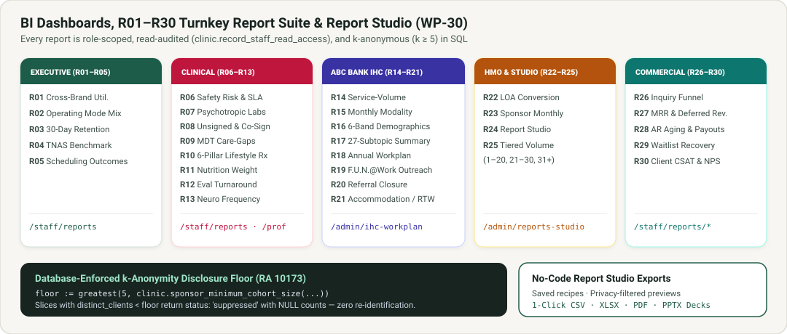
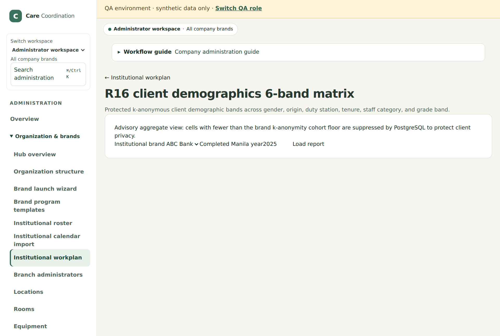
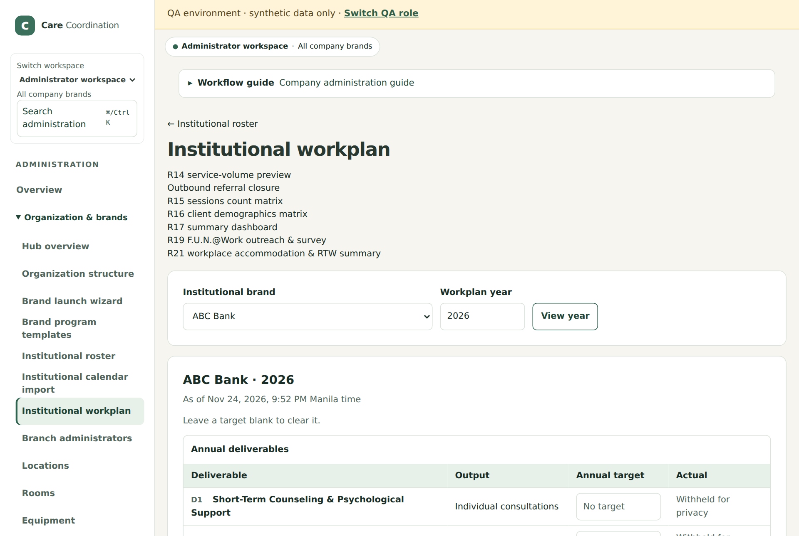

# Persona Guide 10: Corporate Sponsor & HR Viewer

> **Navigation:** [Knowledge Base Home](../README.md) · [Master Index](../INDEX.md) · [ABC Bank IHC & Case Management](../manuals/05-ihc-and-case-management.md) · [Reporting & Analytics](../manuals/06-reporting-and-analytics-guide.md) · [Role Exercises & Labs](../training/01-role-exercises-and-labs.md)

---

## 1. Role Summary & Scope

The **Corporate Sponsor & HR Viewer** (`SPONSOR_VIEWER` / `HR_VIEWER`) represents an institutional partner (such as ABC Bank or an enterprise EAP client) monitoring program utilization, anonymized well-being trends, and ROI — **strictly without access to any Protected Health Information (`PHI`)**.

| Dimension | Details |
| :--- | :--- |
| **Primary Workspaces** | `/sponsor/dashboard`, `/reports` (Sponsor-scoped `R21`–`R25`) |
| **Core Work Packages** | `WP-20` Sponsor & HR Aggregate Portal, `WP-23` Report Studio ($k$-Anonymity), `WP-26` IHC Aggregate Themes |
| **Privacy Guarantee** | **Zero PHI**; **Minimum Cell Size $k \ge 5$** enforced at query and export layers |

---

## 2. What Sponsors Can & Cannot See

| Metric / Artifact | Visible to Sponsor (`SPONSOR_VIEWER`)? | Privacy Mechanism |
| :--- | :--- | :--- |
| Total sessions utilized vs. contracted cap | **Yes** (Aggregate count) | Tenant/program rollup |
| Top **27 IHC Subtopic** themes (e.g., Burnout, Stress) | **Yes** (Only when $n \ge 5$) | Small-cell suppression (`< 5` masked as `*`) |
| Department / Location breakdown | **Yes** (Only when $n \ge 5$) | Automatic $k$-anonymity ($k \ge 5$) |
| Individual employee names, dates of visit, or diagnoses | **NEVER** | Blocked by RBAC + API schema |
| Clinical SOAP notes, `C-SSRS` scores, or `eRx` | **NEVER** | Physically isolated from sponsor scope |

---

## 3. Core Workflows

### 3.1 Reviewing Program Utilization & Well-Being Trends (`/sponsor/dashboard`)
1. Sign in with mandatory MFA (`WP-01`).
2. Review monthly/quarterly **Utilization Rate**, **Modality Split** (In-Person vs. Telehealth vs. IHC), and **Wait-Time SLAs**.
3. Inspect anonymized **Subtopic Trend Charts** (`WP-26` 27 subtopics) to guide organizational wellness initiatives (e.g., manager burnout workshops).

### 3.2 Downloading Board-Ready Aggregate Reports (`R21`–`R25`)
1. Open **`/reports`** and select any Sponsor-eligible report (`R21`–`R25`).
2. Export CSV or PDF; any demographic or department slice with fewer than **5 individuals** is automatically suppressed or rolled up into `Other / Suppressed` to satisfy **RA 10173**.

---

## 4. Visual Reference: $k$-Anonymity & Institutional Reporting

*Synthetic administrator-training capture, November 2026. PostgreSQL suppresses demographic cells below the cohort floor (`k >= 5`) before data ever reaches the UI.*

*Synthetic administrator-training capture, November 2026. Small-cohort counts automatically display **Withheld for privacy** to prevent re-identification.*

---

## 5. Practice & Verification
- Complete **Lab 10** in [Role Exercises & Labs](../training/01-role-exercises-and-labs.md).
- Review $k$-anonymity rules in [Manual 06: Reporting & Analytics Guide](../manuals/06-reporting-and-analytics-guide.md).
