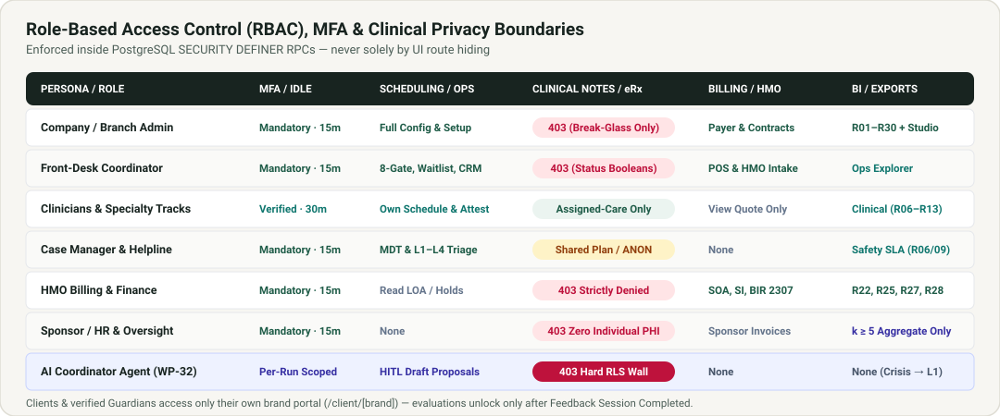

# Training Labs 01: Role-Based Exercises & Hands-On Labs

> **Navigation:** [Knowledge Base Home](../README.md) · [Master Index](../INDEX.md) · [Visual Guide](../VISUAL_GUIDE.md) · [Content & Data Onboarding Checklist](02-content-and-data-onboarding-checklist.md)

> [!CAUTION]
> **Synthetic Data Only:** All labs below must be executed in a staging/training tenant using **synthetic personas** (e.g., `patient.demo@example.test`, `ANON-9042`). Never enter real patient names, real PRC/S2 numbers, or live HMO member IDs in training environments.

---

## Lab Index

| Lab | Target Persona | Primary Modules Exercised | Est. Time |
| :--- | :--- | :--- | :--- |
| **Lab 01** | [Company & Branch Administrator](../personas/01-company-and-branch-administrator.md) | `WP-01` MFA, `WP-02` Branch, `WP-22` Audit, `WP-23` Reports | 20 min |
| **Lab 02** | [Front Desk Coordinator](../personas/02-front-desk-coordinator.md) | `WP-03` 8-Gate Engine, `WP-05` Aventus HMO, `WP-17` Waitlist | 25 min |
| **Lab 03** | [Psychiatrist & Prescriber](../personas/03-psychiatrist-and-prescriber.md) | `WP-08` SOAP/3, `WP-09` C-SSRS, `WP-10` RA 6675 eRx, `WP-11` MedCert | 25 min |
| **Lab 04** | [Psychologist & Psychometrician](../personas/04-psychologist-and-psychometrician.md) | `WP-07` Dual RPm+RPsy, `WP-12` 68 DSM-5-TR Measures | 25 min |
| **Lab 05** | [Counselor & IHC Specialist](../personas/05-counselor-and-ihc-specialist.md) | `WP-26` IHC Today, `MMDDYYYY+Initials+MMDDYYYY`, `SOAP <-> 5Ps` | 20 min |
| **Lab 06** | [Specialty Clinicians (Neuro/RND/CMA)](../personas/06-specialty-clinicians-neuro-rnd-cma.md) | `WP-27` Specialty Tracks, `WP-28` 6-Pillar Lifestyle Rx | 20 min |
| **Lab 07** | [Case Manager & Safety Responder](../personas/07-case-manager-and-safety-responder.md) | `WP-18` Safety Queue, `WP-31` Helpline `L1`–`L4` + Cooldown | 20 min |
| **Lab 08** | [HMO Billing & Finance Officer](../personas/08-hmo-billing-and-finance-officer.md) | `WP-05` HMO Claim, `WP-06` Senior/PWD 20% + VAT-Exempt | 20 min |
| **Lab 09** | [Client, Patient & Guardian](../personas/09-client-patient-and-guardian.md) | `WP-14` Client Portal, `WP-15` Telehealth, `WP-31` `/learn` | 15 min |
| **Lab 10** | [Sponsor & HR Viewer](../personas/10-sponsor-and-hr-viewer.md) | `WP-20` Sponsor Dashboard, `WP-23` $k$-Anonymity ($k \ge 5$) | 15 min |

---

## Lab 01: Admin — Provisioning, Branch Gate Check & Audit Review
1. **Sign In & Enroll MFA:** Log in as `admin.demo@example.test`, enroll a TOTP authenticator, and verify idle lock behavior.
2. **Create Synthetic Branch & Room:** In `/admin/branches`, add `Makati Training Annex` with 1 physical room and 2 telehealth rooms.
3. **Invite Clinician with PRC:** In `/admin/users`, invite `md.demo@example.test` with role `PSYCHIATRIST` and synthetic PRC `0000001`.
4. **Verify Audit Trail:** Open `/admin/audit` and confirm user-creation and role-assignment events appear with timestamp and actor ID.
5. **Pass Criteria:** New branch appears in the 8-Gate Simulator; audit log records 100% of administrative actions.

> Visual reference: [Staff sign-in](../manuals/01-getting-started-and-mfa.md#staff-sign-in-screen), [read-access audit](../manuals/01-getting-started-and-mfa.md#reviewing-metadata-only-staff-read-access-audits), and [professional access preparation](../manuals/10-saas-clients-and-tenant-onboarding.md#prepare-professional-access-and-review-schedule-assignments).

---

## Lab 02: Front Desk — 8-Gate Booking, Waitlist Backfill & Aventus HMO
1. **8-Gate Validation:** Open `/schedule`, attempt to book a `PSYCHIATRIST` SKU with an `RPm` clinician; verify **Gate 4 (Credential Match)** blocks the booking. Switch to `md.demo@example.test` and confirm booking.
2. **7-Step Aventus HMO Intake:** Create a synthetic HMO visit with Member ID `AVT-DEMO-001`, LOA `LOA-2026-991`, and mark **HMO Verified**.
3. **Waitlist Backfill (`WP-17`):** Cancel an existing afternoon slot and use `/schedule/waitlist` to send a backfill offer to a waiting synthetic patient.
4. **Pass Criteria:** Credential mismatch blocked cleanly; HMO visit reaches `CHECKED_IN` with LOA attached; waitlist offer converts to `CONFIRMED`.

> Visual reference: [Missing booking hours](../manuals/02-scheduling-and-hmo-operations.md#when-the-booking-panel-shows-no-published-hours), [HMO slot hold](../manuals/02-scheduling-and-hmo-operations.md#holding-an-initial-hmo-consultation-time), and [HMO availability retry](../manuals/02-scheduling-and-hmo-operations.md#when-an-hmo-availability-lookup-returns-empty-or-fails).

---

## Lab 03: Psychiatrist — SOAP/3, C-SSRS Safety Plan, RA 6675 eRx & QR MedCert
1. **Complete `MHCLINIC-SOAP/3` + 14-Domain MSE:** Open a checked-in synthetic encounter at `/encounters/[id]`. Fill all 14 MSE domains and assign an `ICD-10-CM` code (e.g., `F32.1`).
2. **C-SSRS & Safety Plan:** Record a **Moderate** `C-SSRS` screen and complete all 6 steps of the Stanley-Brown Safety Plan.
3. **RA 6675 `eRx`:** Open the eRx drawer, pick a regimen from the **1-Click Starter Formulary**, verify the generic name is displayed prominently, and sign.
4. **QR MedCert:** Generate a `FIT_TO_WORK` certificate and verify the QR verification URL resolves to a masked authenticity confirmation.
5. **Pass Criteria:** Encounter locks as `SIGNED`, Safety Plan triggers Case Manager alert, and eRx/MedCert PDFs render with valid credential blocks.

> Visual reference: [SOAP draft conflict](../manuals/03-clinical-workflows-and-prescribing.md#reviewing-a-note-draft-conflict), [1-click Starter Formulary](../manuals/03-clinical-workflows-and-prescribing.md#preparing-the-1-click-ph-psychiatric-starter-formulary), and [saved certificate draft](../manuals/03-clinical-workflows-and-prescribing.md#checking-a-saved-certificate-draft).

---

## Lab 04: Psychologist & Psychometrician — Dual `RPm`+`RPsy` & DSM-5-TR Measures
1. **Assign `DSM-5-TR` Measures (`RPm`):** Log in as `rpm.demo@example.test`, open `/assessments/catalog`, and assign **PHQ-9**, **GAD-7**, and **WHODAS 2.0 (12-Item)** to `patient.demo@example.test`.
2. **Score & Submit (`RPm`):** Enter synthetic responses, review auto-computed severity bands, add behavioral observations, and click **Submit for RPsy Co-Signature**.
3. **Co-Sign Gate Check:** Confirm `rpm.demo@example.test` **cannot** release the final report alone (`RA 10029` enforcement).
4. **Co-Sign & Release (`RPsy`):** Log in as `rpsy.demo@example.test`, add clinical interpretation, and **Co-Sign & Release**.
5. **Pass Criteria:** Dual-signature audit trail shows `RPm` submission followed by `RPsy` release.

> Visual reference: [68-measure DSM-5-TR catalog](../manuals/04-assessments-and-specialty-tracks.md#browsing-the-68-measure-apa-dsm-5-tr-section-iii-catalog) and [evaluation instrument approval authority](../manuals/04-assessments-and-specialty-tracks.md#checking-evaluation-instrument-approval-authority-ra-10029).

---

## Lab 05: Counselor & IHC Specialist — `IHC Today`, Case Key & `SOAP <-> 5Ps`
1. **Import Sample Schedule:** In `/ihc/today`, import a synthetic `.ics` calendar file with 2 counseling slots.
2. **Verify Case Key:** Confirm the deterministic case key renders in `MMDDYYYY+Initials+MMDDYYYY` format.
3. **Document `SOAP <-> 5Ps` & Subtopics:** Complete a session note, map the **5Ps**, and tag 2 of the **27 Standardized IHC Subtopics**.
4. **MDT Escalation:** Refer the synthetic case to `/ihc/mdt` for psychiatric consultation.
5. **Pass Criteria:** Session saved with valid case key, subtopic tags, and active `MDT` referral without exposing PHI to sponsor views.

> Visual reference: [IHC Today & walk-in desk](../manuals/05-abc-bank-ihc-and-case-management.md#counselor-ihc-today-and-coordinator-walk-in-desk) and [ABC Bank annual workplan](../manuals/05-abc-bank-ihc-and-case-management.md#reviewing-the-abc-bank-annual-workplan-and-r14r21-links).

---

## Lab 06: Specialty Clinicians — Neuro/RND/CMA & 6-Pillar Lifestyle Rx
1. **Vitals Capture (`CMA`):** Record synthetic BP, Weight, Height, and Waist Circumference in `/check-in`.
2. **Nutrition Care (`RND`):** Document an `ADIME` note in `/specialty/nutrition`.
3. **6-Pillar Lifestyle Rx (`RND` / `MD`):** Configure goals across all 6 Lifestyle Pillars and publish to `/portal/lifestyle`.
4. **Pass Criteria:** Metabolic baseline appears in clinician timeline and Lifestyle Rx cards appear in the Client Portal.

> Visual reference: [Specialty clinical governance & protocol review](../manuals/04-assessments-and-specialty-tracks.md#specialty-clinical-governance--protocol-review).

---

## Lab 07: Case Manager & Safety Responder — Safety Queue & Helpline `L1`–`L4`
1. **High-Risk Outreach:** Open `/cases/safety`, locate the synthetic `Moderate/High C-SSRS` alert from Lab 03, and log a documented outreach attempt.
2. **Helpline Triage (`WP-31`):** In the training workspace at `/staff/helpline-desk`, use a synthetic `ANON-9042` session for **`L1` (Imminent Life Safety)**. **`L4` is informational or self-guided**, not imminent risk. Rehearse the handoff with a simulated recipient and close the training session; do not contact a live emergency service.
3. **Cooldown Verification:** Confirm the responder console enforces the **15-minute post-`L1` cooldown** before accepting the next high-acuity call.
4. **Pass Criteria:** Outreach logged with SLA timestamp; `ANON-9042` remains zero-PII; cooldown timer active.

> Visual reference: [Public helpline deflection](../manuals/07-helpline-learning-hub-and-ai-coordinator.md#public-entitlement-gate--philippine-national-crisis-hotline-deflection), [L1–L4 Responder Desk](../manuals/07-helpline-learning-hub-and-ai-coordinator.md#l1l4-crisis-helpline-responder-desk-staffhelpline-desk), and [Case episodes](../manuals/05-abc-bank-ihc-and-case-management.md#managing-longitudinal-case-episodes).

---

## Lab 08: HMO Billing & Finance — Senior/PWD Discount & Aventus Claim
1. **Senior/PWD Calculation (`WP-06`):** In `/billing/pos`, apply a synthetic Senior Citizen ID (`SC-DEMO-2026`) to a ₱2,000 consultation. Verify **12% VAT removal** and **20% discount** calculation.
2. **Aventus Claim Assembly (`WP-05`):** In `/billing/hmo`, verify the signed encounter from Lab 02/03 has all 7 Aventus checklist items green and submit to the claim batch.
3. **Aging Report:** Open `/reports` and run `R12` (HMO AR Aging).
4. **Pass Criteria:** Receipt reflects exact statutory tax/discount math; HMO claim transitions to `SUBMITTED`.

> Visual reference: [Accounting opening validation, journal approval, and period close](../manuals/08-accounting-invoicing-and-payouts.md#5-connected-accounting-examples).

---

## Lab 09: Client, Patient & Guardian — Portal, Assessments & `/learn`
1. **Portal Sign-In:** Log in as `patient.demo@example.test` at `/portal`.
2. **Pre-Visit Assessment:** Complete the assigned **PHQ-9** in `/portal/assessments`.
3. **Telehealth Check & Lifestyle:** Run the pre-call hardware test in `/portal/appointments` and check off 1 habit in `/portal/lifestyle`.
4. **Public Hub:** Open `/learn` and `/helpline` in an unauthenticated window to verify zero-login access.
5. **Pass Criteria:** PHQ-9 score syncs to clinician chart; `/learn` and `/helpline` load without authentication.

> Visual reference: [Client portal visual guide](../personas/09-client-patient-and-guardian.md#3-visual-guide-to-your-client-experience), [Learning Hub](../manuals/07-helpline-learning-hub-and-ai-coordinator.md#public-self-reading-library--administrator-publisher), and [Assignment and submission receipt](../manuals/04-assessments-and-specialty-tracks.md#following-an-assessment-from-assignment-to-submission). The screenshots use synthetic training records and an invented form, not PHQ-9 or a released report.

---

## Lab 10: Sponsor & HR Viewer — Aggregate Trends & $k$-Anonymity
1. **Sponsor Dashboard:** Log in as `sponsor.demo@example.test` at `/sponsor/dashboard`.
2. **Small-Cell Suppression Check:** Inspect department/subtopic breakdowns where simulated count $< 5$ and verify cells are suppressed (`*` or `Suppressed`) under **$k$-anonymity ($k \ge 5$)**.
3. **PHI Isolation Check:** Attempt to navigate to `/patients` or `/encounters`; verify strict `403 Forbidden` / redirect.
4. **Pass Criteria:** Aggregate `R21`–`R25` metrics render cleanly with zero individual PHI exposure.

> Visual reference: [Database-enforced $k$-anonymity (`R16`)](../manuals/06-reporting-and-analytics-guide.md#database-enforced-k-anonymity-in-institutional-reporting-r16) and [Scoped Report Studio](../manuals/06-reporting-and-analytics-guide.md#scoped-report-studio-workspace-mindwellph).
