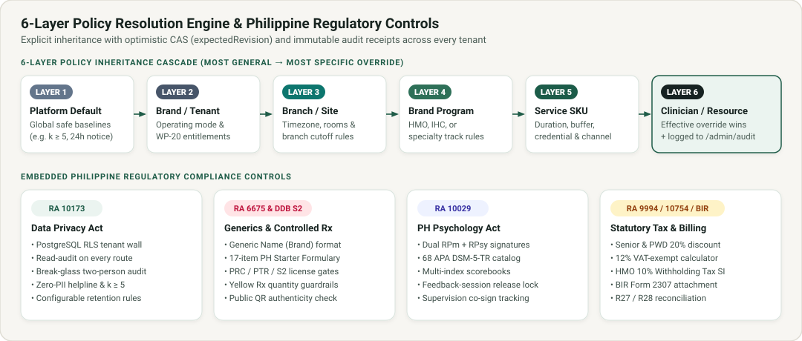
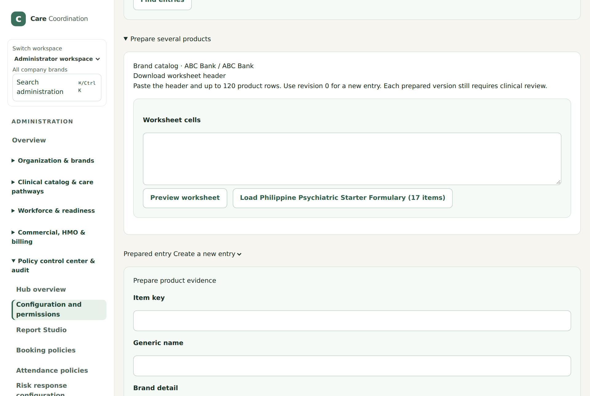
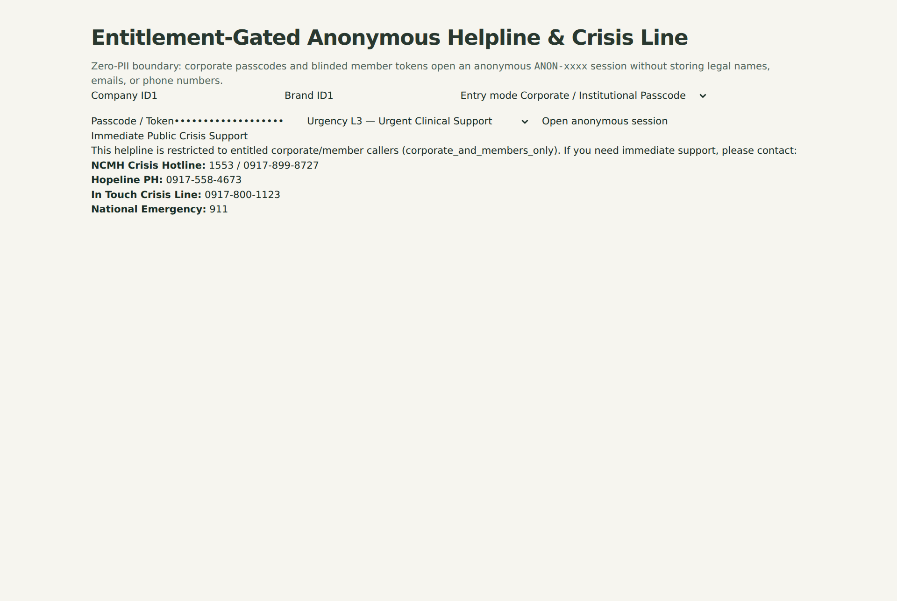

# Training Checklist 02: Content & Data Onboarding (Go-Live Readiness)

> **Navigation:** [Knowledge Base Home](../README.md) · [Master Index](../INDEX.md) · [Role Exercises & Labs](01-role-exercises-and-labs.md) · [Glossary](../GLOSSARY.md)

Use this checklist before promoting a new clinic branch, corporate sponsor program, or clinical catalog to production. It covers core platform readiness plus the specialized data/content work packages (**`WP-21`**, **`WP-23`**, **`WP-24`**, **`WP-26`**, **`WP-29`**, **`WP-31`**).

---

## 1. Security, Identity & Compliance Baseline (`WP-01`, `WP-22`)

- [ ] **MFA Enforced:** All staff accounts have TOTP or Passkey MFA enrolled; zero shared logins exist.
- [ ] **Idle Timeouts:** Reception/shared kiosks configured to 15-minute idle lock.
- [ ] **RA 10173 Privacy Notice & Consent:** Digital consent templates reviewed and published for all active branches.
- [ ] **PRC / PTR / S2 Verification:** All prescribing MDs and `RPsy`/`RPm` clinicians have valid license numbers and future expiration dates entered in `/admin/professional-credential-validity`.
- [ ] **Break-Glass Policy:** DPO email/alert recipient configured for `/admin/audit` emergency access notifications.

---

## 2. Clinical Catalog, Assessments & Formulary (`WP-04`, `WP-10`, `WP-12`)
- [ ] **Service SKUs & Pricing:** All consultation, evaluation, nutrition, and neurology SKUs mapped to branches and clinician credential gates.
- [ ] **Senior/PWD Rules:** `RA 9994` / `RA 10754` 20% discount + VAT-exempt flags verified on eligible SKUs.
- [ ] **DSM-5-TR Catalog (`WP-12`):** All **68 DSM-5-TR Section III measures** verified active and categorized in `/staff/assessments/dsm5tr`.
- [ ] **Starter Formulary (`WP-10`):** Clinic-approved `RA 6675` generic formulary regimens reviewed by Medical Director.

*Synthetic administrator-training capture, November 2026.*

---

## 3. Work-Package Specific Onboarding Gates

### `WP-21`: Optional Discovery / Semantic Search
- [ ] **Default-Off Confirmed:** Verify semantic search / discovery indexing is **OFF by default** unless explicitly enabled for a tenant.
- [ ] **PHI Exclusion:** If enabled for non-PHI catalog/learning search, confirm zero patient chart fields are indexed.

### `WP-23`: Turnkey Reports (`R01`–`R30`) & Report Studio
- [ ] **Turnkey Smoke Test:** Run sample queries across `R01`–`R30` in `/staff/reports` ([Manual 06](../manuals/06-reporting-and-analytics-guide.md)).
- [ ] **$k$-Anonymity Guard ($k \ge 5$):** Confirm small-cell suppression is active on all sponsor/HR exports (`R14`–`R21`, `R23`).

### `WP-24`: Dual-Role Usability & Assignment-to-Review
- [ ] **Assignment-to-Review Walkthrough:** Verify `RPm` → `RPsy` assignment, scoring packet submission, and co-signature UX passes usability check ([Manual 04](../manuals/04-assessments-and-specialty-tracks.md)).
- [ ] **Queue Notifications:** Confirm `RPsy` reviewers receive pending co-signature alerts promptly.

### `WP-26`: ABC Bank In-House Counseling (`IHC`) OS
- [ ] **Roster & `.ics` Import Test:** Validate sample `.ics` and roster CSV import in `/admin/ihc-roster` and `/admin/ihc-calendar-import`.
- [ ] **Case Key Format:** Confirm `MMDDYYYY+Initials+MMDDYYYY` generation matches organizational SOP.
- [ ] **27 Subtopics & `SOAP <-> 5Ps`:** Verify all 27 IHC subtopics and `MDT` referral routing are active ([Manual 05](../manuals/05-ihc-and-case-management.md)).

### `WP-29`: Data Migration & Legacy Import (If Applicable)
- [ ] **Synthetic Dry-Run:** Execute dry-run import on anonymized test batch before live migration.
- [ ] **Identifier Deduplication:** Verify patient MRN, DOB, and guardian linkages reconcile with zero orphan records.
- [ ] **Post-Import Checksums:** Validate record counts match source manifest 100%.

### `WP-31`: Anonymous Helpline & `/learn` Learning Hub
- [ ] **Helpline entitlement test:** At `/helpline`, confirm unentitled visitors see the national crisis deflection card, and that a synthetic corporate passcode or blinded member token opens an `ANON-xxxx` session without collecting a legal name, email, or phone number.
- [ ] **L1–L4 & National Hotline Deflection:** Test unentitled deflection and `L1` escalation and confirm National Crisis Hotline deflection numbers are current and localized.
- [ ] **15-Minute Cooldown:** Verify responder console enforces post-`L1` cooldown.
- [ ] **`/learn` Content Review:** Confirm all published psychoeducation articles, grounding tools, and crisis links in `/learn` are clinically reviewed and bilingual-ready.

*Synthetic public-access training capture, November 2026.*

---

## 4. Final Sign-Off Table

| Role | Sign-Off Owner (Name / Role) | Date | Status |
| :--- | :--- | :--- | :--- |
| **Company / Branch Admin** | | | `[ ] Approved` |
| **Medical Director (`MD`)** | | | `[ ] Approved` |
| **Chief Psychologist (`RPsy`)** | | | `[ ] Approved` |
| **Data Protection Officer (`DPO`)** | | | `[ ] Approved` |
| **Billing & HMO Lead** | | | `[ ] Approved` |
